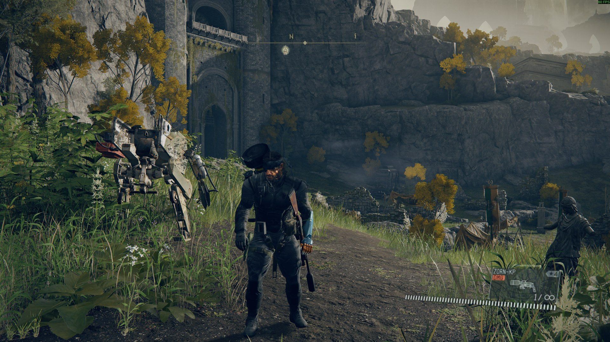
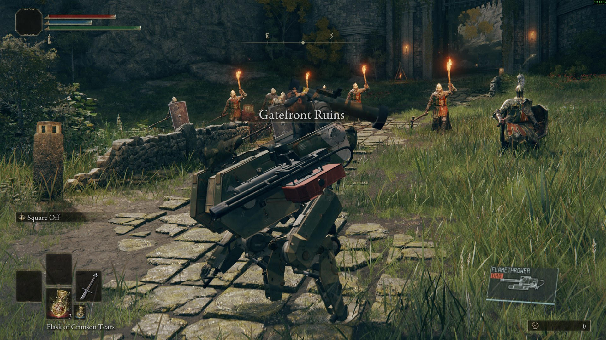
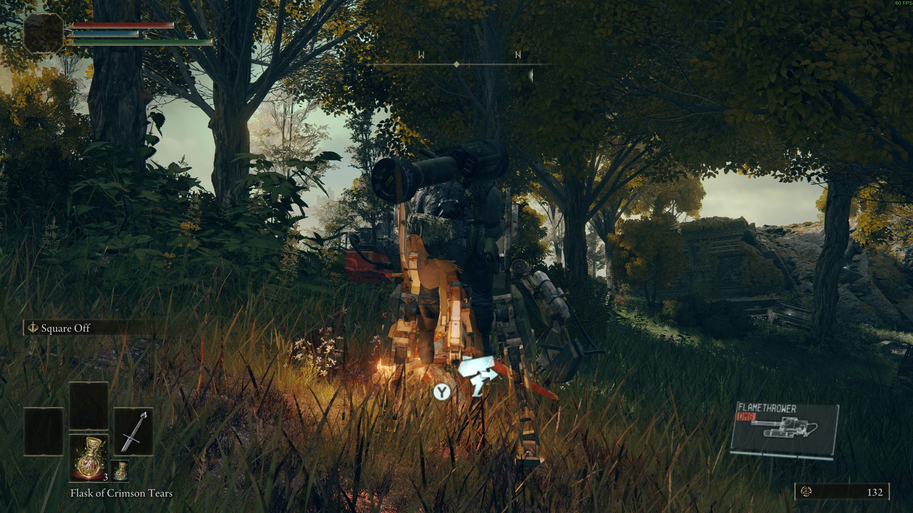

# PhantomRing

Play Elden Ring as Venom Snake. MGSV runs hidden in the background and supplies Snake himself:
his movement, stances, CQC, weapons, animation, life and his battle buddy (D-Walker, D-Horse, D-Dog). Elden
Ring runs its world, enemies, bosses, quests and saves, and draws everything.

Neither game is rewritten. An Elden Ring plugin and an MGSV plugin talk to each other through shared
memory. It's the same idea as [SkyCraft](https://github.com/chasmlol/SkyCraft), which does it for a Minecraft
player in Skyrim.



| | |
|---|---|
|  |  |

> **Status: playable, early.** Developed and tested on Linux (Proton) with both games running; see
> [Known issues](#known-issues) and [docs/STATUS.md](docs/STATUS.md). The Windows build has never been run on
> Windows ([docs/WINDOWS.md](docs/WINDOWS.md)).

> **Read this first**
> - **Unofficial fan-made mod.** Not affiliated with, endorsed or sponsored by Konami, FromSoftware or
>   Bandai Namco.
> - **No game files are included.** You must own both games on Steam: ELDEN RING (1.17.2 or 1.17.1) and METAL
>   GEAR SOLID V: THE PHANTOM PAIN (1.0.15.4). Snake's models, textures, animation and sound are read at runtime
>   from your own MGSV install.
> - **Play offline only.** PhantomRing always starts Elden Ring offline through Mod Engine 3, which
>   neutralises Arxan and never loads Easy Anti-Cheat. Never take a PhantomRing save or setup online.
> - **Back up your saves.** `pr launch` backs up both games' saves before every start (and since 0.7.0 prunes its own older
>   backups: the newest 10 per game and the first are kept), and Elden Ring plays on
>   its own copy of your save (`PhantomRing0000.sl2`). Mods can still go wrong: keep your own backups too.
> - Use at your own risk.

## Install

For players on Linux. On Windows, see [Windows](#windows). To build from source, see
[Build from source and run](#build-from-source-and-run-linux).

**Supported versions.** The plugins check the exact game executables. On any other version they stay inert, and the
game runs as usual.

| | Version | |
|---|---|---|
| ELDEN RING | **1.17.2** (`eldenring.exe` 2.7.2.0, Steam's current build) | sha256 `f9118fea…98ffb328` |
| | **1.17.1** (`eldenring.exe` 2.7.1.0) | sha256 `1a354710…8b597891` |
| METAL GEAR SOLID V: THE PHANTOM PAIN | **1.0.15.4** | sha256 `085c2f82…c5e9bb45` |
| Mod Engine 3 | **0.13.0** (`me3-linux-amd64.tar.gz`, you download it) | sha256 `f31579de…e1e93fc1` |
| PhantomRing | see `tools/pr --version` | both plugins must come from the same release |

1. **Get PhantomRing.** Download `PhantomRing-<version>-linux.tar.gz` and `SHA256SUMS` from the
   [Releases](https://github.com/whp199/PhantomRing/releases) page. Tagged releases only: until there is one, build from
   source (below). Then:
   ```bash
   sha256sum -c --ignore-missing SHA256SUMS
   tar xzf PhantomRing-*-linux.tar.gz && cd PhantomRing-*-linux
   ```
2. **Get me3.** Download `me3-linux-amd64.tar.gz` from the
   [me3 v0.13.0 release](https://github.com/garyttierney/me3/releases/tag/v0.13.0) into `~/Downloads/`, then run
   `tools/pr install-me3`. It checks the archive's sha256 before unpacking.
3. **Check the machine.** `tools/pr doctor` checks Steam, both game versions, me3, gamescope, Proton, the plugins and
   your saves. It changes nothing. Fix every `[FAIL]` line; each one says how.
4. **Prepare both games once** (details in [step 3 below](#build-from-source-and-run-linux)). MGSV's Continue must load
   a save that can go to Africa. Elden Ring needs a character in `ER0000.sl2`.
5. **Play.** `tools/pr launch` backs up your saves and starts both games: MGSV is hidden, Elden Ring is offline. Load
   your character, and Snake takes over after 2-4 minutes. `tools/pr stop` when you're done.
6. **Updating.** Replace the whole folder (both plugins come from one release: `tools/pr --version` lists them). Mixed
   plugins don't link up, and Elden Ring's corner says so in red ("PhantomRing versions differ: ... -- reinstall both").
   Every launch keeps a ~140 MB save backup. Since 0.7.0 `pr launch` keeps the newest 10 of its own backups per game, plus the very
   first one, every `*-pre-restore` one and every one you made with `pr backup-saves`, and deletes older ones; its log folders the
   same way (`--keep-backups 0` / `--keep-logs 0`, or `PHANTOMRING_KEEP_BACKUPS=0`, keeps everything). See
   [Saves, safety and uninstalling](#saves-safety-and-uninstalling).

Something wrong? Run `tools/pr collect-logs` and [open an issue](https://github.com/whp199/PhantomRing/issues/new/choose)
with the zip it writes.

## How it works

| | MGSV (guest, hidden) | Elden Ring (host) |
|---|---|---|
| Movement | Snake runs, crouches, crawls, dives in a sandbox on the Nova Braga Airport apron; only his *intended motion* leaves MGSV | the invisible Elden Ring character takes that motion through Elden Ring's collision (walls, slopes, ledges) |
| Camera | MGSV's over-the-shoulder / aim / CQC cameras | Elden Ring renders from exactly that camera, mapped onto the player |
| Look | captures what it draws for Snake and D-Walker: real meshes, textures, skinning matrices | draws them inside its own frame |
| Controls | gets your controller through a virtual XInput pad | owns the real controller; keeps Start (menu) and View (map) |
| Combat | fires, CQCs, tranqs; life regenerates as in MGSV | resolves the hits on its enemies; its hits drain Snake's life |
| Buddy | D-Walker deployed, following, rideable | drawn next to Snake, on Elden Ring's ground |

Details: [docs/DESIGN.md](docs/DESIGN.md). The shared layout: [protocol/phantomring_protocol.h](protocol/phantomring_protocol.h).

## Requirements

| | |
|---|---|
| Linux | Tested on Gentoo with KDE Plasma (Wayland) and an NVIDIA RTX 50-series GPU. Untested: AMD/Intel GPUs, Steam Deck, other desktops |
| Steam | the native client, running and signed in (both games check it). Flatpak Steam is untested |
| ELDEN RING | **1.17.2** (`eldenring.exe` 2.7.2.0) or **1.17.1** (2.7.1.0), installed through Steam, run with Proton (Proton Experimental is what was tested) |
| METAL GEAR SOLID V: THE PHANTOM PAIN | **1.0.15.4**, installed through Steam (Proton) |
| An Elden Ring character | in your normal save, `ER0000.sl2`: PhantomRing makes its own copy of it |
| An MGSV save | that can load **Africa free roam** (Snake is parked on the Nova Braga Airport apron); D-Walker developed if you want him (optional) |
| gamescope | with the headless backend (`gamescope --backend headless`); MGSV runs hidden inside it |
| Mod Engine 3 | **me3 0.13.0**, the official Linux release, which you download yourself (below) |
| A controller | Xbox-style (XInput). Keyboard and mouse can drive Snake too: `[Keyboard] enabled = true` (experimental, below) |
| A strong PC | both games run at once; MGSV renders in the background |

To build: **MinGW-w64 GCC 13 or newer** (the posix thread model is recommended), **CMake 3.25+**, **Ninja**,
**Python 3.11.4+** (standard library only). For the tests, also wine.

Package names (only Gentoo has been tried):

```bash
sudo pacman -S mingw-w64-gcc cmake ninja python gamescope                          # Arch
sudo dnf install mingw64-gcc-c++ cmake ninja-build python3 gamescope              # Fedora
sudo apt install g++-mingw-w64-x86-64-posix cmake ninja-build python3 gamescope   # Ubuntu 24.04 / Debian 13
```

The plugins check the exact game versions (file hashes). After a Steam update to either game they do nothing
and the game runs normally, until PhantomRing is updated for the new version.

## Build from source and run (Linux)

**1. Get the code and build it.**

```bash
git clone --recursive https://github.com/whp199/PhantomRing PhantomRing    # --recursive: MinHook is a submodule
cd PhantomRing                                               # (after a plain clone: git submodule update --init)
cmake -S . -B build -G Ninja -DCMAKE_TOOLCHAIN_FILE=cmake/mingw-w64-x86_64.cmake -DCMAKE_BUILD_TYPE=Release
cmake --build build
```

Use `-B build`: the launcher looks for the two DLLs there.

**2. Get me3.** Download `me3-linux-amd64.tar.gz` from the
[me3 v0.13.0 release](https://github.com/garyttierney/me3/releases/tag/v0.13.0) into `~/Downloads/` (or
`third_party/downloads/` in this folder), then:

```bash
tools/pr install-me3       # checks the archive's sha256 against the release, extracts it into third_party/me3/
```

**3. Prepare both games once.**

- Start **MGSV** normally from Steam. If it asks for your country/region and Konami's updated Terms of Use
  (July 2026 patch), answer it yourself: PhantomRing never does, and runs MGSV offline anyway. Make sure
  Continue loads a save that can go to Africa, then quit.
- Start **Elden Ring** normally once if you have never played it on this machine, so that `ER0000.sl2` holds a
  character. PhantomRing copies it to `PhantomRing0000.sl2` on its first launch and only ever plays that copy
  (another save: `tools/pr launch --seed-save NAME`).

**4. Play.**

```bash
tools/pr launch --dry-run   # checks everything and prints what it would do; fix any [FAIL] it lists
tools/pr launch             # backs up both games' saves, starts MGSV hidden, then Elden Ring (offline)
tools/pr status             # both sides, live
tools/pr stop               # when you're done (quit Elden Ring from its menu first)
```

Load your character in Elden Ring and play the Tarnished as usual while MGSV boots hidden (2-4 minutes);
then Snake takes over. All `pr` commands: [docs/TOOLS.md](docs/TOOLS.md).

## Windows

Built and tested under Wine, but **never run on Windows**. On Windows, Elden Ring starts MGSV hidden by itself.
The zip (`PhantomRing-<version>-windows.zip`) is attached to tagged releases, or you can build it on Linux with
`python3 -I tools/package_windows.py`. Setup and status: [docs/WINDOWS.md](docs/WINDOWS.md). If you try it, please
report how it went (below).

## How to play

Start it (`tools/pr launch`, see [Install](#install)), load your character in Elden Ring and play the Tarnished
as usual while MGSV boots hidden (2-4 minutes; the top-right corner says what it is doing). "Snake is in control" means
your controller now plays Venom Snake. Use an Xbox-style pad.

**Healing -- the Tarnished's flasks as Snake** (new in 0.6.0, tried live with both games): **hold View, then press X** (View must
go down first: X alone is MGSV's dive; within a second of View -- held longer, MGSV's iDroid opens). The hidden Tarnished drinks his Flask of Crimson Tears -- or whatever is in his quick slot --
while you keep playing Snake, and the heal is Snake's: live, 4570 -> 7438 of 7801 life 1.5 s after the press, Snake walking all
the while. **Hold View, then press D-pad down** to switch to the next quick item. The top-right corner says what is left ("Flask of
Crimson Tears: 3 left"); an empty flask is refused ("rest at a grace"), as is anything that opens one of Elden Ring's screens or
calls Torrent (Tarnished mode for those). Elden Ring's own questions -- Memory of Grace's "Lose all runes...?", travel -- take the
controller while they are up (answer with A; B does nothing there in Elden Ring).

**Getting over things -- jump, climb, vault, ladders** (new in 0.5.0, smoother in 0.6.0, tried live with both games):
- **R3 (click the right stick): jump**, ~1.2 m up: onto a ledge about a metre high, and now uphill too (before 0.5.0 a jump
  up a slope or across a curb ended after 2 cm, so R3 often seemed to do nothing). Rather have it on A,
  as in Elden Ring? `[Jump] button = a` in `PhantomRingHost.ini` (then R3 crouches; `l3` is the other choice).
- **Y at a ledge or a wall 0.5-1.8 m high: Snake climbs up** onto it with MGSV's own climb. **Y at a fence or a low wall: he
  vaults over** it (Limgrave's rail fences too). Running into one up to ~1.3 m high does it by itself. While a ledge that fits is in front of him, Y is the
  climb's alone: D-Walker following him is not mounted, C4 in hand is not set off.
- **Ladders: Snake climbs them himself.** Y on Elden Ring's "Climb" / "Descend" prompt, then the left stick up / down. MGSV
  plays Snake's own ladder climb on Elden Ring's ladder, without a break however long it is, and stops when you stop on the rungs;
  the Tarnished never shows.
- The first few times Snake keeps walking into something he could get over, the top-right corner says how ("R3: jump onto it
  -- Y: climb up", "Y: vault over -- or run into it").

**Snake's controls are MGSV's own**, with three exceptions for Elden Ring and two additions (R3: jump; View held + X / D-pad down:
Elden Ring's quick item):

| Button | What it does |
|---|---|
| Left stick / right stick | move (tilt = walk or run) / camera |
| **R3 (click the right stick)** | **jump** (MGSV has none): standing, walking or running on foot, ~1.2 m up; up onto a ledge about a metre high (Stormveil's rock steps and its wooden walkway), over a gap of two metres or more running. Not crouched, prone, aiming or riding. With LB held (D-Walker's orders), a D-pad direction held (MGSV's weapon and item wheels: R3 = Use there, e.g. the Phantom Cigar), while aiming, riding, in a menu or the binoculars R3 is MGSV's own. `[Jump] button = a` (or `l3`) in `PhantomRingHost.ini` moves the jump -- and those R3 uses -- to A (L3), and A's crouch (L3's sprint) to R3 |
| A | tap: crouch / stand up, hold: lie down |
| X | dive (running: the dive hops Snake over a short gap or onto a knee-high ledge, see below; `[Puppet] hop = false` turns the hop off) |
| B | reload |
| Y | MGSV's action: at a ledge **climb up**, at a low fence **vault over** (above: then the Y is the climb's only); next to D-Walker: get on; riding: hold to get off; pick up a supply box; next to a sleeping enemy: hold for MGSV's Fulton -- **or Elden Ring's** whenever Elden Ring shows its own prompt ("Y: Rest at site of grace", "Y: Retrieve lost runes", items, a ladder's "Climb" / "Descend") |
| LT / RT | aim / fire; RT without LT, standing, next to an enemy = CQC strike; **held** = grab him (keep holding: choke him out, LB: interrogate, let go: release), with the left stick pushed = throw him (CQC holds and throws, below) |
| D-pad | tap up: primary weapons (by default an SVG-76 assault rifle at the hip and an FB MR R-LAUNCHER rocket launcher on the back: hold up and push the right stick to switch), down: handgun (a WU S.PISTOL with tranquilizer darts), right: support items (grenades, mines, C4: Y sets it off), left: items -- hold it and push the right stick to pick one (the cardboard box, the night-vision goggles), a quick tap uses the one picked |
| RB (while aiming) | first person / down the scope: you aim with the gun's own sights (MGSV shows no reticle there) |
| RB (hold, not aiming) | MGSV's binoculars (right stick looks, zoom as in MGSV): keep an Elden Ring character near the middle for half a second to **mark** him (below) |
| LB (hold) | MGSV's call menu: D-Walker's or D-Dog's orders (below); with D-Dog out an amber paw marks the enemy he would take |
| **Start** | **Elden Ring's** menu (equipment, items, system, quit) |
| **View, tapped** | **Elden Ring's** map (and fast travel from it) |
| **View, held (let go after 0.4 s, or held 1 s)** | **MGSV's iDroid** (supply drops, buddy support, Mother Base); while it is open MGSV has the whole pad; Start closes it |
| **View held + X** | **Elden Ring's quick item, Snake keeps the controller**: the hidden Tarnished drinks his Flask of Crimson Tears (or uses whatever is in his quick slot: a Physick, a pot, spirit ashes) and the heal is Snake's; the corner says "Flask of Crimson Tears: 3 left". View must go down first (X alone is MGSV's dive). An empty flask is refused ("rest at a grace"), as is an item that opens one of Elden Ring's screens or calls Torrent (Tarnished mode for those) |
| **View held + D-pad down** | **Elden Ring's next quick item** (its own D-pad down); the corner names it |
| **View + Start, held together 1 s** | **Tarnished mode**: you play the Tarnished (flasks, spirit ashes, Torrent, jumps, answering NPCs); the same again gives Snake back, where the Tarnished stands. Neither button opens a menu. Either may go down first: Start up to 0.7 s after View still makes the chord (MGSV's iDroid may flash open for a moment and closes by itself) |

**Keyboard and mouse** (opt-in, off by default; tried live 2026-10-15 with keys and mouse events sent into Elden Ring's window --
walking, running, the camera, aim and fire, the wheel, the jump, D-Walker's orders, Tab/Esc/G, a rest at a grace with E -- not yet
with a player's own keyboard and mouse): set `[Keyboard] enabled = true` in `PhantomRingHost.ini` (or try it with
`tools/pr er "input kbm on"`). While Snake plays the keys and the mouse become his pad;
Elden Ring's own keyboard and mouse work as usual in its menus and in Tarnished mode. A controller keeps priority: whichever
you touched last plays Snake.

| Key | Pad | What it does |
|---|---|---|
| W A S D / Shift held | left stick | walk / run |
| Mouse | right stick | camera (a faster move turns faster: `mouse_sensitivity`, `mouse_acceleration`) |
| Ctrl | A | tap: crouch / stand up, hold: lie down |
| Space / R | X / B | dive / reload |
| E or F | Y | MGSV's action, or Elden Ring's on its own prompts (E: Rest at site of grace) |
| Right / left mouse button | LT / RT | aim / fire (left held next to an enemy: CQC grab, with `[Cqc]` on) |
| V | RB | first person while aiming; held while not aiming: binoculars (marking) |
| Q (hold) | LB | MGSV's call menu; move the mouse toward an order, stop, click the wheel (R3) |
| Wheel click (middle button) | R3 | jump (with Q held: picks the call menu's order instead) |
| 1 / 2 / 3 / 4, wheel up / down | D-pad up / down / right / left | primary weapons / handgun / support items / items (hold one and move the mouse to pick) |
| Tab tapped / held | View | Elden Ring's map / MGSV's iDroid |
| Esc | -- | Elden Ring's menu (closes MGSV's iDroid while that is open) |
| E, Q, Enter, arrows | -- | while an Elden Ring pickup or dialog has the controls (Snake stands still): Elden Ring's own keys for it (`er_interaction_keys`); the rest of the keyboard and the mouse wait |
| G held 1 s | View + Start | Tarnished mode and back (in Tarnished mode a G tap opens Elden Ring's map, as the pad's View: `chord_tap`) |

Every key can be changed in `[Keyboard]`. With no controller connected, PhantomRing gives Elden Ring a virtual pad the first
time you use the keyboard (`virtual_pad = auto`), so the first key press may take a moment.

**CQC holds and throws** (on; tried live 2026-10-15 on Gatefront's soldiers: hold, choke to sleep, throw, interrogate;
`enabled = false` under `[Cqc]` in `PhantomRingHost.ini` turns it off). MGSV grabs only its own soldiers, so PhantomRing reads what you do with RT and Elden Ring's enemy in
front of Snake (within ~1.6 m) answers: **hold RT** next to him and he is caught and held in place for a few seconds; **keep
holding** and Snake chokes him to sleep (2.5 s); **LB** while holding interrogates him (he says something in the corner);
**let go** to release him; **RT with the stick pushed toward him** throws him to the ground. Apart from a token 1 HP (so
Elden Ring plays the flinch) none of it does damage of its own (MGSV's punch that comes with the press does). Bosses (Elden Ring's own mark of one,
or 2000 HP or more) can't be grabbed: they only stagger. Once let go, the same enemy can't be held again for 8
seconds (grabbing him only makes him flinch).

**Tarnished mode.** Everything Snake can't do yet, the Tarnished does: hold **View + Start together for a second** and the
corner says "Tarnished mode -- View+Start to return to Snake". He shows with his weapon and Elden Ring has the whole pad: X
drinks a flask (the quick item), and so on; Snake waits, parked, in MGSV. The same chord gives Snake back where the Tarnished
stands, and what the Tarnished went through is Snake's too: a Flask of Crimson Tears that took the Tarnished from 74% to 100%
gives Snake the same share of his life back, a boss's hit takes it. Snake takes over only on foot: on Torrent (or a
ladder) the corner says "get off Torrent first". Torrent: the Spectral Steed Whistle from a quick slot, or Start ->
Inventory -> Tools -> the whistle -> Use.

**Dive = hop (on).** Besides the jump (R3), MGSV's dive hops: MGSV's dive (X while running) carries Snake in a small hop,
~0.6 m up and ~2.5 m forward: over a ditch up to ~2 m wide, onto a ledge up to ~0.75 m high (`hop = false` under `[Puppet]`
in PhantomRingHost.ini, or `pr er "puppet hop off"`, turns it off).
A dive ends with Snake on the ground, as in MGSV: A gets him up. A wall 1 m high stops him, and under a low ceiling
the hop is lower or doesn't happen. He lands as from any fall (a hop off a cliff hurts like the fall).

**Ladders.** Y on a ladder's "Climb" prompt and Snake climbs it himself: the left stick climbs up and down as in Elden Ring.
Elden Ring moves him on its ladder, MGSV plays his own ladder climb, and Elden Ring's ladder camera follows. He steps off at the
top or the bottom; let go of the stick first, because Snake doesn't run on with it. To go down, walk up to the hole at the top
until "Descend" shows, then press Y. Walking on into the hole drops Snake down the shaft, as it would the Tarnished (a 19 m tower
costs ~90% of his life). MGSV's own ladder is only 8 m long; since 0.6.0 Snake is moved along it as he nears either end, so a long
climb has no break (before, his hands lost the rungs for about a second every ~5.5 m), and a stop on the rungs is a stop in MGSV
too. Tried live with both games on Fort Haight's 19 m tower ladder (0.5.0) and Stormveil's 14.5 m ladder (0.6.0: +14.6 m up in
18.9 s with a 5 s stop half way, -14.5 m down in 14.0 s, his hands on the rungs throughout). `[Ladder] snake = off` in
`PhantomRingHost.ini` brings back the old way: the Tarnished climbs, and Snake is back at the end.

**Climbing up and vaulting.** Y at a ledge or a wall 0.5-1.8 m high in front of Snake climbs him onto it, if there is room to
stand up there. Y at a fence or a low wall up to ~1.35 m with ground behind it vaults him over (Limgrave's wooden rail fences
stand 1.1-1.3 m; live 2026-11-01 with both games, one by the Church of Elleh: 1.10 m, MGSV's vault 16 ms after Y, over in 1.4 s).
MGSV plays its own climb-up and vault for both. Running into one up to ~1.3 m high does it without Y (`[Mantle] run_into = low`; `off` = Y only, `all` = any
height). It doesn't work prone, aiming, riding or in the box. With D-Walker right beside him (closer than 1.3 m), Y mounts it as
usual; any further away, Y climbs. A wall too high, a ledge with no room on top, a fence over a drop: nothing happens
(`[Mantle]` in `PhantomRingHost.ini`). Since 0.6.0 MGSV plays a full climb-up that ends standing on top (onto a crate up to
1.1 m, an oil drum above), ~2 s, and Elden Ring's climb takes as long; Snake is drawn facing the ledge throughout. Tried live with
both games at the Church of Elleh's rubble (0.6.0): Y onto 1.71 m and 0.57 m ledges (MGSV played the climb 17-33 ms after the
press, its move 1988 / 2002 ms, Elden Ring's climb ending 8 ms from MGSV's). 0.5.0: Y onto a 1.09 m ruined wall and over a
0.52 m ledge (1.23 s), D-Walker 2.4 m away not mounted.

**Ordering D-Walker.** Hold **LB**: MGSV's call menu opens. Push the **right stick** toward an order (Whistle up-right,
the modes to the right; your current mode is greyed out), **let the stick go** (the order stays selected), then **click the
right stick in** while still holding LB. Releasing LB without the click cancels, and MGSV ignores a click while the stick is
still pushed. Elden Ring's corner then shows the order ("D-Walker: Search Mode -- it marks enemies nearby"); the first
few times you hold LB it also shows how, and it tells you when you let go without giving one.
- **Whistle**: D-Walker comes to you, from anywhere (a far one is brought closer first, then it walks).
- **Normal Mode**: it follows you, about 3 m to your left, and keeps up with you running (since 0.6.0: live, a median 2.8 m from
  Snake while he ran). This is the mode it starts in.
- **Search / Stealth / Intercept Mode** (whatever your save has developed): it stays in that mode and does not follow
  until you whistle or choose Normal Mode again.
- Y next to it mounts it: ride it through Elden Ring, RT (or LT+RT in its cockpit view) burns enemies with its
  flamethrower; hold Y to get off. If D-Walker is ever destroyed in MGSV's world, PhantomRing has MGSV bring it back
  after ~10 s (not yet seen live).

**Ordering D-Dog** (new in 0.8.0, run live with both games, **on by default**; nothing of it runs while D-Dog isn't out). Deploy
D-Dog from the iDroid (below). He follows Snake as in MGSV, without jumping when MGSV's world moves under Snake or when MGSV's own leap
snaps him onto his target (what Elden Ring shows of him never moves more than half a metre a frame), and he works on Elden Ring's
enemies:
- **He smells them.** Hostile enemies within ~40 m of the dog get a **hollow red mark** (seen through walls, the distance only near the
  middle of the view), and the corner says "D-Dog: Found enemy (3 nearby)". The binoculars still mark one for good.
- **Attack orders.** Look at the enemy (near the middle of the view, 3.5-25 m away, in sight, with a straight run for the dog), hold
  **LB** -- an amber **paw** shows over the one he will take -- push the **right stick** to the attack entry (right; its name is his
  equipment's), **let the stick go**, then **click it in**. MGSV's dog runs, leaps and bites with its own animation, and Elden Ring's
  enemy gets:

  | His equipment (iDroid > Missions > Buddy Support > Change Equipment) | The order | In Elden Ring |
  |---|---|---|
  | Naked | Keep 'em busy | held in place 6 s (no attack, no move), flinching: walk up and CQC him, or slip past |
  | Sneaking suit, knife | Do it (kill enemy) | MGSV's knife share: an ordinary soldier dies |
  | Sneaking suit, stun knife | Do it (knock out enemy) | asleep (then fulton him, or let D-Dog's "Get it" do it) |
  | Battledress | Do it (wound enemy) | knocked down to 1 HP |
  | Tactical vest (Fulton) | Get it | a **sleeping** enemy fultoned by the dog: he goes up under MGSV's balloon, you get his runes |

  The one the paw showed over stays his for a moment while you let the stick go and click, even if he steps behind a post. No one
  to take: the corner says why ("he is out of sight", "he is too close -- CQC him", "D-Dog can't run to him straight (a wall in the
  way)", "D-Dog: look at an enemy (25 m)"), and the dog stays with you.
- **Never a friend.** Only enemies Elden Ring makes the Tarnished's are ever picked, bitten or barked at: never a merchant, a quest
  character, a spirit summon or a neutral one (live: one lying 1 m from a soldier, dead centre, was never picked; the soldier was).
  **Never a boss**: Elden Ring's own boss mark (every boss, even a small catacomb one) or 2000+ HP.
- **Wait** (the entry just above the attack one): he stays where he is, in Elden Ring too, while you run on -- even where Elden Ring's
  walls stop Snake and MGSV's Snake runs on; **Whistle** (between Wait and the top) brings him back; **DD** (below the attack one) calls him over. **Bark**, if your save has it: enemies within 20 m of
  him stop and stare at him for 5 s.
- Elden Ring's enemies don't attack the dog (yet). Changing his equipment costs GMP in memory only: MGSV never saves.
- Switches: `[Dog]` in `PhantomRingHost.ini` (the marks, the pick, the bite, Bark, the texts, the step guard, the Wait pin) and in
  `PhantomRingGuest.ini` (the treadmill, the attack orders, the shown speed, Wait in Elden Ring's terms); with the host's `[Dog] enabled
  = false` (or `tools/pr er "dog all off"` for one session) the call menu's orders are MGSV's own, as in 0.7.0.

**Quiet** (new in 0.9.0, run live with both games, **on by default**; nothing of it runs while she isn't out). She is a sniper
buddy: she holds a post of her own in Elden Ring, spots enemies, and rests with Snake at the grace.
- **Getting her.** iDroid > Missions > Buddy Support > **Quiet (Attack)**: pick a sniping point on MGSV's map, A (GMP in memory
  only); she drops in and then takes her post in Elden Ring. If your save has her, she deploys as she is. If it doesn't -- she left
  after "A Quiet Exit" (most finished saves), she was recruited but isn't deployable yet, or you never recruited her (or killed her) --
  PhantomRing **borrows her for the session**: she is listed in Buddy Support from the start, **in memory only**: MGSV never saves
  under PhantomRing, and her bits are put back (checked byte by byte) when MGSV or Elden Ring closes. `[Quiet] Borrow` in
  `PhantomRingGuest.ini`: `always` (the default, any save), `memory` (only a Quiet your save has had), `off`. All four save states
  passed a live round trip (your own "gone" save; the other three simulated in memory); a Quiet in sickbay or dying is not borrowed.
  Her bond is your save's (0 if she left), so Take aim / Cover me may be missing from the call menu on some saves. The borrow waits
  for Elden Ring's Quiet layer (`[Quiet] enabled` in `PhantomRingHost.ini`): without it she would be 0.8.0's Quiet.
- **Her post.** With enemies within 60 m she takes ground 25-55 m from Snake with a clear line to him and to them; when it is calm,
  8-16 m. While Snake travels with no enemy near she is cloaked and unseen, as MGSV's Quiet is, and appears at her next post when he
  stops; a post change you can see is her cloak's short fade. Indoors and in tight places there is often no post: she stays unseen.
  While she is out, Quiet (Scout) / (Attack) are greyed (her post is Elden Ring's); Dismiss Quiet works as usual.
- **Spotting.** From her post she marks hostiles she can see within 60 m (red marks, "Quiet: Enemy spotted (3 nearby)"): never a
  boss, a neutral character or a spirit summon.
- **Her orders are opt-in in 0.9.0.** MGSV's own Quiet offers Fire only while she snipes from one of MGSV's sniping points: she goes
  there cloaked 10-20 s after you mark an enemy, and not every time (live: 1 of 1 tries in this round, 4 of 10 in the MGSV test, left her
  beside Snake with Fire greyed). So by default the call menu's Fire / Take aim stay greyed beside her, Cover me says "not in Elden Ring
  yet" and the talk entry only shows "Quiet". To try them: `[Quiet] orders = true` in `PhantomRingHost.ini` (or `tools/pr er "quiet
  orders on"` for a session). Look at an enemy through the binoculars (RB): a ring shows the one she would take, white until MGSV's
  Fire is live, then teal; hold LB, Fire (up-right), let the stick go, click. Her round lands only if Elden Ring's line from her post
  is clear: Wicked Butterfly kills an ordinary soldier, Guilty Butterfly puts him to sleep, Sinful Butterfly hits hard and knocks him
  down. "no target" = no enemy picked; "no shot (MGSV)" = MGSV wouldn't take the shot. **Never a friend** (a merchant, a quest
  character, a spirit summon, a neutral one) **and never a boss**: the pick refuses them and the round checks again.
- Elden Ring's enemies don't attack her. In Tarnished mode she holds her post and stays out of the fight.

**Resting with Quiet.** Rest at a grace (Y) with Quiet out: she comes to the grace while the screen is black, and about a second
after the grace menu is up she appears (her cloak's fade) crouched beside the grace with her rifle held upright, about 2 m from the
light, beside Snake and clear of the menu. She stays through the menu, Pass time and Level Up. When Snake walks away she stays at that
spot (it is her post) until her post rule moves her on (faded in view), keeping her relaxed crouch at her posts until she is next
unseen (Snake on the move); then she aims again. No rest in Tarnished mode, nor when a grace starts a talk (no black screen, so
nothing moves), nor with the Quiet layer off. Switches: `[Grace] buddy_rest` in `PhantomRingHost.ini`, `[Quiet] RestAtGrace` in
`PhantomRingGuest.ini`; `[Quiet] enabled = false` (or `tools/pr er "quiet off"` for a session) makes her 0.8.0's Quiet again.

**Changing or dismissing the buddy** (MGSV's own menu): hold View for the iDroid, RB to **Missions** > **Buddy Support**: pick
**D-Horse**, **D-Dog**, **D-Walker** or **Quiet (Attack)** and confirm the drop point (A; GMP is spent in memory only, MGSV never saves), or **Dismiss**
the one that is out. MGSV sends the old one away (a dismissed D-Horse leaves under a Fulton balloon, in Elden Ring's sky too) and
the new one arrives in 10-30 s; the corner says "Buddy: D-Dog is out" / "D-Walker dismissed -- no buddy now". With no buddy out
nothing is drawn or placed. D-Dog: [Ordering D-Dog](#how-to-play) above (before 0.8.0 he only followed Snake); Quiet: above. The next
launch deploys the ini's buddy again (`[Buddy] Type`).

**D-Horse instead of D-Walker** (optional): set `[Buddy] Type = horse` in `PhantomRingGuest.ini` (in MGSV's folder) before
`tools/pr launch`, or deploy it from the iDroid as above, or `tools/pr lua '!buddy horse'` (`!buddy walker` back). The horse waits where it
is; hold LB and pick **Whistle** and it gallops over (PhantomRing also whistles it when it is more than 15 m away). Y next to
it mounts, the left stick walks it, **tap X** to canter and gallop (13-17 m/s), Y gets off. It is drawn under Snake and
stands on Elden Ring's ground; walls and ruins stop it as they stop Snake, and galloping off a ledge or a cliff hurts like a
fall (Limgrave's lake shores and ravines kill). PhantomRing moves the horse inside MGSV's world -- with Snake on it, and beside
him on foot (`[Buddy] HorseTreadmill`, on since live 2026-10-15) -- so the ride has no limit and the horse never jumps: a 300 m
straight gallop east from Gatefront in 27 s, 1.2 km of riding in all, and after getting off it stood 3.7 m beside Snake, no jump,
no whistle. `tools/pr lua '!horse'` shows whether it found the horse (`confirmed`); if it can't move it, it says so and the ride
is limited by MGSV's own world again (the airport's terminal ~40 m one way), as before. The next launch deploys the ini's buddy
again.

**Fulton.** A sleeping Elden Ring enemy can be sent to Mother Base with MGSV's own Fulton: put him to sleep (two tranquilizer
darts in the body, or sleep gas), walk right up to him -- MGSV's Fulton prompt shows (a balloon, "100%", your balloons left) --
and **hold Y** for about two seconds. Snake attaches the balloon; a few seconds later Elden Ring lifts the enemy away under a
balloon, "Fulton: the enemy is on its way to Mother Base", and you get the runes he would have dropped. He stays gone until you
rest at a grace (as if killed, without a death or a drop). Be quick: Elden Ring's sleep lasts about 50 s, and an enemy that wakes
can't be fultoned (if he wakes before MGSV's balloon goes up, nothing happens). Never a boss: MGSV is not offered one.

**Marking with the binoculars.** Hold **RB** (not aiming) to look through Snake's binoculars and keep an Elden Ring character
near the middle of the view for about half a second, as you would an MGSV soldier: he is marked. A marked character carries a
triangle over his head -- red for an enemy, white for anyone else -- with his distance from Snake in metres, seen through walls,
until the next loading screen (fast travel, a death, the title); it fades when he dies. Only what Snake can see gets marked
(not through a wall), up to 150 m away. The marks show only while you play Snake, not in Elden Ring's or MGSV's menus or in talks;
Elden Ring's "Auto" HUD fading out does not hide them. `[Marking]` in `PhantomRingHost.ini` sets the range, how long to look, what the marks
show (`distance = always | centre | off`), or turns it off (`enabled = false`). Tried live 2026-10-14 (a Stormveil soldier marked).

**Phantom Cigar** (on; tried live 2026-10-15: Elden Ring went 12:14 -> 18:02 -> 02:14 in two smokes, and at night Renna stood
at the Church of Elleh after a fast travel). It changes Elden Ring's time of day, which Elden Ring saves. PhantomRing puts the
cigar into a free item slot if your MGSV save carries none (only while MGSV can't save, which is the default `[Saves] Block`:
it never reaches your MGSV save). **Hold D-pad left** (MGSV's item wheel), **point the right stick at
the Phantom Cigar and click it in (R3) while still pointing**: Snake smokes, MGSV's time-lapse runs, and the same game time
passes in Elden Ring, its sky following along while he smokes. A tap of D-pad left puts it out (the cigar is then the item
picked: the next tap lights it again). `[Cigar] TimeSkip = false` in `PhantomRingGuest.ini` turns it off.
Smoke until night and Elden Ring turns night; the corner then says how much time passed ("Phantom Cigar: 6 h 30 min passed
(12:00 -> 18:30)"). Switches: `[Cigar] TimeSkip` in `PhantomRingGuest.ini`, `[TimeSkip] enabled` in `PhantomRingHost.ini`.
`tools/pr er "timeskip 120"` moves Elden Ring's clock two hours the same way without MGSV.

**Aim assist and marking on Elden Ring's enemies (experimental, off).** With `[Proxies] Enabled = true` in
`PhantomRingGuest.ini` (or `tools/pr lua '!proxy on'` for one session), MGSV puts an inert stand-in soldier where each of the
four nearest Elden Ring enemies is: LT swings the aim onto them as it would onto MGSV's own soldiers, and marking one shows MGSV's
marker over him. The stand-ins stand on Snake's ground (at the enemy's spot, not on his ledge), so LT puts the reticle at the
stand-in, below or above an enemy on a ledge or in a dip; a round fired there still flies to the enemy's real height, and a round
you aim at the enemy himself flies where you aimed. They are kept from noticing Snake, and if MGSV goes on alert anyway its soldiers are switched off again and
the alert is called off; an alert that lasts 20 s switches the stand-ins off for the session (`!proxy` shows it). Tried live
2026-10-15 at Gatefront for 11 minutes: MGSV stayed at alert phase 0 throughout, no stand-in ever shot Snake, MGSV's analyzer read
a stand-in through the binoculars and a Fulton through a stand-in worked -- but LT never swung the aim onto one (3 tries, 4-11
degrees off), so it stays off: see Known issues.

**Guns.** Each round does what it does in MGSV: an assault-rifle round takes a fifth of a soldier's life (five body hits kill
a Limgrave soldier, so does one headshot), a rocket kills the soldier it hits. Rockets fly visibly (a dark body with a bright trail) and blow up
where they hit. The tranquilizer pistol: two body darts, or one in the head, put a soldier to sleep without a fight.
Each shot shows a small burst of Elden Ring's sparks at the muzzle (`[Combat] muzzle_flash`, on since 0.6.0; seen live with the
real MGSV's rifle). Grenades and rockets in flight are drawn with MGSV's own models (`[Render] projectile_meshes` and the guest's
`[Capture] ProjectileMeshes`, both on since 0.6.0; learned from MGSV's own draws on the first throw -- seen with both games: MGSV's
blue sleep-grenade canister in flight; a rocket shows as its bright exhaust flying away), otherwise as simple shapes. Since 0.7.0
the models learned are kept across sessions (`PhantomRingHost.projectiles` next to the ini): the first throw of a session is
already MGSV's grenade.

**The sleep pistol's suppressor and being heard** (new in 0.7.0, tried live with both games). Snake's WU S.PISTOL now carries
MGSV's own suppressor (`[Loadout] Suppressors = sleep` in `PhantomRingGuest.ini`: the guns firing tranquilizer darts; `all`, `none`):
MGSV's weapon box shows `SUP` and its gauge, the shot is quiet, with no muzzle flash. And Elden Ring's enemies now **hear** Snake's
shots: an unsuppressed round makes Elden Ring's own AI sound at the muzzle (pistol 20 m, rifle 35, sniper 40, shotgun 45, launchers
55; `[Noise]` in `PhantomRingHost.ini`), so the soldiers nearby turn, come to look and fight; a suppressed one makes none. Live:
a head dart put one of four soldiers in a Stormveil courtyard to sleep and the three around him never heard a thing (18 s), while one
SVG-76 round beside them had three in battle 2-3 s later. A suppressor wears down by one per shot, at MGSV's full value for the gun
(30 for the WU S.PISTOL): when it is spent, MGSV's gauge goes, the corner says "Suppressor worn out" and the shots are loud. Resting
at a grace (or a respawn, or picking up ammo) puts a fresh one on. **With MGSV's Infinity Bandana on** (it is your MGSV save's
choice -- MGSV shows the reserve as "∞") MGSV never wears a suppressor down: it stays full, as in MGSV itself. Some of Elden
Ring's enemies never react to sounds (Stormveil's upper-rampart soldiers and a sentry did not, even to a 60 m sound).

**The controls card** (new in 0.7.0). The first time Snake takes control a small panel at the top of the screen lists his
controls (jump, climb, flask, map, iDroid, Tarnished mode, the buddy's orders). **A** closes it (that A does nothing else), it fades
after 12 s or at any other press, and **View + D-pad up** shows it again. It waits while one of Elden Ring's or MGSV's menus is up.
It comes once per install (`PhantomRingHost.firstrun` next to the ini remembers it: delete it to see it again; `[Overlay]
controls_card = always | off`).

**Elden Ring's bars** (new in 0.7.0). While you play Snake, Elden Ring's HP, FP and stamina bars are hidden (Snake's life is MGSV's
HUD); they are back in Tarnished mode, Elden Ring's menus and its screens (`[Overlay] er_bars = all` keeps them).

**Progression** (optional, off by default): `[Progression] damage_scaling = level | weapon | both` in `PhantomRingHost.ini`
makes the Tarnished's rune level and his right-hand weapon's upgrade scale Snake's damage ([docs/COMBAT.md](docs/COMBAT.md)):
x(level / 20)^0.5 and x(1 + 1.5 x upgrade / max upgrade), between x0.5 and x3. A level-15 Tarnished with a +0 weapon: a rifle
round on a soldier did 35 off, 31 with `level`. Try it while you play: `tools/pr er "progression level"` (`off`, `weapon`,
`both`); the ini makes it stick. His Vigor already counts: Elden Ring's hits cost Snake the share of the Tarnished's HP they take.

**Life.** Elden Ring's hits take Snake's life as MGSV's own would, and he recovers as in MGSV: nothing for ~2.4 s after a hit,
then slowly, then faster (full ~7 s after a 20% hit, ~12 s after a 65% one). Each new hit starts it again, so standing in a
boss's combo kills him (`[Combat] RegenGate` in `PhantomRingGuest.ini`; `false` brings back the old instant regeneration).
Each hit costs Snake the share of the Tarnished's HP it would cost him (a Limgrave soldier's: ~11.6% at level 15); the Tarnished's
flasks heal him (View held + X, above). If camps are still too deadly, `[Combat] hurt_mult = 0.6` in `PhantomRingHost.ini` makes
every Elden Ring hit on Snake 60% as strong (try it live: `tools/pr er "combat set hurt_mult 0.6"`).

**Grenades and mines.** D-pad right picks the support item, hold LT: the throw arc shows (dots and a ring where it lands,
in Elden Ring's world); tap or press RT while still holding LT to throw (letting both go together throws nothing; live
2026-10-31: 4 of 4 quick 50 ms taps threw). Sleep gas puts enemies to sleep, stun grenades stagger them, frag grenades and molotovs
hurt. Mines (LT+RT places them) lie where you put them with a blinking light and go off when an Elden Ring enemy walks
into them. They stay while you play on; a death or fast travel clears them (MGSV takes them back) -- since 0.6.0 also one set in
the very moment the Tarnished dies (it used to be kept at the grace).

**C4.** D-pad right to the C4, LT+RT sets one (set as many as you carry). To set them off, keep the C4 in hand (support
item selected, on foot) and tap **Y**: each tap sets off the oldest C4 you placed, and its blast is Elden Ring's, where the
C4 lies (8 m, lethal). Stand clear. MGSV's own detonator never answers the press in PhantomRing's sandbox, so PhantomRing
sets the C4 off when MGSV doesn't within `C4GraceMs` (`[Combat] C4Backup`, on; live 2026-10-14: every tap set one off, and a
Y tap at D-Walker with C4 in hand mounted it and set nothing off). `C4DetonateAll = true` sets off every C4 at once
(`PhantomRingGuest.ini`). C4 from an old save that was already lying in MGSV's world is never yours to set off in Elden
Ring. Next to a supply box a tap of Y with C4 in hand may set one off too (untested; a held Y, MGSV's Fulton of a sleeping
enemy, never does).

**Decoys** (on; tried live 2026-10-15 with the save's E-STUN decoy at Gatefront). Pick a decoy as the support item (D-pad
right: hold it and point the right stick at the decoy), then **throw it like a grenade: hold LT until the arc shows, press RT
while still holding LT** (let go of both together and nothing is thrown). Where it lands in Elden Ring a rubber soldier
inflates, set down on Elden Ring's ground. An Elden Ring enemy within 15 m that sees it stops and stares at it for a few
seconds -- slip past behind him (live: two soldiers stared, one at 11.8 m right after being shot at); the active decoy calls
out, so enemies hear it within 25 m even without seeing it. One fighting Snake right next to him doesn't fall for it. An enemy
that walks into a decoy knocks it over (live: the shock decoy's blast staggered him). Bosses never stop to stare. Decoys stay until a load (fast travel, a
death). `[Decoys]` in `PhantomRingHost.ini`; `[Combat] Decoys` in `PhantomRingGuest.ini`.

**The cardboard box.** Hold D-pad left, push the right stick to the box, let go: Snake is in it (RT takes it off, X dives
out). Keep still in it (or creep slowly for a moment): Elden Ring's enemies that haven't spotted Snake walk past; one
that is already after him, or comes within 2 m, still finds him. Snake's first box carries MGSV's anime pin-up girl on its
lid (`[Loadout] BoxPoster`; X in that item menu changes the poster): an enemy that sees it within 15 m stops and stares for
a few seconds.

**Breaking things.** Shoot a crate, cart or pot, punch it (CQC with no enemy in reach) or blow it up: it breaks as it
would for the Tarnished. Walking into a cart or a rock, Snake stops at it as the Tarnished would, never inside it.

**Night vision.** Hold D-pad left, push the right stick to the NVG and let go: the goggles go on (a quick tap of D-pad
left takes them off and puts them on again). Elden Ring's picture -- the world, Snake and D-Walker -- turns MGSV's bright
green, the dark lifted most; Elden Ring's HUD and menus stay as they are. Off in cutscenes, loads and while dying.

**Ammo and life refill.** Resting at a grace refills Snake as it refills the Tarnished's flasks: his life, every magazine,
the ammo reserve and his grenades and other items. So does every respawn (a death, the grace or a Stake of Marika). A
supply drop from the iDroid still works too.

**Dying** is Elden Ring's: YOU DIED, the grace or a Stake of Marika, and Snake gets up with full life and ammo. A fall into
a chasm with no ground to land on counts as a death after a few seconds (~60 m). Resting at a grace (its menu: Pass time,
Level Up, ...), fast travel, NPCs' questions and Elden Ring's menus (Start, or Esc and G on the keyboard) work as usual:
Elden Ring has the pad while one of its screens is up.

**Bosses.** Walking into a boss's mist: Y on "Traverse the mist" -- Snake steps aside for a moment while Elden Ring walks the
Tarnished through, then he plays on inside. The boss's health bar is Elden Ring's HUD; Snake keeps the pad for the fight.
A boss counts as many soldiers: one 30-round SVG-76 magazine takes about 14.5% of Margit's health. Margit's hits cost Snake
11-45% of his life each.

## Saves, safety and uninstalling

- **Elden Ring** plays only `PhantomRing0000.sl2`, a copy of your save made on the first launch (your
  `ER0000.sl2` is never touched). It is yours: keep it, or delete it to start the copy over.
- **MGSV never saves** while PhantomRing runs (its writes stay in memory), so your MGSV progress stays as it
  was.
- **Backups.** Every `pr launch` first copies both games' saves to `backups/<time>/` and verifies them by
  sha256. Each Elden Ring backup is ~140 MB (one player had 18.8 GB of them), so **since 0.7.0 `pr launch` prunes its own old
  backups** right after the new one has verified: for each game it keeps the newest 10 it took and the very first one (your saves
  before PhantomRing ever ran, named in `backups/.first.json`), and it never deletes a `*-pre-restore` backup, a backup you made with
  `pr backup-saves`, anything from the last 24 hours, or any other folder you put there (a copy, notes). Backups from before 0.7.0
  count as launch backups only while their launch's folder is still in `logs/`; otherwise they are treated as made by hand and kept.
  To keep everything: `--keep-backups 0` or `PHANTOMRING_KEEP_BACKUPS=0` (`--keep-backups N` keeps another count). The launch log
  folders in `logs/` are pruned the same way (`--keep-logs N`, `PHANTOMRING_KEEP_LOGS`). `pr backup-saves` makes one by hand (never
  pruned); `pr restore-saves <time> --yes` puts one back (and backs up the current saves first). For Elden Ring it restores
  only `PhantomRing0000.sl2` (and its `.bak`), never your other saves in that folder (`--all-er-files` does).
- **Online.** Elden Ring always runs offline: me3's profile sets `start_online = false` and `pr launch`
  passes `--online=false`, and Easy Anti-Cheat is never loaded. MGSV runs offline too (`[Online] Offline =
  true`). Since its July 2026 patch, MGSV's first login asks you to pick your country/region and accept
  Konami's updated Terms of Use; PhantomRing never answers that for you.
- **MGSV's folder.** `pr launch` puts `dinput8.dll` (the MGSV plugin) and `PhantomRingGuest.ini` there. The plugin
  only activates when started by `pr launch`; otherwise it passes everything through. It never overwrites a
  `dinput8.dll` from another mod (IHHook, Infinite Heaven): move that aside while you play PhantomRing.
- **Uninstall.** `tools/pr stop`, then `tools/pr uninstall-guest` (removes the two files from MGSV's folder, only
  if they are the ones it installed), then delete this folder. `backups/` holds your save backups: keep what
  you want first (copy them out: `pr launch` prunes old launch backups, and deleting this folder deletes them all).

## Known issues

The full list, with measurements: [docs/STATUS.md](docs/STATUS.md#known-issues).
The 2026-10-14 features, their switches, how to test them and what live passes A and B (2026-10-14/15, both games) showed:
[docs/FEATURES-1.md](docs/FEATURES-1.md).

- Elden Ring's grass drawn over Snake where it stands behind him: checked texel by texel in tall grass, with stand-ins (Church of
  Elleh, ~52,000 texels) and with both games (0.6.0, Gatefront in the rain: 50,688 texels sampled, 31,500 of them Snake's, 669 covered
  by grass in front of him, none by anything behind him) -- it was the see-through fixed on 2026-10-14. Tell us where it still
  happens (`tools/pr er render`'s "G-buffer point" line).
- Snake can't go under anything lower than him: standing he stops at the edge of a staircase's underside or a table, crouched
  (A) he gets further; prone further still. Pushed into a corner for a few seconds he is put back where he stood free.
- Wooden floors (scaffolding, planks with gaps): Snake used to fall through them. Fixed and tried live 2026-10-14 on
  Stormveil's cliffside scaffold (a switch from Tarnished mode on its planks, walking its landings and stairs: he stays up;
  the old filter saw the floor 0.5-1.4 m too low there). If he still falls through something the Tarnished stands on, the
  log's `Snake left the ground ... his five ground rays` line says what was below; `[Puppet] ground_filter = 0x2000058` in
  `PhantomRingHost.ini` is the old way (tell us where). If Snake stops at an invisible wall the Tarnished walks through,
  `wall_filter_also = 0` there (and tell us where).
- D-Dog's coat (and D-Walker when it is right next to the camera) used to be drawn in false colours (orange, green, magenta),
  and the cardboard box very dark: a fix is in (MGSV's textures re-keyed when it reuses them; live 2026-10-14 D-Dog and
  D-Walker close up after two buddy swaps showed no false colours, 0 textures in a wrong role) -- the box not yet re-checked.
  Elden Ring also checks each texture's role and the box poster, but by default only logs (`tools/pr er render` shows
  `material guard (...): N textures in a wrong role`). If the false colours still happen and that count is above 0,
  `tools/pr er "render set role_guard on"` leaves those textures out (plain grey instead of wrong colours).
- Fulton: Elden Ring's balloon goes up ~5 s after you let go of Y (MGSV's own balloon lifts its stand-in first).
- Phantom Cigar: Elden Ring's night-only characters may only appear after the area reloads (live: Renna stood at the Church
  of Elleh at night after a fast travel). The cigar is smoked from the item wheel with R3 while the stick still points at it.
- Full proxies (`[Proxies] Enabled`, aim assist and marking on Elden Ring's enemies) stay off. Live 2026-10-15 (11 minutes at
  Gatefront): MGSV stayed at alert phase 0, no stand-in shot Snake, a Fulton through a stand-in worked -- but LT never swung the
  aim onto a stand-in, the fourth stand-in switches between two equally near enemies every ~20 s, and `location objects lost`
  climbed to 4. MGSV's marker shows at the stand-in, i.e. at Snake's ground height, not on an enemy on a ledge.
- D-Walker: since 0.6.0 PhantomRing leads it beside Snake (a median 2.8 m from him while he runs, live with both games; before,
  4.8 m behind and up to 10 m). Since 0.7.0 it never glides: at a run's start it stands until MGSV's own walking AI moves its legs
  (~2 s after a stand, whatever the orders: why MGSV's walker drops its first order is still open), so for the first seconds of a run
  it is up to ~8 m behind him, then catches up (at up to 9 m/s when it is far behind, so a dashing Snake doesn't lose it; standing far
  behind for 4 s it is whistled over as before). It takes each order 1-2 s late. Its footsteps are much quieter since 0.6.0 (`[Audio]
  WalkerDistance` 8: MGSV's whole output while running with it following, median -36.5 dBFS, about Snake's own running; before, -29
  dBFS with peaks near -5).
- Binocular marks (live 2026-10-14: a Stormveil soldier marked half a second after the binoculars came up): since 0.7.0 a mark sits
  0.35 m over the character's own height (a soldier's at 2.25 m, a big enemy's at 4.85 m; live with both games: just over a hooded
  Stormveil soldier's head, "11m"); MGSV plays no marking sound for Elden Ring's characters. If real soldiers never get marked, try
  `[Marking] rendered_only = false` (it skips characters Elden Ring doesn't render) and report it. Through the binoculars MGSV's lens
  no longer paints MGSV's airport around the view (fixed 2026-10-14).
- MGSV's own effects (explosions, smoke, flames) are replaced by Elden Ring's pot effects and Dragonfire flames; a muzzle flash
  is a small burst of Elden Ring's sparks (`[Combat] muzzle_flash`, on since 0.6.0). Grenades and rockets in flight are drawn with
  MGSV's own meshes once the guest tags them (`[Render] projectile_meshes`, on; the guest's `[Capture] ProjectileMeshes`, on),
  otherwise as simple shapes. Live with both games: MGSV's sleep grenade in flight; a rocket only from behind (its exhaust glow
  hides its body). Since 0.7.0 a model once learned is kept (`PhantomRingHost.projectiles`): only the very first throw of each item
  ever is the simple shape (live with both games: the session's first sleep grenade was MGSV's canister 0.02 s after the release).
- C4 goes off by PhantomRing's backup (MGSV's own detonator never answers); next to a supply box a tap of Y with C4 in hand
  may set one off too (untested).
- Throwing or placing (grenades, C4, decoys): keep LT held until the throw has left; a quick RT tap is enough now (0.5.0: 4 of 4
  50 ms taps threw live, where 0.4.1 needed RT held about a second). Letting LT and RT go together throws nothing, and an
  unaimed RT with a grenade or C4 in hand is MGSV's punch.
- Decoys are thrown (LT, then RT); a popped or dropped one stays standing in MGSV's own sandbox (`DecoyPopInMgsv` off), which
  holds 32 placed objects (live: 9 decoys out, still throwing).
- CQC holds, throws and chokes are Elden Ring's own reactions (a hold in place, a knockdown, sleep), not MGSV's paired
  animations: Snake grabs the air in MGSV. Since 0.8.0 a boss is told by Elden Ring's own mark (its NpcParam row) as well as by its
  HP, so a small field or catacomb boss can no longer be held. The punch that comes with each RT press was seen twice (0.4.0) to cost a held or guarding soldier a second ~25 HP a
  moment later; chased in 0.6.0 (one melee event per strike, one hit per bullet, HP read ~14 times a second after each punch, free
  and held soldiers, the real MGSV's punches: 27 each, nothing after) and not reproduced. The hold and the throw take 1 HP.
- After loading a save Elden Ring wrote while the Tarnished was dying (the game killed during or right after a death, not quit
  from its menu), its black "Choose revival location" screen could come up with Snake already in control: the pad then played
  Snake. Snake now waits while the Tarnished has 0 HP (seen live 2026-10-31 on two deaths: Snake waited, then took over after
  the respawn; the revival screen itself not reproduced). If it still happens: hold View + Start (Tarnished mode), choose, and
  hold them again once Snake's world is back.
- Elden Ring opens no map while an enemy is after Snake (its own rule): View then seems to do nothing.
- With the camera pushed into Snake (a wall, an enemy right behind him) his see-through model showed magenta and green tints: fixed
  in 0.7.0 (`[Render] near_fade_cell` 2; live with both games, the camera against a wall: none). Tell us if you still see them.
- Sturdy objects (Limgrave's palisade fences) don't break, even in a blast.
- The cardboard box doesn't shake off an enemy that has already spotted Snake.
- Keyboard and mouse driving Snake (`[Keyboard]`): opt-in (off by default), tried live only with keys and mouse events sent into
  Elden Ring's window; the mouse turns the camera like a stick (no native mouse aim yet). The middle mouse button is R3: Snake's
  jump. In Tarnished mode a G tap opens the map as the pad's View does (`chord_tap = view`): this save had Elden Ring's map on M.
- Flasks no longer need Tarnished mode: View held + X uses Elden Ring's quick item (tried live with both games in 0.6.0: the heal,
  the count, Snake walking through the drink, the empty flask refused; spirit ashes not yet tried: for them the corner says
  "pressed", as Elden Ring may still refuse the summon). Torrent, Memory of Grace and the fingers still need Tarnished mode. View +
  D-pad down switches with one press since 0.7.0 (Elden Ring's "Auto" HUD wanted a press to show its slots first: PhantomRing makes
  that wake press itself, and quick presses queue). Spirit ashes are untested (no Spirit Calling Bell in the test save). Memory of
  Grace's question used from Elden Ring's inventory now gives Elden Ring the controller while it is up (fixed in 0.6.0; before,
  Snake kept the pad and B reloaded in MGSV): A on NO closes it.
- Teleport-style travel into a spot Elden Ring hasn't loaded yet (the dev console's `call setpos`; not fast travel) can drop
  Snake through the ground before its collision streams in.
- Snake's jump (R3) looks like MGSV's short fall, not a jump (MGSV has none). Not crouched, prone or under something lower than
  his head. `[Jump] button = a` (or `l3`) in `PhantomRingHost.ini` moves it (A's crouch, L3's sprint then go to R3). R3 with a
  D-pad direction held is MGSV's (its wheels' Use): no jump then.
- Climbing up and vaulting: MGSV plays the same climb-up for every height (onto a crate up to 1.1 m, an oil drum above: ~2 s, it
  ends standing on top), so a 1.8 m ledge looks like a 0.6 m one. Rough rocks and rubble: rounded boulders, rubble in steps and a
  slanted face climb (tried live at Gatefront and the Church of Elleh); a rock that rises too steeply still refuses ("nothing to
  stand on": jump instead). Limgrave's wooden rail fences: Y vaults them and running into one up to 1.3 m vaults it (live with both
  games: 1.10 m by Y, 1.16 m running into it); walked into crouched or prone, or where one stands higher than 1.3 m from your side
  (some do, on sloping ground), Snake breaks it as he breaks crates (Y still vaults it up to 1.35 m). MGSV's vault is made for ~1 m,
  so over a 1.3 m fence it looks a little short. MGSV's HUD layer is hidden for the first 1.6 s of a climb (its last prompt used to
  linger).
- Ladders: Snake is drawn on the ladder where the Tarnished would be; his hands may sit a little off Elden Ring's rungs
  (`[Ladder] offset`). After a climb Snake takes over ~0.23 s after Elden Ring's climb ends since 0.7.0 (live with both games: MGSV back on the
  sandbox +0.21 s, Snake's start +0.23 s; 0.6.0: +0.30 s), and MGSV's HUD comes back 150 ms after (was 300). A stick held through
  the end does nothing until you let it go and push again (so he doesn't run off a tower's landing). Going
  down a narrow shaft, Elden Ring's camera hangs close over his head. Inside dark towers he had been hard to see: a small floor of
  light on him (`[Render] min_ambient` 0.008 since 0.7.0, chosen from frames in a dark Stormveil tower; raise it if he is still too
  dark, `tools/pr er "render set min_ambient 0.01"` tries it live).
- Snake's life can tick up by up to ~2% for a moment after a hit before MGSV's recovery curve holds it back again.
- Elden Ring's bars: only all three (HP, FP, stamina) can be hidden; keeping the HP bar alone didn't work. After one of Elden Ring's
  menus or screens they show for 1.5 s before they hide again (so Elden Ring's next screen is still recognised).
- The suppressor: after a rest MGSV's weapon box shows the old gauge until the next shot or weapon change. With the Infinity Bandana
  on, MGSV never wears it down. MGSV's own supply drop was not tried (an ammo pickup refills it).
- Being heard: some Elden Ring enemies never react to sounds (Stormveil's upper-rampart soldiers, a sentry); the fallback `[Noise]
  mode = heard` (the enemies near a shot are aggroed directly) is untested live.
- Fixed in 0.6.0 (seen once in testing): 2 s after Snake died to an enemy the Tarnished showed, kneeling, where Snake had been.
  Anything that stopped Snake's control in a death's first frames (a stray View + Start, MGSV's heartbeat) showed him; live with
  both games after the fix, a console death, a 36 m fall and four kills by Godrick soldiers: Snake lying where he died, never the
  Tarnished, until the respawn. Tell us if you still see it (`build/PhantomRingHost.log` has a "death trace" line for each death).
- D-Dog (on by default since 0.8.0's integration run with both games: two 10-minute runs, 40 orders, every suit, 0 MGSV alerts,
  0 warnings; the dog as drawn at most 0.49 m a frame): MGSV's green marker over the dog (with its distance) still shows now and then
  while it bites. Elden Ring's enemies don't attack the dog, and whether Snake's MGSV rounds hurt it while it bites is untested. An
  order can still be refused at the click when the enemy steps out of sight or within 3.5 m before the paw shows ("he is too close --
  CQC him"); clutter (barrels, spikes, rubble) refuses many straight runs; the corner says why. Indoors under a low arch the dog can be
  drawn on top of it for a moment. "D-Dog: Found enemy" is PhantomRing's line (MGSV's own announcement isn't used). Not tried live:
  `[Dog] bosses = stagger`, a real Elden Ring dog as the target. Turn it off with `[Dog] enabled = false` in `PhantomRingHost.ini`.
- D-Horse: galloping in Limgrave's broken ground often ends at a wall or off a cliff (three fall deaths around Agheel Lake in
  pass B); the road east from Gatefront is a good 300 m run.
- Quiet (0.9.0): her **orders are opt-in** (above: MGSV offers Fire only once she snipes from one of its own sniping points, which she
  reaches cloaked 10-20 s after the binocular look, not every time); Cover me and Shoot this are not in Elden Ring yet. At a grace
  she appears ~1-2 s after the menu comes up (MGSV takes ~3 s to settle her into her rest; she is faded in once settled rather than
  shown mid-hop). After a rest she keeps her relaxed crouch at her posts until she is next unseen. MGSV's green marker over her sits
  on MGSV's flat ground, so at a post up on a ledge it shows a few metres under her. Indoors (Rampart Tower) she is mostly unseen
  (no post passes). MGSV's own "Quiet: On the move" line shows when she relocates. Not tried live: a rest at a stairs, scaffold or
  cave grace, a rest that turns into a talk (safe by construction: no black screen, no seat).
- Buddies (0.9.0): a buddy MGSV takes out of the fight by itself within 30 s of an iDroid visit (20 s for D-Walker and D-Horse)
  is taken for a dismissal and isn't called back -- e.g. D-Dog hit by the Support Fire you just called (the play-test: the strike
  17 s after the iDroid closed, D-Dog gone 11 s later). Deploy it again from the iDroid. Dismissals themselves are told by MGSV's
  own leave order; the time window is only the fallback, to be narrowed to D-Horse in a later release.
- At a ladder's top, walking into the hole drops Snake down the shaft (press Y on "Descend" instead).
- `[Puppet] motion = root_motion` (Elden Ring's own movement for the hidden Tarnished) is there to try
  (`tools/pr er "puppet motion root_motion"`); `kinematic` stays the default: neither is clearly better yet.
- Skipping a boss's intro cutscene with Start: fixed and unit-tested, not yet re-tried in the game (Margit's plays only
  once per save).
- MGSV's night-vision goggles on Snake's head are drawn with a noisy texture on their lenses.
- Elden Ring shows an occasional 36-40 ms frame in the open world; MGSV slows to ~54 frames/s while the camera
  turns.

## Troubleshooting

- **Start with `tools/pr doctor`**: versions, me3, gamescope, Proton, the build, your saves. Then run `tools/pr launch
  --dry-run`, which checks what one launch needs. Both say what to fix for each `[FAIL]`.
- **"PhantomRing versions differ: Elden Ring plugin vX, MGSV plugin vY -- reinstall both"** (in Elden Ring's corner):
  the two plugins come from different builds. Rebuild both (`cmake --build build`) or unpack one release package
  whole; `tools/pr --version` shows what you have.
- **"Steam folder ... has no steamapps/"**: set `PHANTOMRING_STEAM` to your Steam folder (the one holding
  `steamapps/libraryfolders.vdf`).
- **"eldenring.exe is not 1.17.2 (2.7.2.0) or 1.17.1 (2.7.1.0)" / "mgsvtpp.exe is not 1.0.15.4"**: Steam updated the
  game. PhantomRing needs an update for the new version (each Elden Ring build gets its own address table).
- **MGSV never takes over**: `tools/pr status` shows what MGSV is doing, and the top-right corner of Elden Ring
  says it too. `tools/pr logs` shows both plugins' logs. MGSV's save must be able to load Africa free roam.
- **Something is stuck after quitting**: `tools/pr stop` (`--kill` if it reports leftovers).
- **Elden Ring drops to ~10 frames/s**: don't build PhantomRing (`cmake --build`) or run other heavy jobs while you play;
  both games together use most of the machine.
- **A save went wrong**: the backups are the folders in `backups/`; `tools/pr restore-saves <time>` shows what
  it would restore, and `--yes` puts it back.

## Building and tests

The build is above (`cmake -B build`, MinGW-w64). The offline tests don't need the games:

```bash
python3 tools/phantomring/test_launcher.py    # launcher guards on temp dirs
python3 tools/phantomring/test_fakes.py       # the protocol between two stand-in games, on a private mapping
export WINEPREFIX=$(mktemp -d)                # keeps the wine-based tests off your own prefix
python3 tools/phantomring/test_layout.py      # proto.py vs the C++ header, byte for byte
python3 tools/phantomring/test_plugins.py     # the plugins' link code under wine vs the stand-ins
python3 tools/phantomring/test_replay.py      # record/replay of a session between the stand-ins
python3 tools/phantomring/test_release.py     # versions, both packages (reproducible), pr doctor, collect-logs
cmake --build build --target check_host check_guest check_windows
```

CI runs all of these on every push ([.github/workflows/ci.yml](.github/workflows/ci.yml)). A `v<VERSION>` tag also
publishes both packages as a GitHub pre-release. The version lives in one place, the [VERSION](VERSION) file
([CONTRIBUTING.md](CONTRIBUTING.md#building-and-testing)).

What each one needs (wine, Lua 5.1.5 sources, extracted game data): [docs/TOOLS.md](docs/TOOLS.md#tests-offline).
Design: [docs/DESIGN.md](docs/DESIGN.md); per-plugin details: [docs/HOST.md](docs/HOST.md),
[docs/GUEST.md](docs/GUEST.md), [docs/COMBAT.md](docs/COMBAT.md); reverse-engineering notes:
[docs/research/](docs/research/README.md).

## Reporting problems and contributing

**Bug reports** are welcome as [GitHub issues](https://github.com/whp199/PhantomRing/issues/new/choose); the form
asks for the following:

- what you did and what happened;
- the first line of `tools/pr --version` and the output of `tools/pr doctor`;
- the zip from `tools/pr collect-logs`: both plugins' logs (`build/PhantomRingHost.log`,
  `MGS_TPP/PhantomRingGuest.log`), the last launch's logs, the inis, the versions. Your home folder, user name, host
  name and Steam ids are redacted;
- your distro, desktop, GPU and driver, Proton version, and whether Steam is native or Flatpak.

Look the logs over before you post them anyway. Never attach saves or `pr record` files (`.prrec`), which contain
MGSV's assets.

**Pull requests**: read [CONTRIBUTING.md](CONTRIBUTING.md) (the legal rules, how to test, live-test etiquette),
run the offline tests above first, and keep to the project's rules:

- No game code or assets in the repository, ever.
- tpp-mod is GPL: it may be read for facts, never copied.
- Third-party code must have an MIT-compatible licence and an entry in
  [THIRD-PARTY-NOTICES.md](THIRD-PARTY-NOTICES.md).
- Elden Ring stays offline.

## Roadmap

| # | Phase | Status |
|---|---|---|
| 0 | Link | done, live |
| 1 | Drive (movement, camera, input, puppet) | done, live |
| 2 | See Snake (MGSV meshes drawn in Elden Ring, lit by Elden Ring) | done, live |
| 3 | Fight (shots/CQC/stun hit Elden Ring enemies; grenades, mines, tranq darts; their hits drain Snake's life; death/respawn) | done, live (C4 detonation built, UNVERIFIED live) |
| 4 | D-Walker (deployed, following, drawn, rideable, flamethrower) | done, live |
| 5 | Polish: MGSV HUD layer, Elden Ring lighting, interaction prompts, audio (done); keyboard and mouse | mostly done |
| 6 | MGSV collision from Elden Ring (vault, climb, cover), proxies for native MGSV combat | done, live (0.5.0): climb up / vault over Elden Ring's ledges and Snake on its ladders with MGSV's own moves; Fulton of sleeping enemies done; cover not yet; full proxies experimental, off |
| 7 | Windows players ([docs/WINDOWS.md](docs/WINDOWS.md)) | built, tested under Wine; not yet run on Windows |
| 8 | Seamless Co-op | planned |
| -- | D-Dog as a real battle buddy (spotting, Bark, Wait, the attack orders and Get it on Elden Ring's enemies with MGSV's own bite) | done, live (0.8.0), on by default: [Ordering D-Dog](#how-to-play), [docs/research/ddog.md](docs/research/ddog.md) |
| -- | Quiet as a sniper buddy (any save; her posts, spotting, resting with Snake at a grace; Fire / Take aim on Elden Ring's enemies) | done, live (0.9.0), on by default except her orders (opt-in: MGSV offers Fire only from its own sniping points): [Quiet](#how-to-play), [docs/research/quiet.md](docs/research/quiet.md) |

## What's new in 0.9.0

The player's ask, "let's start on adding Quiet ... have her rest with us at Grace sites", run live with both games ([Quiet](#how-to-play)):
- **Quiet on any save**, by default: if your save doesn't have her (she left after "A Quiet Exit", or you never got her), she is
  borrowed for the session in memory and listed in the iDroid's Buddy Support. MGSV's save is never written (checked byte by byte).
- **She holds a sniper's post in Elden Ring**: 25-55 m off with a line to Snake and the enemies when they are near, 8-16 m when it is
  calm, cloaked and unseen while Snake travels, faded in at her next post when he stops. No more 6 m jumps every few seconds.
- **She spots** hostile enemies she can see from her post (red marks, "Quiet: Enemy spotted").
- **She rests with you at a Site of Grace**: crouched beside the grace with her rifle held upright, through the menu, Pass time and
  Level Up; when you walk away she stays at the spot until her post rule moves her on.
- **Her Fire / Take aim on Elden Ring's enemies** is built and works when MGSV lets her fire, but MGSV offers Fire only from its own
  sniping points: **opt-in** (`[Quiet] orders = true` in `PhantomRingHost.ini`) until that is solved.
- Fixed: after the grace's **Pass time**, Snake had the pad inside the grace menu (B went to MGSV, nothing closed the menu) since
  0.7.0's Elden Ring bars; Quiet's orders no longer pause D-Walker's following; the iDroid no longer reopens by itself when you
  close it within a second of opening it; a buddy you send away with DISMISS (Quiet from a far post) is no longer called back.
- Protocol v18: both plugins must come from this release.

## What's new in 0.8.0

The player's next ask, D-Dog as a battle buddy, run live with both games and on by default ([Ordering D-Dog](#how-to-play)):
- **D-Dog stays beside Snake, smoothly.** MGSV's world moves under Snake as he runs; the dog is now moved with it (it used to jump
  ~6 m in Elden Ring every few seconds), comes along to MGSV's ladders and ledges, and never moves more than half a metre a frame in
  Elden Ring -- his leap onto an enemy is a leap, not a snap. **Wait** keeps him on his Elden Ring spot while you run on, even where
  Elden Ring's walls stop Snake; **Whistle** brings him back.
- **He smells Elden Ring's enemies** within ~40 m: hollow red marks through walls, "D-Dog: Found enemy (N nearby)".
- **Attack orders on the enemy you look at**, with MGSV's own run, leap and bite: hold LB (an amber paw marks the one he will take),
  pick the attack entry, let the stick go, click -- the one the paw showed over stays his through the click. Keep 'em busy (held
  6 s), Do it: kill / knock out / wound, as his equipment has it, and **Get it** (he
  fultons a sleeping enemy; runes as from Snake's Fulton). Never a friendly or neutral character, a merchant, a spirit summon or a
  boss. **Bark** makes the enemies near him stop and stare.
- **Bosses are now told by Elden Ring's own mark** (their NpcParam row), not only by HP: a small catacomb or evergaol boss can no
  longer be held by CQC, made to stare by a decoy or the box poster, or fultoned.
- D-Walker after D-Dog follows at once again (D-Dog's orders used to pause its following until a whistle).
- Protocol v17: both plugins must come from this release.

## What's new in 0.7.0

From the player's 0.6.0 feedback ("plays great"; a silencer for the sleep pistol, the remaining rough edges), run live with both games:
- **A silencer on the sleep pistol, and Elden Ring's enemies hear Snake.** The WU S.PISTOL carries MGSV's own suppressor (gauge,
  wear, quiet shots, no muzzle flash); unsuppressed shots make Elden Ring's own AI sound, so the soldiers nearby come looking. A
  suppressed dart sleeps one soldier of a group and the others don't notice; a rifle shot beside them starts the fight. The corner
  says when the suppressor is worn out; a grace puts a new one on. With the Infinity Bandana MGSV never wears it (MGSV's rule).
- **One press switches the quick item** (View + D-pad down): Elden Ring's "Auto" HUD swallowed the first press after a pause.
- **The controls card** at Snake's first takeover (A closes it, View + D-pad up shows it again).
- **Elden Ring's HP / FP / stamina bars** are hidden while you play Snake, back in Tarnished mode.
- **Snake walks sooner after a ladder** (~0.08 s), MGSV's HUD back in 150 ms after a climb; **no Tarnished after a respawn** (he was
  visible for up to ~4 s at the grace); **marks** over a character's real height; **no magenta / green tints** with the camera pushed
  into Snake; **grenade and rocket models kept** across sessions (the first throw is MGSV's model); **a little more light** on Snake in
  dark places; **D-Walker never glides** at a run's start.
- **Backups and logs are pruned**: the newest 10 of `pr launch`'s own per game, the first, every pre-restore and every hand-made one
  stay (`--keep-backups 0` keeps all).
- Fixes from two code reviews and the integration run (resting at a grace now keeps Elden Ring's menu up until you leave it with the
  bars hidden; a hand-made backup is never pruned; ...): [Changes](#changes).
- Protocol v16: both plugins must come from this release.

## What's new in 0.6.0

The roadmap items players feel most, run live with both games:
- **Flasks as Snake.** Hold View, then press X: the hidden Tarnished drinks his flask (or uses his quick item) and Snake gets the
  heal, without leaving Snake or stopping; View + D-pad down switches the quick item. An empty flask is refused.
- **Long ladders without a break.** MGSV's ladder is 8 m: Snake is now moved along it mid-climb instead of climbing over its top
  and mounting again every ~5.5 m. Stop on the rungs and he stops too (he used to climb on in MGSV).
- **Climb-ups that end on top.** MGSV plays a full climb-up onto a crate or a drum (~2 s) and Elden Ring's climb is paced to it;
  Snake is drawn facing the ledge throughout (he could be drawn sideways), and the camera no longer turns after a ladder.
- **D-Walker keeps up.** Running, it stays beside Snake on his left, a median 2.8 m from him (it trailed 4.8 m behind, up to 10 m),
  and no longer jumps when MGSV's sandbox moves him; its footsteps are about as loud as Snake's own (they were the loudest thing in
  the mix).
- **Rail fences vault.** Limgrave's wooden rail fences (1.1-1.3 m) are vaulted with Y (they were refused as too high); the limits are
  1.35 m for Y and 1.3 m for running into one.
- **Muzzle flashes and grenade / rocket models** are on: a burst of sparks at the muzzle, MGSV's own grenade and rocket in flight.
- **Snake's deaths stay Snake's**: whatever happens in a death's first frames, the Tarnished stays hidden and Snake lies where he
  died until the respawn (once, 2 s after a death, the Tarnished knelt on screen instead); View + Start is ignored while dying.
- **Elden Ring's questions** (Memory of Grace's "Lose all runes...?") take the controller while they are up; **View held** opens
  MGSV's iDroid when you let go after 0.4 s or after 1 s, so View, a pause, then X still drinks; **after a ladder** a pushed stick
  walks Snake about half a second after the climb ends (it could do nothing at all).
- Fixes: a mine or C4 set as the Tarnished dies is no longer kept at the grace (and if Elden Ring refuses a death, later mines are
  no longer dropped); only flasks are pressed for Snake if Elden Ring's item table can't be read; a ladder climb in MGSV ends by itself if Elden Ring
  crashes or is restarted (Snake stayed stuck on MGSV's ladder until the next ladder); a climb started right after another isn't
  lost; Snake always gets back from MGSV's ladder or obstacle (or is warped back); a Y at a ledge either climbs or reaches MGSV,
  never both or neither; MGSV's start no longer waits on its unix pid lookup.
- Protocol v15, as in 0.5.0: both plugins must still come from the same release.

## What's new in 0.5.0

From the feedback on the video ("Snake can't jump", "it switches back to the Tarnished to climb ladders"):
- **Snake climbs ladders himself.** MGSV plays his own ladder climb on Elden Ring's ladder; the Tarnished never shows
  (Fort Haight's 19 m tower and Stormveil, up and down, with both games).
- **Y climbs up ledges and vaults fences** with MGSV's own moves, or just run into a low one. With D-Walker following, Y at a
  ledge now climbs instead of mounting it.
- **The jump works uphill.** R3 up a slope or across a curb used to end after 2 cm; live it now rises 1.2 m on 14-24 degree
  slopes. The corner tells new players about R3 and Y the first times Snake walks into something he could get over.
- **Quick throws:** a short RT tap while aiming a grenade throws it.
- Fixes: a Fulton takes only the sleeping enemy it was meant for and never a boss; decoys and the box poster no longer freeze
  bosses; grenades and decoys land on the wooden floors Snake stands on; MGSV's save never gets the Phantom Cigar, the box or
  its poster while saves could go through; Elden Ring and MGSV no longer crash at start under Proton Experimental's Wine 11.
- Protocol v15: both plugins must come from this release.

## Changes

**0.9.0-alpha (2026-11-04).** Quiet as a sniper buddy and the grace rest (protocol v18: `kHostQuietLayer`, `kHostAtGrace`, HostState's
grace and post fields with the guest's echoes, `kBuddyCloaked` / `kBuddySeated` / `kBuddyAtPost` / Quiet's weapon / `kBuddyQuietCover` /
`kBuddyCanRest` / `kBuddyQuietMarked`, `kActorQuietTarget` / `kActorQuietThreat`, `kGEvQuietShot`; [What's new in
0.9.0](#whats-new-in-090); docs/research/quiet.md): the borrow on any save (memory only, by her save bits, put back with a raw byte
diff), her location object held at the host's post (the mirror, pulled into MGSV's free apron), posts from Elden Ring's terrain,
spotting, the grace rest inside Elden Ring's observed black (its InGame fade plate), her orders on the host's pick with MGSV's own
shot (opt-in). Fixes of the round's code review: an unknown rifle is never lethal (refused; her dash attacks are no order's round);
the layer needs posts (enabled without posts swallowed every Fire); her "can't" ends the order at once; EnableFire / EnableDying
sent again after a sandbox load and only counted when MGSV took them; a get-up never sent to a later Quiet; nothing placed while
Snake climbs, rides, plays the Tarnished or hangs on the Fulton anchor; her own treadmill shift no longer read as a dash (300 ms
hidden at every jump); the borrow waits for the host's layer and comes back when Elden Ring does; her rifle kept by its mesh moving
with her (not by distance alone); the console's data races; the far-ground rule takes the floor nearest her and none beyond
lift_max (she floated up to 10 m); the seat's fallback keeps the character and reach rules; NPC phantoms (Varre) kept at a distance
by posts and seats; no pop-in after a rest that didn't seat her; graceSeq's contract. Found in the integration run and fixed: the
iDroid's Quiet (Scout) / (Attack) were greyed from the boot, so no one could deploy her (now only while she is out); MGSV's Quiet
settles into her rest ~3 s after her order (she hopped beside the grace in view): she is echoed once settled and faded in; her get-up
order made her dash cloaked in view (she now keeps her rest at her posts until she is unseen); a treadmill jump read through the
host's lagging post moved her 6 m and back (the holder waits 250 ms after a jump); Pass time at a grace gave Snake the pad inside the
grace menu (Elden Ring's bars stay Elden Ring's at a grace). Found in the player's play-test and fixed: the iDroid closed within 1.2 s
of opening reopened by itself (the rest of the View hold's Start reached MGSV again; any MGSV menu now ends that Start); DISMISS
QUIET from her far post (12.8 s to go) was called back (the guest goes by MGSV's own `leave` order to the buddy from the iDroid; the
old window, now 20-30 s per buddy, is only the fallback); a cut iDroid hold's close tap could shut the next hold's iDroid
(`idroid_open_ms` <= `chord_window_ms` only). Defaults: `[Quiet] enabled`, `posts`, `spot`, `indicator`, `order_text`
and `[Grace] buddy_rest` on; `[Quiet] orders` (new) off; the guest's `Borrow = always`, `BorrowListInIdroid = true`.

**0.8.0-alpha (2026-11-04).** D-Dog as a battle buddy (protocol v17: `kActorDogTarget`, `kBuddyEngaged`, `kGEvDogAttack`,
`kHostDogLayer`, D-Dog's style in buddyFlags; [What's new in 0.8.0](#whats-new-in-080)): the dog moved with MGSV's treadmill, and
spotting, the pick and its paw, Bark, Wait, the attack orders and Get it on Elden Ring's enemies (on by default). Fixes of the round's code
review: the guest takes the attack orders over only while the host's layer is on (it whistled the dog back with nothing on screen),
D-Dog's style published every frame ("Get it" picked awake enemies), the player's Wait / DD no longer undone by our whistle, the dog's
stand-in soldier kept when Snake walks up to the held enemy, a data race on the dog job's texts, the alert guard re-armed, bosses by
NpcParam's boss bit, no bite on an enemy under a Fulton balloon or in Snake's hold, a second busy bite no longer lets go, nothing applied
while D-Dog isn't live, LB while MGSV's menu is up, no failure text after the player's own whistle, the floor search capped at 30 m.
Found in the integration run and fixed: the stun knife and the knife were swapped (the stun knife was applied as a kill), a missed kill
or wound bullet now still deals its damage, the dog system forgotten while no dog is out (400 garbage style reads in one re-equip),
D-Dog's orders no longer pause D-Walker's following. Its polish (each side live, then together with both games): the bitten stand-in
soldier held, what Elden Ring is shown of the dog never faster than it runs, MGSV's undone moves given again, the dog taken along to
MGSV's ladders and ledges, Wait in Elden Ring's terms (the guest's slip from the characters around Snake, the host's from Snake's own),
MGSV's order markers out of the HUD layer, the shown pick kept through the click, the dog's place and drawn body guarded against
one-frame jumps. Fixes of the polish's review: MGSV's markers no longer stay hidden after an order cut short; the slip's baseline only
from a settled table, a patrol or a teleport no longer taken for it; a bite from Wait lands on its enemy (the Wait's correction goes
with the dog's run, and an attack order ends the host's pin); the latch re-checks the clear run; a far jump never glides in view; an
Elden Ring shove no longer resets the guards; `[Dog] enabled = false` turns all of it off. Found in the integration run and fixed: the
host's draw guard watched an estimate of the dog's place that jumped metres as the dog turned, and moved the real body by it; it now
watches the dog's published place. Run live with both games on Elden Ring 1.17.2 ([docs/STATUS.md](docs/STATUS.md)).

**0.7.0-alpha (2026-11-03).** The sleep pistol's suppressor and shots heard by Elden Ring's enemies (protocol v16:
`kGuestSuppressorOn`, `kFireSuppressed`), the one-press quick item, the controls card, Elden Ring's bars hidden for Snake, the
respawn's Tarnished hidden, real mark heights, no tints, kept projectile models, the ladder settle, D-Walker without the glide,
pruned backups and logs ([What's new in 0.7.0](#whats-new-in-070)). Fixes of the round's code review: pruning only ever takes
`pr launch`'s own backups with a launcher-made name, keeps the first per game in `backups/.first.json`, keeps everything on a bad
`PHANTOMRING_KEEP_*` value and never follows a symlink; the AI-state getters byte-verified; mode heard's token hits after the shot's
own hit and never on sleepers; darts quiet until the guest reports a suppressor; no false "worn out" on a weapon switch; the card
only where it can be seen; no double switch after the wake press; the projectile store validated; never-wearing suppressors, every
tranquilizer gun, partly-suppressed shotgun shots; D-Walker catching up when far behind. Found in the integration run and fixed:
with the bars hidden Elden Ring's HUD signal read "hidden" all the time, so a rest at a grace ended after 3.5 s with its menu still up
(Snake had the pad) -- now the menu keeps Elden Ring's controller until you leave it. Run live with both games on Elden Ring 1.17.2
([docs/STATUS.md](docs/STATUS.md)).

**0.6.0-alpha (2026-11-01).** Flasks as Snake, seamless ladders, paced climb-ups, D-Walker beside Snake, rail fences vaulted, muzzle
flashes and projectile models on, deaths that keep the Tarnished hidden, Elden Ring's questions as menus, and the fixes of two code
reviews ([What's new in 0.6.0](#whats-new-in-060)); protocol v15 unchanged. Run live with both games on Elden Ring 1.17.2
([docs/STATUS.md](docs/STATUS.md)).

**0.5.0-alpha (2026-10-31).** Ladders, climb-ups, vaults and the uphill jump ([What's new in 0.5.0](#whats-new-in-050)); protocol v15.
Run live with both games on Elden Ring 1.17.2 ([docs/STATUS.md](docs/STATUS.md)).

**0.4.1-alpha (2026-10-26).** Elden Ring 1.17.2 (`eldenring.exe` 2.7.2.0, Steam build 25827938, released 2026-10-21).
- Supported versions: ELDEN RING **1.17.2** (2.7.2.0) and **1.17.1** (2.7.1.0), METAL GEAR SOLID V: THE PHANTOM PAIN
  **1.0.15.4**, Mod Engine 3 **0.13.0** (unchanged: it runs 1.17.2 as it ran 1.17.1). The Elden Ring plugin has one
  byte-verified address table per build and picks it by the exe's identity; any other build leaves it inert.
- WorldChrMan grew by 0x10 in 1.17.2: the camera field the compass uses and the by-distance character list moved
  (`er/Addresses.cpp` `Layout`). Nothing else PhantomRing uses changed.
- Run live on 1.17.2 with both games: Snake, his rendering, camera and compass, movement on Stormveil's wooden walkway and
  stairs, jumps and dive hops, every weapon kind, CQC, Fulton, C4, decoys, Elden Ring's hits and deaths, menus, the iDroid,
  Tarnished mode, graces, fast travel, D-Walker and a buddy change, marking, the Phantom Cigar, night vision
  ([docs/STATUS.md](docs/STATUS.md)). No code change was needed for it.
- `pr launch` and `pr doctor` accept either build; `tools/er_aob_scan.py verify` checks either exe.

**0.4.0-alpha (2026-10-15).** Live passes A and B with both games: every round-1 feature tried, CQC holds, the Phantom Cigar's
time skip and the D-Horse treadmill on by default ([docs/FEATURES-1.md](docs/FEATURES-1.md)). Elden Ring 1.17.1 only.

## Layout

| Folder | |
|---|---|
| `er/` | Elden Ring plugin, `PhantomRingHost.dll` (Mod Engine 3 native) |
| `mgsv/` | MGSV plugin, built as `dinput8.dll` |
| `common/` | shared core: mapping, rings, log, ini, hooks, signature scans |
| `protocol/` | the shared-memory layout |
| `tools/` | `pr` launcher and consoles, fake peers, reverse-engineering scripts |
| `docs/` | design, per-plugin docs, research reports |

## Legal

METAL GEAR SOLID V: THE PHANTOM PAIN and related names are trademarks of Konami Digital Entertainment. ELDEN
RING is a trademark of Bandai Namco Entertainment Inc. and FromSoftware, Inc. All other names and trademarks
belong to their respective owners. PhantomRing is an unofficial fan mod, not affiliated with or endorsed by any
of them.

No game code or assets are included in this repository. Models, textures, animation and sound are read at
runtime from your own installs. The exception is `pr record` files, which you create yourself and must not
share. Screenshots in `docs/screenshots/` show the mod running.

Mod Engine 3 neutralises Arxan so the plugins can load, for offline play only: never play online with this
setup. Use at your own risk.

## Credits and licence

PhantomRing is released under the [MIT License](LICENSE). Third-party parts keep their own licences:
[THIRD-PARTY-NOTICES.md](THIRD-PARTY-NOTICES.md) lists them, with what was adapted and from where. With thanks
to [SkyCraft](https://github.com/chasmlol/SkyCraft), whose design and shared-memory core PhantomRing grew from,
and to [MGS5VR](https://github.com/nikamigaming-create/MGS5VR), [me3](https://github.com/garyttierney/me3),
[MinHook](https://github.com/TsudaKageyu/minhook), fromsoftware-rs, The Grand Archives, IHHook and Infinite
Heaven, hudhook and IGCS.
