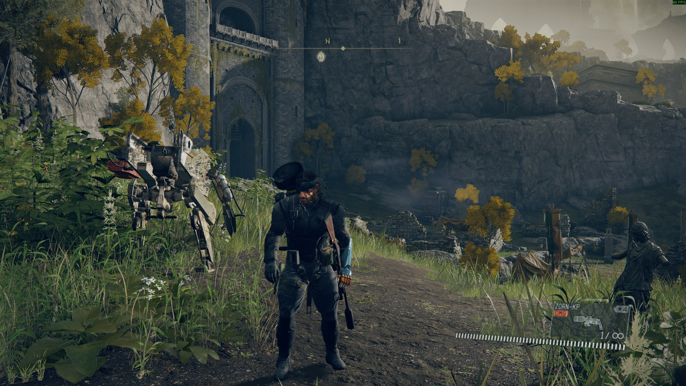
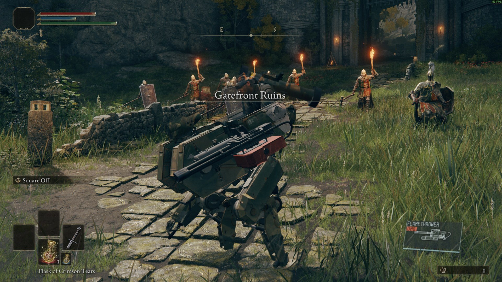
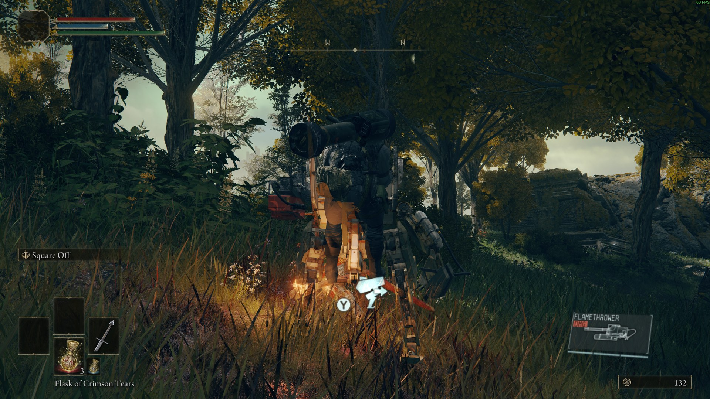

# PhantomRing

Play Elden Ring as Venom Snake. MGSV runs hidden in the background and supplies Snake himself:
his movement, stances, CQC, weapons, animation, life and his battle buddy (D-Walker first). Elden
Ring runs its world, enemies, bosses, quests and saves, and draws everything.

Neither game is rewritten. An Elden Ring plugin and an MGSV plugin talk to each other through shared
memory. It's the same idea as [SkyCraft](https://github.com/chasmlol/SkyCraft), which does it for a Minecraft
player in Skyrim.



| | |
|---|---|
|  |  |

> **Status: playable, early.** Developed and tested on Linux (Proton) with both games running; see
> [Known issues](#known-issues) and [docs/STATUS.md](docs/STATUS.md). The Windows build has never been run on
> Windows ([docs/WINDOWS.md](docs/WINDOWS.md)).

> **Read this first**
> - **Unofficial fan-made mod.** Not affiliated with, endorsed or sponsored by Konami, FromSoftware or
>   Bandai Namco.
> - **No game files are included.** You must own both games on Steam: ELDEN RING (1.17.1) and METAL GEAR
>   SOLID V: THE PHANTOM PAIN (1.0.15.4). Snake's models, textures, animation and sound are read at runtime
>   from your own MGSV install.
> - **Play offline only.** PhantomRing always starts Elden Ring offline through Mod Engine 3, which
>   neutralises Arxan and never loads Easy Anti-Cheat. Never take a PhantomRing save or setup online.
> - **Back up your saves.** `pr launch` backs up both games' saves before every start, and Elden Ring plays on
>   its own copy of your save (`PhantomRing0000.sl2`). Mods can still go wrong: keep your own backups too.
> - Use at your own risk.

## Install

For players on Linux. On Windows, see [Windows](#windows). To build from source, see
[Build from source and run](#build-from-source-and-run-linux).

**Supported versions.** The plugins check the exact game executables. On any other version they stay inert, and the
game runs as usual.

| | Version | |
|---|---|---|
| ELDEN RING | **1.17.1** (`eldenring.exe` 2.7.1.0) | sha256 `1a354710…8b597891` |
| METAL GEAR SOLID V: THE PHANTOM PAIN | **1.0.15.4** | sha256 `085c2f82…c5e9bb45` |
| Mod Engine 3 | **0.13.0** (`me3-linux-amd64.tar.gz`, you download it) | sha256 `f31579de…e1e93fc1` |
| PhantomRing | see `tools/pr --version` | both plugins must come from the same release |

1. **Get PhantomRing.** Download `PhantomRing-<version>-linux.tar.gz` and `SHA256SUMS` from the
   [Releases](https://github.com/whp199/PhantomRing/releases) page. Tagged releases only: until there is one, build from
   source (below). Then:
   ```bash
   sha256sum -c --ignore-missing SHA256SUMS
   tar xzf PhantomRing-*-linux.tar.gz && cd PhantomRing-*-linux
   ```
2. **Get me3.** Download `me3-linux-amd64.tar.gz` from the
   [me3 v0.13.0 release](https://github.com/garyttierney/me3/releases/tag/v0.13.0) into `~/Downloads/`, then run
   `tools/pr install-me3`. It checks the archive's sha256 before unpacking.
3. **Check the machine.** `tools/pr doctor` checks Steam, both game versions, me3, gamescope, Proton, the plugins and
   your saves. It changes nothing. Fix every `[FAIL]` line; each one says how.
4. **Prepare both games once** (details in [step 3 below](#build-from-source-and-run-linux)). MGSV's Continue must load
   a save that can go to Africa. Elden Ring needs a character in `ER0000.sl2`.
5. **Play.** `tools/pr launch` backs up your saves and starts both games: MGSV is hidden, Elden Ring is offline. Load
   your character, and Snake takes over after 2-4 minutes. `tools/pr stop` when you're done.
6. **Updating.** Replace the whole folder (both plugins come from one release: `tools/pr --version` lists them). Mixed
   plugins don't link up, and Elden Ring's corner says so in red ("PhantomRing versions differ: ... -- reinstall both").
   Every launch keeps a ~140 MB save backup; `tools/pr doctor` warns when they pile up (`--keep-backups N` prunes).

Something wrong? Run `tools/pr collect-logs` and [open an issue](https://github.com/whp199/PhantomRing/issues/new/choose)
with the zip it writes.

## How it works

| | MGSV (guest, hidden) | Elden Ring (host) |
|---|---|---|
| Movement | Snake runs, crouches, crawls, dives in a sandbox on the Nova Braga Airport apron; only his *intended motion* leaves MGSV | the invisible Elden Ring character takes that motion through Elden Ring's collision (walls, slopes, ledges) |
| Camera | MGSV's over-the-shoulder / aim / CQC cameras | Elden Ring renders from exactly that camera, mapped onto the player |
| Look | captures what it draws for Snake and D-Walker: real meshes, textures, skinning matrices | draws them inside its own frame |
| Controls | gets your controller through a virtual XInput pad | owns the real controller; keeps Start (menu) and View (map) |
| Combat | fires, CQCs, tranqs; life regenerates as in MGSV | resolves the hits on its enemies; its hits drain Snake's life |
| Buddy | D-Walker deployed, following, rideable | drawn next to Snake, on Elden Ring's ground |

Details: [docs/DESIGN.md](docs/DESIGN.md). The shared layout: [protocol/phantomring_protocol.h](protocol/phantomring_protocol.h).

## Requirements

| | |
|---|---|
| Linux | Tested on Gentoo with KDE Plasma (Wayland) and an NVIDIA RTX 50-series GPU. Untested: AMD/Intel GPUs, Steam Deck, other desktops |
| Steam | the native client, running and signed in (both games check it). Flatpak Steam is untested |
| ELDEN RING | **1.17.1** (`eldenring.exe` 2.7.1.0), installed through Steam, run with Proton (Proton Experimental is what was tested) |
| METAL GEAR SOLID V: THE PHANTOM PAIN | **1.0.15.4**, installed through Steam (Proton) |
| An Elden Ring character | in your normal save, `ER0000.sl2`: PhantomRing makes its own copy of it |
| An MGSV save | that can load **Africa free roam** (Snake is parked on the Nova Braga Airport apron); D-Walker developed if you want him (optional) |
| gamescope | with the headless backend (`gamescope --backend headless`); MGSV runs hidden inside it |
| Mod Engine 3 | **me3 0.13.0**, the official Linux release, which you download yourself (below) |
| A controller | Xbox-style (XInput). Keyboard and mouse can drive Snake too: `[Keyboard] enabled = true` (experimental, below) |
| A strong PC | both games run at once; MGSV renders in the background |

To build: **MinGW-w64 GCC 13 or newer** (the posix thread model is recommended), **CMake 3.25+**, **Ninja**,
**Python 3.11.4+** (standard library only). For the tests, also wine.

Package names (only Gentoo has been tried):

```bash
sudo pacman -S mingw-w64-gcc cmake ninja python gamescope                          # Arch
sudo dnf install mingw64-gcc-c++ cmake ninja-build python3 gamescope              # Fedora
sudo apt install g++-mingw-w64-x86-64-posix cmake ninja-build python3 gamescope   # Ubuntu 24.04 / Debian 13
```

The plugins check the exact game versions (file hashes). After a Steam update to either game they do nothing
and the game runs normally, until PhantomRing is updated for the new version.

## Build from source and run (Linux)

**1. Get the code and build it.**

```bash
git clone --recursive https://github.com/whp199/PhantomRing PhantomRing    # --recursive: MinHook is a submodule
cd PhantomRing                                               # (after a plain clone: git submodule update --init)
cmake -S . -B build -G Ninja -DCMAKE_TOOLCHAIN_FILE=cmake/mingw-w64-x86_64.cmake -DCMAKE_BUILD_TYPE=Release
cmake --build build
```

Use `-B build`: the launcher looks for the two DLLs there.

**2. Get me3.** Download `me3-linux-amd64.tar.gz` from the
[me3 v0.13.0 release](https://github.com/garyttierney/me3/releases/tag/v0.13.0) into `~/Downloads/` (or
`third_party/downloads/` in this folder), then:

```bash
tools/pr install-me3       # checks the archive's sha256 against the release, extracts it into third_party/me3/
```

**3. Prepare both games once.**

- Start **MGSV** normally from Steam. If it asks for your country/region and Konami's updated Terms of Use
  (July 2026 patch), answer it yourself: PhantomRing never does, and runs MGSV offline anyway. Make sure
  Continue loads a save that can go to Africa, then quit.
- Start **Elden Ring** normally once if you have never played it on this machine, so that `ER0000.sl2` holds a
  character. PhantomRing copies it to `PhantomRing0000.sl2` on its first launch and only ever plays that copy
  (another save: `tools/pr launch --seed-save NAME`).

**4. Play.**

```bash
tools/pr launch --dry-run   # checks everything and prints what it would do; fix any [FAIL] it lists
tools/pr launch             # backs up both games' saves, starts MGSV hidden, then Elden Ring (offline)
tools/pr status             # both sides, live
tools/pr stop               # when you're done (quit Elden Ring from its menu first)
```

Load your character in Elden Ring and play the Tarnished as usual while MGSV boots hidden (2-4 minutes);
then Snake takes over. All `pr` commands: [docs/TOOLS.md](docs/TOOLS.md).

## Windows

Built and tested under Wine, but **never run on Windows**. On Windows, Elden Ring starts MGSV hidden by itself.
The zip (`PhantomRing-<version>-windows.zip`) is attached to tagged releases, or you can build it on Linux with
`python3 -I tools/package_windows.py`. Setup and status: [docs/WINDOWS.md](docs/WINDOWS.md). If you try it, please
report how it went (below).

## How to play

Start it (`tools/pr launch`, see [Install](#install)), load your character in Elden Ring and play the Tarnished
as usual while MGSV boots hidden (2-4 minutes; the top-right corner says what it is doing). "Snake is in control" means
your controller now plays Venom Snake. Use an Xbox-style pad.

**Snake's controls are MGSV's own**, with three exceptions for Elden Ring and one addition (R3: jump):

| Button | What it does |
|---|---|
| Left stick / right stick | move (tilt = walk or run) / camera |
| **R3 (click the right stick)** | **jump** (MGSV has none): standing, walking or running on foot, ~1.2 m up; up onto a ledge about a metre high (Stormveil's rock steps and its wooden walkway), over a gap of two metres or more running. Not crouched, prone, aiming or riding. With LB held (D-Walker's orders), a D-pad direction held (MGSV's weapon and item wheels: R3 = Use there, e.g. the Phantom Cigar), while aiming, riding, in a menu or the binoculars R3 is MGSV's own |
| A | tap: crouch / stand up, hold: lie down |
| X | dive (running: the dive hops Snake over a short gap or onto a knee-high ledge, see below; `[Puppet] hop = false` turns the hop off) |
| B | reload |
| Y | MGSV's action (next to D-Walker: get on; riding: hold to get off; pick up a supply box; next to a sleeping enemy: hold for MGSV's Fulton), **or Elden Ring's** whenever Elden Ring shows its own prompt ("Y: Rest at site of grace", "Y: Retrieve lost runes", items) |
| LT / RT | aim / fire; RT without LT, standing, next to an enemy = CQC strike; **held** = grab him (keep holding: choke him out, LB: interrogate, let go: release), with the left stick pushed = throw him (CQC holds and throws, below) |
| D-pad | tap up: primary weapons (by default an SVG-76 assault rifle at the hip and an FB MR R-LAUNCHER rocket launcher on the back: hold up and push the right stick to switch), down: handgun (a WU S.PISTOL with tranquilizer darts), right: support items (grenades, mines, C4: Y sets it off), left: items -- hold it and push the right stick to pick one (the cardboard box, the night-vision goggles), a quick tap uses the one picked |
| RB (while aiming) | first person / down the scope: you aim with the gun's own sights (MGSV shows no reticle there) |
| RB (hold, not aiming) | MGSV's binoculars (right stick looks, zoom as in MGSV): keep an Elden Ring character near the middle for half a second to **mark** him (below) |
| LB (hold) | MGSV's call menu: D-Walker's orders (below) |
| **Start** | **Elden Ring's** menu (equipment, items, system, quit) |
| **View, tapped** | **Elden Ring's** map (and fast travel from it) |
| **View, held a moment (0.4 s)** | **MGSV's iDroid** (supply drops, buddy support, Mother Base); while it is open MGSV has the whole pad; Start closes it |
| **View + Start, held together 1 s** | **Tarnished mode**: you play the Tarnished (flasks, spirit ashes, Torrent, jumps, answering NPCs); the same again gives Snake back, where the Tarnished stands. Neither button opens a menu. Either may go down first: Start up to 0.7 s after View still makes the chord (MGSV's iDroid may flash open for a moment and closes by itself) |

**Keyboard and mouse** (opt-in, off by default; tried live 2026-10-15 with keys and mouse events sent into Elden Ring's window --
walking, running, the camera, aim and fire, the wheel, the jump, D-Walker's orders, Tab/Esc/G, a rest at a grace with E -- not yet
with a player's own keyboard and mouse): set `[Keyboard] enabled = true` in `PhantomRingHost.ini` (or try it with
`tools/pr er "input kbm on"`). While Snake plays the keys and the mouse become his pad;
Elden Ring's own keyboard and mouse work as usual in its menus and in Tarnished mode. A controller keeps priority: whichever
you touched last plays Snake.

| Key | Pad | What it does |
|---|---|---|
| W A S D / Shift held | left stick | walk / run |
| Mouse | right stick | camera (a faster move turns faster: `mouse_sensitivity`, `mouse_acceleration`) |
| Ctrl | A | tap: crouch / stand up, hold: lie down |
| Space / R | X / B | dive / reload |
| E or F | Y | MGSV's action, or Elden Ring's on its own prompts (E: Rest at site of grace) |
| Right / left mouse button | LT / RT | aim / fire (left held next to an enemy: CQC grab, with `[Cqc]` on) |
| V | RB | first person while aiming; held while not aiming: binoculars (marking) |
| Q (hold) | LB | MGSV's call menu; move the mouse toward an order, stop, click the wheel (R3) |
| Wheel click (middle button) | R3 | jump (with Q held: picks the call menu's order instead) |
| 1 / 2 / 3 / 4, wheel up / down | D-pad up / down / right / left | primary weapons / handgun / support items / items (hold one and move the mouse to pick) |
| Tab tapped / held | View | Elden Ring's map / MGSV's iDroid |
| Esc | -- | Elden Ring's menu (closes MGSV's iDroid while that is open) |
| E, Q, Enter, arrows | -- | while an Elden Ring pickup or dialog has the controls (Snake stands still): Elden Ring's own keys for it (`er_interaction_keys`); the rest of the keyboard and the mouse wait |
| G held 1 s | View + Start | Tarnished mode and back (in Tarnished mode a G tap opens Elden Ring's map, as the pad's View: `chord_tap`) |

Every key can be changed in `[Keyboard]`. With no controller connected, PhantomRing gives Elden Ring a virtual pad the first
time you use the keyboard (`virtual_pad = auto`), so the first key press may take a moment.

**CQC holds and throws** (on; tried live 2026-10-15 on Gatefront's soldiers: hold, choke to sleep, throw, interrogate;
`enabled = false` under `[Cqc]` in `PhantomRingHost.ini` turns it off). MGSV grabs only its own soldiers, so PhantomRing reads what you do with RT and Elden Ring's enemy in
front of Snake (within ~1.6 m) answers: **hold RT** next to him and he is caught and held in place for a few seconds; **keep
holding** and Snake chokes him to sleep (2.5 s); **LB** while holding interrogates him (he says something in the corner);
**let go** to release him; **RT with the stick pushed toward him** throws him to the ground. Apart from a token 1 HP (so
Elden Ring plays the flinch) none of it does damage of its own (MGSV's punch that comes with the press does). Bosses (and
anything with 2000 HP or more) can't be grabbed: they only stagger. Once let go, the same enemy can't be held again for 8
seconds (grabbing him only makes him flinch).

**Tarnished mode.** Everything Snake can't do yet, the Tarnished does: hold **View + Start together for a second** and the
corner says "Tarnished mode -- View+Start to return to Snake". He shows with his weapon and Elden Ring has the whole pad: X
drinks a flask (the quick item), and so on; Snake waits, parked, in MGSV. The same chord gives Snake back where the Tarnished
stands, and what the Tarnished went through is Snake's too: a Flask of Crimson Tears that took the Tarnished from 74% to 100%
gives Snake the same share of his life back, a boss's hit takes it. Snake takes over only on foot: on Torrent (or a
ladder) the corner says "get off Torrent first". Torrent: the Spectral Steed Whistle from a quick slot, or Start ->
Inventory -> Tools -> the whistle -> Use.

**Dive = hop (on).** Besides the jump (R3), MGSV's dive hops: MGSV's dive (X while running) carries Snake in a small hop,
~0.6 m up and ~2.5 m forward: over a ditch up to ~2 m wide, onto a ledge up to ~0.75 m high (`hop = false` under `[Puppet]`
in PhantomRingHost.ini, or `pr er "puppet hop off"`, turns it off).
A dive ends with Snake on the ground, as in MGSV: A gets him up. A wall 1 m high stops him, and under a low ceiling
the hop is lower or doesn't happen. He lands as from any fall (a hop off a cliff hurts like the fall).

**Ladders.** Y on a ladder's "Climb" prompt: the Tarnished takes the ladder and you climb it with the left stick, as in Elden
Ring; Snake is back where the Tarnished gets off (let go of the stick first: Snake doesn't run on with it). To go down, stand at
the top next to the hole and turn Snake to face it (a light touch of the stick turns him): "Descend" shows, Y. Walking on into
the hole drops Snake down the shaft, as it would the Tarnished (a 19 m tower costs ~90% of his life).

**Ordering D-Walker.** Hold **LB**: MGSV's call menu opens. Push the **right stick** toward an order (Whistle up-right,
the modes to the right; your current mode is greyed out), **let the stick go** (the order stays selected), then **click the
right stick in** while still holding LB. Releasing LB without the click cancels, and MGSV ignores a click while the stick is
still pushed. Elden Ring's corner then shows the order ("D-Walker: Search Mode -- it marks enemies nearby"); the first
few times you hold LB it also shows how, and it tells you when you let go without giving one.
- **Whistle**: D-Walker comes to you, from anywhere (a far one is brought closer first, then it walks).
- **Normal Mode**: it follows you, a few metres to your left. This is the mode it starts in.
- **Search / Stealth / Intercept Mode** (whatever your save has developed): it stays in that mode and does not follow
  until you whistle or choose Normal Mode again.
- Y next to it mounts it: ride it through Elden Ring, RT (or LT+RT in its cockpit view) burns enemies with its
  flamethrower; hold Y to get off. If D-Walker is ever destroyed in MGSV's world, PhantomRing has MGSV bring it back
  after ~10 s (not yet seen live).

**Changing or dismissing the buddy** (MGSV's own menu): hold View for the iDroid, RB to **Missions** > **Buddy Support**: pick
**D-Horse**, **D-Dog** or **D-Walker** and confirm the drop point (A; GMP is spent in memory only, MGSV never saves), or **Dismiss**
the one that is out. MGSV sends the old one away (a dismissed D-Horse leaves under a Fulton balloon, in Elden Ring's sky too) and
the new one arrives in 10-30 s; the corner says "Buddy: D-Dog is out" / "D-Walker dismissed -- no buddy now". With no buddy out
nothing is drawn or placed. D-Dog follows Snake and marks Elden Ring's enemies ("D-Dog: Found enemy"); Quiet is untested. The next
launch deploys the ini's buddy again (`[Buddy] Type`).

**D-Horse instead of D-Walker** (optional): set `[Buddy] Type = horse` in `PhantomRingGuest.ini` (in MGSV's folder) before
`tools/pr launch`, or deploy it from the iDroid as above, or `tools/pr lua '!buddy horse'` (`!buddy walker` back). The horse waits where it
is; hold LB and pick **Whistle** and it gallops over (PhantomRing also whistles it when it is more than 15 m away). Y next to
it mounts, the left stick walks it, **tap X** to canter and gallop (13-17 m/s), Y gets off. It is drawn under Snake and
stands on Elden Ring's ground; walls and ruins stop it as they stop Snake, and galloping off a ledge or a cliff hurts like a
fall (Limgrave's lake shores and ravines kill). PhantomRing moves the horse inside MGSV's world -- with Snake on it, and beside
him on foot (`[Buddy] HorseTreadmill`, on since live 2026-10-15) -- so the ride has no limit and the horse never jumps: a 300 m
straight gallop east from Gatefront in 27 s, 1.2 km of riding in all, and after getting off it stood 3.7 m beside Snake, no jump,
no whistle. `tools/pr lua '!horse'` shows whether it found the horse (`confirmed`); if it can't move it, it says so and the ride
is limited by MGSV's own world again (the airport's terminal ~40 m one way), as before. The next launch deploys the ini's buddy
again.

**Fulton.** A sleeping Elden Ring enemy can be sent to Mother Base with MGSV's own Fulton: put him to sleep (two tranquilizer
darts in the body, or sleep gas), walk right up to him -- MGSV's Fulton prompt shows (a balloon, "100%", your balloons left) --
and **hold Y** for about two seconds. Snake attaches the balloon; a few seconds later Elden Ring lifts the enemy away under a
balloon, "Fulton: the enemy is on its way to Mother Base", and you get the runes he would have dropped. He stays gone until you
rest at a grace (as if killed, without a death or a drop). Be quick: Elden Ring's sleep lasts about 50 s, and an enemy that wakes
can't be fultoned. Not for bosses.

**Marking with the binoculars.** Hold **RB** (not aiming) to look through Snake's binoculars and keep an Elden Ring character
near the middle of the view for about half a second, as you would an MGSV soldier: he is marked. A marked character carries a
triangle over his head -- red for an enemy, white for anyone else -- with his distance from Snake in metres, seen through walls,
until the next loading screen (fast travel, a death, the title); it fades when he dies. Only what Snake can see gets marked
(not through a wall), up to 150 m away. The marks show only while you play Snake, not in Elden Ring's or MGSV's menus or in talks;
Elden Ring's "Auto" HUD fading out does not hide them. `[Marking]` in `PhantomRingHost.ini` sets the range, how long to look, what the marks
show (`distance = always | centre | off`), or turns it off (`enabled = false`). Tried live 2026-10-14 (a Stormveil soldier marked).

**Phantom Cigar** (on; tried live 2026-10-15: Elden Ring went 12:14 -> 18:02 -> 02:14 in two smokes, and at night Renna stood
at the Church of Elleh after a fast travel). It changes Elden Ring's time of day, which Elden Ring saves. PhantomRing puts the
cigar into a free item slot if your MGSV save carries none. **Hold D-pad left** (MGSV's item wheel), **point the right stick at
the Phantom Cigar and click it in (R3) while still pointing**: Snake smokes, MGSV's time-lapse runs, and the same game time
passes in Elden Ring, its sky following along while he smokes. A tap of D-pad left puts it out (the cigar is then the item
picked: the next tap lights it again). `[Cigar] TimeSkip = false` in `PhantomRingGuest.ini` turns it off.
Smoke until night and Elden Ring turns night; the corner then says how much time passed ("Phantom Cigar: 6 h 30 min passed
(12:00 -> 18:30)"). Switches: `[Cigar] TimeSkip` in `PhantomRingGuest.ini`, `[TimeSkip] enabled` in `PhantomRingHost.ini`.
`tools/pr er "timeskip 120"` moves Elden Ring's clock two hours the same way without MGSV.

**Aim assist and marking on Elden Ring's enemies (experimental, off).** With `[Proxies] Enabled = true` in
`PhantomRingGuest.ini` (or `tools/pr lua '!proxy on'` for one session), MGSV puts an inert stand-in soldier where each of the
four nearest Elden Ring enemies is: LT swings the aim onto them as it would onto MGSV's own soldiers, and marking one shows MGSV's
marker over him. The stand-ins stand on Snake's ground (at the enemy's spot, not on his ledge), so LT puts the reticle at the
stand-in, below or above an enemy on a ledge or in a dip; a round fired there still flies to the enemy's real height, and a round
you aim at the enemy himself flies where you aimed. They are kept from noticing Snake, and if MGSV goes on alert anyway its soldiers are switched off again and
the alert is called off; an alert that lasts 20 s switches the stand-ins off for the session (`!proxy` shows it). Tried live
2026-10-15 at Gatefront for 11 minutes: MGSV stayed at alert phase 0 throughout, no stand-in ever shot Snake, MGSV's analyzer read
a stand-in through the binoculars and a Fulton through a stand-in worked -- but LT never swung the aim onto one (3 tries, 4-11
degrees off), so it stays off: see Known issues.

**Guns.** Each round does what it does in MGSV: an assault-rifle round takes a fifth of a soldier's life (five body hits kill
a Limgrave soldier, so does one headshot), a rocket kills the soldier it hits. Rockets fly visibly (a dark body with a bright trail) and blow up
where they hit. The tranquilizer pistol: two body darts, or one in the head, put a soldier to sleep without a fight.
Two looks are off because they don't work yet (live 2026-10-14): `muzzle_flash = true` under `[Combat]` in
`PhantomRingHost.ini` gives each shot an Elden Ring flash at the muzzle -- a fireball a metre or more across that covers the
aim, not a muzzle flash; `projectile_meshes = true` under `[Render]` together with `ProjectileMeshes = true` under `[Capture]`
in `PhantomRingGuest.ini` was meant to draw a grenade or rocket in flight with MGSV's own model, but no model was ever
learned (grenades are never tagged, a rocket only as a flat 4-vertex quad), so the ball stays either way.

**Progression** (optional, off by default): `[Progression] damage_scaling = level | weapon | both` in `PhantomRingHost.ini`
makes the Tarnished's rune level and his right-hand weapon's upgrade scale Snake's damage ([docs/COMBAT.md](docs/COMBAT.md)):
x(level / 20)^0.5 and x(1 + 1.5 x upgrade / max upgrade), between x0.5 and x3. A level-15 Tarnished with a +0 weapon: a rifle
round on a soldier did 35 off, 31 with `level`. Try it while you play: `tools/pr er "progression level"` (`off`, `weapon`,
`both`); the ini makes it stick. His Vigor already counts: Elden Ring's hits cost Snake the share of the Tarnished's HP they take.

**Life.** Elden Ring's hits take Snake's life as MGSV's own would, and he recovers as in MGSV: nothing for ~2.4 s after a hit,
then slowly, then faster (full ~7 s after a 20% hit, ~12 s after a 65% one). Each new hit starts it again, so standing in a
boss's combo kills him (`[Combat] RegenGate` in `PhantomRingGuest.ini`; `false` brings back the old instant regeneration).

**Grenades and mines.** D-pad right picks the support item, hold LT: the throw arc shows (dots and a ring where it lands,
in Elden Ring's world); press RT while still holding LT to throw (letting both go together throws nothing). Sleep gas puts enemies to sleep, stun grenades stagger them, frag grenades and molotovs
hurt. Mines (LT+RT places them) lie where you put them with a blinking light and go off when an Elden Ring enemy walks
into them. They stay while you play on; a death or fast travel clears them (MGSV takes them back).

**C4.** D-pad right to the C4, LT+RT sets one (set as many as you carry). To set them off, keep the C4 in hand (support
item selected, on foot) and tap **Y**: each tap sets off the oldest C4 you placed, and its blast is Elden Ring's, where the
C4 lies (8 m, lethal). Stand clear. MGSV's own detonator never answers the press in PhantomRing's sandbox, so PhantomRing
sets the C4 off when MGSV doesn't within `C4GraceMs` (`[Combat] C4Backup`, on; live 2026-10-14: every tap set one off, and a
Y tap at D-Walker with C4 in hand mounted it and set nothing off). `C4DetonateAll = true` sets off every C4 at once
(`PhantomRingGuest.ini`). C4 from an old save that was already lying in MGSV's world is never yours to set off in Elden
Ring. Next to a supply box a tap of Y with C4 in hand may set one off too (untested; a held Y, MGSV's Fulton of a sleeping
enemy, never does).

**Decoys** (on; tried live 2026-10-15 with the save's E-STUN decoy at Gatefront). Pick a decoy as the support item (D-pad
right: hold it and point the right stick at the decoy), then **throw it like a grenade: hold LT until the arc shows, press RT
while still holding LT** (let go of both together and nothing is thrown). Where it lands in Elden Ring a rubber soldier
inflates, set down on Elden Ring's ground. An Elden Ring enemy within 15 m that sees it stops and stares at it for a few
seconds -- slip past behind him (live: two soldiers stared, one at 11.8 m right after being shot at); the active decoy calls
out, so enemies hear it within 25 m even without seeing it. One fighting Snake right next to him doesn't fall for it. An enemy
that walks into a decoy knocks it over (live: the shock decoy's blast staggered him). Decoys stay until a load (fast travel, a
death). `[Decoys]` in `PhantomRingHost.ini`; `[Combat] Decoys` in `PhantomRingGuest.ini`.

**The cardboard box.** Hold D-pad left, push the right stick to the box, let go: Snake is in it (RT takes it off, X dives
out). Keep still in it (or creep slowly for a moment): Elden Ring's enemies that haven't spotted Snake walk past; one
that is already after him, or comes within 2 m, still finds him. Snake's first box carries MGSV's anime pin-up girl on its
lid (`[Loadout] BoxPoster`; X in that item menu changes the poster): an enemy that sees it within 15 m stops and stares for
a few seconds.

**Breaking things.** Shoot a crate, cart or pot, punch it (CQC with no enemy in reach) or blow it up: it breaks as it
would for the Tarnished. Walking into a cart or a rock, Snake stops at it as the Tarnished would, never inside it.

**Night vision.** Hold D-pad left, push the right stick to the NVG and let go: the goggles go on (a quick tap of D-pad
left takes them off and puts them on again). Elden Ring's picture -- the world, Snake and D-Walker -- turns MGSV's bright
green, the dark lifted most; Elden Ring's HUD and menus stay as they are. Off in cutscenes, loads and while dying.

**Ammo and life refill.** Resting at a grace refills Snake as it refills the Tarnished's flasks: his life, every magazine,
the ammo reserve and his grenades and other items. So does every respawn (a death, the grace or a Stake of Marika). A
supply drop from the iDroid still works too.

**Dying** is Elden Ring's: YOU DIED, the grace or a Stake of Marika, and Snake gets up with full life and ammo. A fall into
a chasm with no ground to land on counts as a death after a few seconds (~60 m). Resting at a grace (its menu: Pass time,
Level Up, ...), fast travel, NPCs' questions and Elden Ring's menus (Start, or Esc and G on the keyboard) work as usual:
Elden Ring has the pad while one of its screens is up.

**Bosses.** Walking into a boss's mist: Y on "Traverse the mist" -- Snake steps aside for a moment while Elden Ring walks the
Tarnished through, then he plays on inside. The boss's health bar is Elden Ring's HUD; Snake keeps the pad for the fight.
A boss counts as many soldiers: one 30-round SVG-76 magazine takes about 14.5% of Margit's health. Margit's hits cost Snake
11-45% of his life each.

## Saves, safety and uninstalling

- **Elden Ring** plays only `PhantomRing0000.sl2`, a copy of your save made on the first launch (your
  `ER0000.sl2` is never touched). It is yours: keep it, or delete it to start the copy over.
- **MGSV never saves** while PhantomRing runs (its writes stay in memory), so your MGSV progress stays as it
  was.
- **Backups.** Every `pr launch` first copies both games' saves to `backups/<time>/` and verifies them by
  sha256. All of them are kept unless you ask for pruning (`--keep-backups N` or `$PHANTOMRING_KEEP_BACKUPS=N`:
  for each game the newest N and the very first one survive, and every `*-pre-restore` one; each ER backup is
  ~140 MB, so prune now and then). `pr backup-saves` makes one by hand;
  `pr restore-saves <time> --yes` puts one back (and backs up the current saves first). For Elden Ring it restores
  only `PhantomRing0000.sl2` (and its `.bak`), never your other saves in that folder (`--all-er-files` does).
- **Online.** Elden Ring always runs offline: me3's profile sets `start_online = false` and `pr launch`
  passes `--online=false`, and Easy Anti-Cheat is never loaded. MGSV runs offline too (`[Online] Offline =
  true`). Since its July 2026 patch, MGSV's first login asks you to pick your country/region and accept
  Konami's updated Terms of Use; PhantomRing never answers that for you.
- **MGSV's folder.** `pr launch` puts `dinput8.dll` (the MGSV plugin) and `PhantomRingGuest.ini` there. The plugin
  only activates when started by `pr launch`; otherwise it passes everything through. It never overwrites a
  `dinput8.dll` from another mod (IHHook, Infinite Heaven): move that aside while you play PhantomRing.
- **Uninstall.** `tools/pr stop`, then `tools/pr uninstall-guest` (removes the two files from MGSV's folder, only
  if they are the ones it installed), then delete this folder. `backups/` holds your save backups: keep what
  you want first.

## Known issues

The full list, with measurements: [docs/STATUS.md](docs/STATUS.md#known-issues).
The 2026-10-14 features, their switches, how to test them and what live passes A and B (2026-10-14/15, both games) showed:
[docs/FEATURES-1.md](docs/FEATURES-1.md).

- Elden Ring's grass is drawn over Snake's models even where it stands behind them.
- Snake can't go under anything lower than him: standing he stops at the edge of a staircase's underside or a table, crouched
  (A) he gets further; prone further still. Pushed into a corner for a few seconds he is put back where he stood free.
- Wooden floors (scaffolding, planks with gaps): Snake used to fall through them. Fixed and tried live 2026-10-14 on
  Stormveil's cliffside scaffold (a switch from Tarnished mode on its planks, walking its landings and stairs: he stays up;
  the old filter saw the floor 0.5-1.4 m too low there). If he still falls through something the Tarnished stands on, the
  log's `Snake left the ground ... his five ground rays` line says what was below; `[Puppet] ground_filter = 0x2000058` in
  `PhantomRingHost.ini` is the old way (tell us where). If Snake stops at an invisible wall the Tarnished walks through,
  `wall_filter_also = 0` there (and tell us where).
- D-Dog's coat (and D-Walker when it is right next to the camera) used to be drawn in false colours (orange, green, magenta),
  and the cardboard box very dark: a fix is in (MGSV's textures re-keyed when it reuses them; live 2026-10-14 D-Dog and
  D-Walker close up after two buddy swaps showed no false colours, 0 textures in a wrong role) -- the box not yet re-checked.
  Elden Ring also checks each texture's role and the box poster, but by default only logs (`tools/pr er render` shows
  `material guard (...): N textures in a wrong role`). If the false colours still happen and that count is above 0,
  `tools/pr er "render set role_guard on"` leaves those textures out (plain grey instead of wrong colours).
- Fulton: Elden Ring's balloon goes up ~5 s after you let go of Y (MGSV's own balloon lifts its stand-in first).
- Phantom Cigar: Elden Ring's night-only characters may only appear after the area reloads (live: Renna stood at the Church
  of Elleh at night after a fast travel). The cigar is smoked from the item wheel with R3 while the stick still points at it.
- Full proxies (`[Proxies] Enabled`, aim assist and marking on Elden Ring's enemies) stay off. Live 2026-10-15 (11 minutes at
  Gatefront): MGSV stayed at alert phase 0, no stand-in shot Snake, a Fulton through a stand-in worked -- but LT never swung the
  aim onto a stand-in, the fourth stand-in switches between two equally near enemies every ~20 s, and `location objects lost`
  climbed to 4. MGSV's marker shows at the stand-in, i.e. at Snake's ground height, not on an enemy on a ledge.
- D-Walker's footsteps are loud, and it follows Snake 2-3 s late.
- Binocular marks (live 2026-10-14: a Stormveil soldier marked half a second after the binoculars came up): a mark sits a
  fixed 2.2 m over the feet, inside a giant or a boss; MGSV plays no marking sound for Elden Ring's characters. If real soldiers
  never get marked, try `[Marking] rendered_only = false` (it skips characters Elden Ring doesn't render) and report it.
  Through the binoculars MGSV's lens no longer paints MGSV's airport around the view (fixed 2026-10-14).
- MGSV's own effects (explosions, muzzle flashes, smoke, flames) are replaced by Elden Ring's pot effects
  and Dragonfire flames; muzzle flashes are missing (`[Combat] muzzle_flash` shows a fireball, too big: off). Grenades and
  rockets in flight are simple shapes (`[Render] projectile_meshes` + `[Capture] ProjectileMeshes` learned no model live: off).
- C4 goes off by PhantomRing's backup (MGSV's own detonator never answers); next to a supply box a tap of Y with C4 in hand
  may set one off too (untested).
- Decoys are thrown (LT, then RT); a popped or dropped one stays standing in MGSV's own sandbox (`DecoyPopInMgsv` off), which
  holds 32 placed objects (live: 9 decoys out, still throwing).
- CQC holds, throws and chokes are Elden Ring's own reactions (a hold in place, a knockdown, sleep), not MGSV's paired
  animations: Snake grabs the air in MGSV. Bosses are told apart by their HP only, so a small field boss (under 2000 HP) can
  be held. The punch that comes with each RT press sometimes costs a soldier a second ~25 HP a moment later (seen twice on a
  held or guarding soldier: 82 -> 4 HP over one punch, a hold and an interrogation); the hold and the throw themselves take 1.
- After loading a save Elden Ring wrote while the Tarnished was dying (the game killed during or right after a death, not quit
  from its menu), its black "Choose revival location" screen can come up with Snake already in control: the pad then plays
  Snake. Hold View + Start (Tarnished mode), choose, and hold them again once Snake's world is back.
- Elden Ring opens no map while an enemy is after Snake (its own rule): View then seems to do nothing.
- With the camera pushed into Snake (a wall, an enemy right behind him) his see-through model can show magenta and green tints.
- Sturdy objects (Limgrave's palisade fences) don't break, even in a blast.
- The cardboard box doesn't shake off an enemy that has already spotted Snake.
- Keyboard and mouse driving Snake (`[Keyboard]`): opt-in (off by default), tried live only with keys and mouse events sent into
  Elden Ring's window; the mouse turns the camera like a stick (no native mouse aim yet). The middle mouse button is R3: Snake's
  jump. In Tarnished mode a G tap opens the map as the pad's View does (`chord_tap = view`): this save had Elden Ring's map on M.
- Flasks, spirit ashes and Torrent need Tarnished mode (View + Start held 1 s).
- Snake's jump (R3; live 2026-10-14: 1.2 m, onto 1.1-1.3 m rock steps and a wooden walkway at Stormveil's cliffside, not
  crouched, not under a walkway's edge) looks like MGSV's short fall, not a jump. `[Jump] Button` in `PhantomRingGuest.ini`
  moves it to another button (L3 is MGSV's sprint). R3 with a D-pad direction held is MGSV's (its wheels' Use): no jump then.
- Snake's life can tick up by up to ~2% for a moment after a hit before MGSV's recovery curve holds it back again.
- D-Horse: galloping in Limgrave's broken ground often ends at a wall or off a cliff (three fall deaths around Agheel Lake in
  pass B); the road east from Gatefront is a good 300 m run. Quiet is untested.
- At a ladder's top, walking into the hole drops Snake down the shaft (face the hole and press Y on "Descend" instead).
- `[Puppet] motion = root_motion` (Elden Ring's own movement for the hidden Tarnished) is there to try
  (`tools/pr er "puppet motion root_motion"`); `kinematic` stays the default: neither is clearly better yet.
- Skipping a boss's intro cutscene with Start: fixed and unit-tested, not yet re-tried in the game (Margit's plays only
  once per save).
- MGSV's night-vision goggles on Snake's head are drawn with a noisy texture on their lenses.
- Elden Ring shows an occasional 36-40 ms frame in the open world; MGSV slows to ~54 frames/s while the camera
  turns.

## Troubleshooting

- **Start with `tools/pr doctor`**: versions, me3, gamescope, Proton, the build, your saves. Then run `tools/pr launch
  --dry-run`, which checks what one launch needs. Both say what to fix for each `[FAIL]`.
- **"PhantomRing versions differ: Elden Ring plugin vX, MGSV plugin vY -- reinstall both"** (in Elden Ring's corner):
  the two plugins come from different builds. Rebuild both (`cmake --build build`) or unpack one release package
  whole; `tools/pr --version` shows what you have.
- **"Steam folder ... has no steamapps/"**: set `PHANTOMRING_STEAM` to your Steam folder (the one holding
  `steamapps/libraryfolders.vdf`).
- **"eldenring.exe is not 1.17.1" / "mgsvtpp.exe is not 1.0.15.4"**: Steam updated the game. PhantomRing
  needs an update for the new version.
- **MGSV never takes over**: `tools/pr status` shows what MGSV is doing, and the top-right corner of Elden Ring
  says it too. `tools/pr logs` shows both plugins' logs. MGSV's save must be able to load Africa free roam.
- **Something is stuck after quitting**: `tools/pr stop` (`--kill` if it reports leftovers).
- **Elden Ring drops to ~10 frames/s**: don't build PhantomRing (`cmake --build`) or run other heavy jobs while you play;
  both games together use most of the machine.
- **A save went wrong**: the backups are the folders in `backups/`; `tools/pr restore-saves <time>` shows what
  it would restore, and `--yes` puts it back.

## Building and tests

The build is above (`cmake -B build`, MinGW-w64). The offline tests don't need the games:

```bash
python3 tools/phantomring/test_launcher.py    # launcher guards on temp dirs
python3 tools/phantomring/test_fakes.py       # the protocol between two stand-in games, on a private mapping
export WINEPREFIX=$(mktemp -d)                # keeps the wine-based tests off your own prefix
python3 tools/phantomring/test_layout.py      # proto.py vs the C++ header, byte for byte
python3 tools/phantomring/test_plugins.py     # the plugins' link code under wine vs the stand-ins
python3 tools/phantomring/test_replay.py      # record/replay of a session between the stand-ins
python3 tools/phantomring/test_release.py     # versions, both packages (reproducible), pr doctor, collect-logs
cmake --build build --target check_host check_guest check_windows
```

CI runs all of these on every push ([.github/workflows/ci.yml](.github/workflows/ci.yml)). A `v<VERSION>` tag also
publishes both packages as a GitHub pre-release. The version lives in one place, the [VERSION](VERSION) file
([CONTRIBUTING.md](CONTRIBUTING.md#building-and-testing)).

What each one needs (wine, Lua 5.1.5 sources, extracted game data): [docs/TOOLS.md](docs/TOOLS.md#tests-offline).
Design: [docs/DESIGN.md](docs/DESIGN.md); per-plugin details: [docs/HOST.md](docs/HOST.md),
[docs/GUEST.md](docs/GUEST.md), [docs/COMBAT.md](docs/COMBAT.md); reverse-engineering notes:
[docs/research/](docs/research/README.md).

## Reporting problems and contributing

**Bug reports** are welcome as [GitHub issues](https://github.com/whp199/PhantomRing/issues/new/choose); the form
asks for the following:

- what you did and what happened;
- the first line of `tools/pr --version` and the output of `tools/pr doctor`;
- the zip from `tools/pr collect-logs`: both plugins' logs (`build/PhantomRingHost.log`,
  `MGS_TPP/PhantomRingGuest.log`), the last launch's logs, the inis, the versions. Your home folder, user name, host
  name and Steam ids are redacted;
- your distro, desktop, GPU and driver, Proton version, and whether Steam is native or Flatpak.

Look the logs over before you post them anyway. Never attach saves or `pr record` files (`.prrec`), which contain
MGSV's assets.

**Pull requests**: read [CONTRIBUTING.md](CONTRIBUTING.md) (the legal rules, how to test, live-test etiquette),
run the offline tests above first, and keep to the project's rules:

- No game code or assets in the repository, ever.
- tpp-mod is GPL: it may be read for facts, never copied.
- Third-party code must have an MIT-compatible licence and an entry in
  [THIRD-PARTY-NOTICES.md](THIRD-PARTY-NOTICES.md).
- Elden Ring stays offline.

## Roadmap

| # | Phase | Status |
|---|---|---|
| 0 | Link | done, live |
| 1 | Drive (movement, camera, input, puppet) | done, live |
| 2 | See Snake (MGSV meshes drawn in Elden Ring, lit by Elden Ring) | done, live |
| 3 | Fight (shots/CQC/stun hit Elden Ring enemies; grenades, mines, tranq darts; their hits drain Snake's life; death/respawn) | done, live (C4 detonation built, UNVERIFIED live) |
| 4 | D-Walker (deployed, following, drawn, rideable, flamethrower) | done, live |
| 5 | Polish: MGSV HUD layer, Elden Ring lighting, interaction prompts, audio (done); keyboard and mouse | mostly done |
| 6 | MGSV collision from Elden Ring (vault, climb, cover), proxies for native MGSV combat | Fulton of sleeping enemies done (through MGSV's own Fulton); full proxies experimental, off |
| 7 | Windows players ([docs/WINDOWS.md](docs/WINDOWS.md)) | built, tested under Wine; not yet run on Windows |
| 8 | Seamless Co-op | planned |

## Layout

| Folder | |
|---|---|
| `er/` | Elden Ring plugin, `PhantomRingHost.dll` (Mod Engine 3 native) |
| `mgsv/` | MGSV plugin, built as `dinput8.dll` |
| `common/` | shared core: mapping, rings, log, ini, hooks, signature scans |
| `protocol/` | the shared-memory layout |
| `tools/` | `pr` launcher and consoles, fake peers, reverse-engineering scripts |
| `docs/` | design, per-plugin docs, research reports |

## Legal

METAL GEAR SOLID V: THE PHANTOM PAIN and related names are trademarks of Konami Digital Entertainment. ELDEN
RING is a trademark of Bandai Namco Entertainment Inc. and FromSoftware, Inc. All other names and trademarks
belong to their respective owners. PhantomRing is an unofficial fan mod, not affiliated with or endorsed by any
of them.

No game code or assets are included in this repository. Models, textures, animation and sound are read at
runtime from your own installs. The exception is `pr record` files, which you create yourself and must not
share. Screenshots in `docs/screenshots/` show the mod running.

Mod Engine 3 neutralises Arxan so the plugins can load, for offline play only: never play online with this
setup. Use at your own risk.

## Credits and licence

PhantomRing is released under the [MIT License](LICENSE). Third-party parts keep their own licences:
[THIRD-PARTY-NOTICES.md](THIRD-PARTY-NOTICES.md) lists them, with what was adapted and from where. With thanks
to [SkyCraft](https://github.com/chasmlol/SkyCraft), whose design and shared-memory core PhantomRing grew from,
and to [MGS5VR](https://github.com/nikamigaming-create/MGS5VR), [me3](https://github.com/garyttierney/me3),
[MinHook](https://github.com/TsudaKageyu/minhook), fromsoftware-rs, The Grand Archives, IHHook and Infinite
Heaven, hudhook and IGCS.
