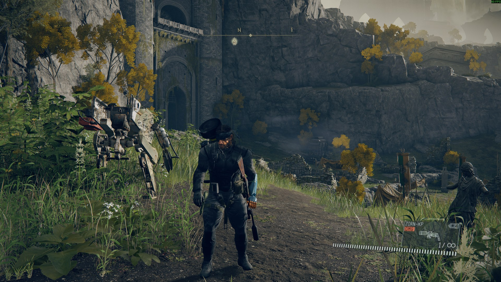
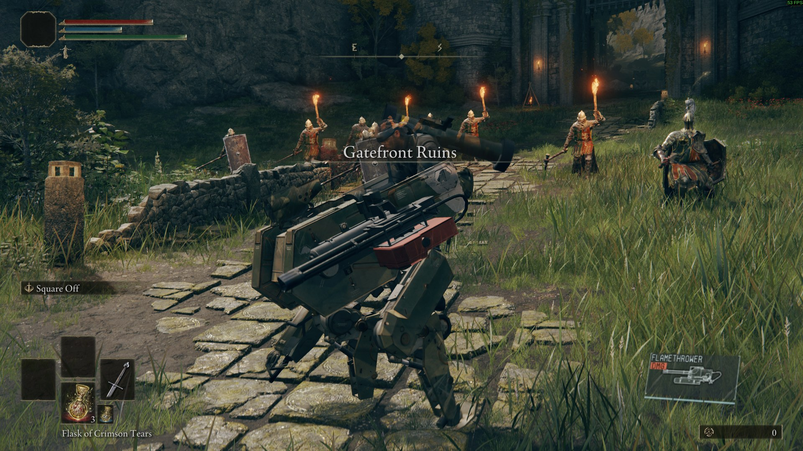

# Status (2026-11-01, 0.6.0-alpha)

The detailed record of what has been tested live, and how. The short version is in the [README](../README.md).

Tested with both games running (`pr launch`, Limgrave: Gatefront, Agheel Lake, the Stake of Marika). The last pass
(2026-10-12 evening: ~2.5 hours with both games, 10 minutes of it continuous play) drove the controller through the
plugin's test pad, with no player; "evening" below marks what it re-tested.

## 0.6.0-alpha, 2026-11-01: release integration with both games

Both real games on the default mapping (`pr launch --er-headless 3840x2160`, `pr er-continue`, the virtual pad -- exclusive since
this round, no controller plugged in: `real pad polls hidden 0`; Elden Ring 1.17.2, MGSV 1.0.15.4; ~1 h 50 min, one launch), the
player's save at Stormveil, then Stormveil Cliffside, the Church of Elleh at night, Gatefront and The First Step. The saves taken at
the start (`backups/20261101-000309`) were put back afterwards, sha256 equal file by file (15 of 15: `PhantomRing0000.sl2` and its `.bak` restored, `ER0000*`, `MGS_ER0000*`, `steam_autocloud.vdf` and MGSV's 7 files unchanged). Frames through the
host's `hud shot`; the dev console's `call setpos` was used to reach spots (a ladder's foot, the meadow by the Church of Elleh).

- **Two code reviews' findings** (the agents' round, then this one's six; commit "Review fixes: the dead bit first ..."): the puppet's
  own dead bit before every other stop reason, View + Start ignored while dying, only flasks pressed without an EquipParamGoods row,
  "pressed" for a non-consumable, a deadline per Elden Ring-only button and no cycle retry while a use is followed, placed
  explosives no longer dropped for good after a kill Elden Ring refused, the player's stick ends the odometer's stillness after a
  climb. Unit tests: `TestRevival`, `TestQuickItem`, `test_guest_logic` (AfterDeath), `TestOdoThaw`.
- **Deaths** (open item a): `pr er die` (Snake's death as MGSV reports it), a 36 m fall (`call setpos` 36 m up) and a Godrick soldier
  with a torch (Elden Ring's hits through the hit hook, the guest's own death) -- frames at 0.3, 1, 2.4, 4, 6, 9 s of each: Snake lying
  where he died (the soldier standing over him; D-Walker beside him after the fall; YOU DIED), the Tarnished in none; the death trace
  `the Tarnished hidden ... hidden by us yes ... Snake drawn (46-65 draws)` at every point to 9 s, `another character` at 15.3 s (the
  respawn load), `ER player respawned` 13.1-18.4 s after, Snake back at the grace (frames). Four more kills by the same patrol (log
  only, one framed at 11 s): the same lines. 0 `the Tarnished is visible` warnings.
- **Grenade and rocket in flight** (open item b; both switches left on): a sleep grenade (LT, an RT tap): `throw equip 378 drawn with
  MGSV's mesh from now on ... 0.22 m across` 226 ms after the release; a frame 0.5 s after it shows MGSV's blue sleep-grenade canister
  over the meadow; the blast 4.98 s later 15.8 m out. Three rockets into the open: `round bullet 46 drawn with MGSV's mesh ... 2 part(s)
  ... 0.53 m across`, hits 105-129 m out 2.4 s after the shot; 28 frames 50-170 ms apart: the rocket flies straight away from the
  camera, so only its exhaust shows (a glow at the launcher for ~0.3 s, then a shrinking white dot down range) and the orange blast.
  The guest also tagged four or five rigid meshes (0 bones) near a rocket's path: not the learned template, left out, never drawn.
- **Muzzle flash**: frames during an SVG-76 burst show orange sparks in front of the rifle.
- **Fence vault** (open item c): Limgrave's wooden rail fence AEG700_068_1003 east of the Church of Elleh -- `mantle plan`: `vault over --
  fits (face 0.49 m ahead, top 1.10 m up, 0.15 m deep, drop +0.12 m, 1.40 s)`; Y -> `Snake vaults over a 1.10 m obstacle ... (Y, squared
  up to the face) -> kHEvMantle a=110 b=1 1.40 s`, `MGSV plays it` 16 ms later, `vault over done` 1.40 s after, MGSV's move 1184 ms
  (`staged at MGSV's 100 cm obstacle`); frames: at the fence, over it bent with a hand down, standing on the far side.
  Running into it (Snake standing, from 5 m, the stick full): `Snake vaults over a 1.16 m obstacle 0.25 m deep 0.00 m ahead (running
  into it) -> kHEvMantle a=116 b=1 1.41 s`, MGSV 16 ms later (`not facing it: turned again`), done 1.41 s later, MGSV's move 1152 ms;
  frames: over the rails, then on the far side with the fence whole behind him. Earlier tries broke the fence instead: crawling
  (Snake was prone) and at a segment 1.31 m from one side, 1.45 m from the other (over `run_into_max` 1.3: it broke, as README says);
  the torch patrol's swings broke two more segments (Elden Ring's hits were set harmless with `combat set hurt_mult 0` for the fence
  runs, 1 again afterwards).
- **Memory of Grace's question** (open item d): Start -> Inventory -> Tools -> Memory of Grace -> Use with Snake playing: `menu watch:
  Elden Ring's dialog box is up (a question) -- Elden Ring has the pad until it closes`, `menu OPEN ... DIALOG BOX up`, no MGSV HUD over
  it (frame); B held 300 ms meanwhile: MGSV's pad `Connected|Neutral buttons 0` in all 12 samples; NO (selected by default) with A ->
  `dialog box closed`, the place and runes unchanged, MGSV's HUD back (frame).
- **Flasks**: after a 14.7 m/s landing (`fall damage 30%`, then 61% of the HP bar) View then X 150 ms later -> `Elden Ring healed 250 HP
  (37% of 680) -> Snake +2868 life (kHEvHeal 717)`, `used 1336 ms after the press, 2 left`; View held 600 ms then X -> drunk, no
  iDroid; View held 1.5 s -> `View held 400 ms+ (still held after 1000 ms) -> MGSV Start held 1200 ms`, the iDroid (frame), the X at
  1.5 s MGSV's; View 600 ms let go -> the iDroid at the release; a View tap -> Elden Ring's map; View + D-pad down -> the next item
  (each of six switches took the second press: `the quick slot is still 0 -- one more press`); the Cerulean flask drunk to 0, the
  switch's corner "Quick item: Flask of Cerulean Tears (empty -- rest at a grace)" (frame), View + X then `refused (empty)`.
- **Ladder** (Stormveil's AEG219_067_4000, 14.5 m; its foot found in Tarnished mode: `prompt 5000` 0.48 m before it, 0.22 m to its
  side): up `+14.6 m` in 18.8 s with a 5 s stop at +7 m (`kHEvClimb ... still on it at 0.00 m/s`, +6.991 m at both ends of the stop,
  frames 2.5 s apart: the same pose, hands on the rungs), `15.5 m climbed in MGSV, 4 moved along MGSV's ladder (seamless), 0 loops`;
  down ("Descend", `prompt 5010`) `-14.5 m` in 19.1 s with a 4.5 s stop, `16.1 m, 4 moved, 0 loops`. The Tarnished nowhere (frames).
- **The stick after a ladder** (open item e): Elden Ring's climb over (none) at 0, the stick pushed +53 / +35 ms, MGSV home +205 /
  +195 ms, the puppet ON +301 / +317 ms, the guest `the player's stick 110 / 122 ms after the move -- Snake's motion counts again`,
  Snake walking in MGSV +522 / +440 ms. Before this round (real MGSV) a stick pushed 162 ms after the end never moved him in 3 s.
- **D-Walker** (open item f): Gatefront, a 22 s run: 127 samples, **median 2.81 m, p90 2.81, max 2.82** (target < 3.5; it was 4.83 /
  6.7 / 10.0), 2.4-2.6 m standing after; a run out of the Church of Elleh's grace (it started 5.6 m away): 2.79 / 3.43 / 4.28. Frames of
  a 27 m run: beside Snake on his left in every one, legs walking. Once it stood between him and a fence he walked at.
- **Regression** (README How to play, each once, The First Step): run, camera, A crouch / stand, R3 (`Snake jumps -- 1.20 m up at 3.5
  m/s`), X dive (`hop #1: 0.60 m up`), LT + RT fire (the tranquilizer pistol 7 -> 6 rounds), B reload (6 -> 8), D-pad up / down (weapon
  0x7 -> 0x24 -> 0x7), RB binoculars (`marking: binoculars up`), LB call menu, Start (Elden Ring's menu) and B, View tapped (its map) and
  B, View held (`View held 400 ms+ (let go) -> MGSV Start held 1200 ms` -> `MGSV menu open (kGuestInMenu)`) and Start, View + Start
  (`Tarnished mode ON` / `OFF`), View + X (`Flask of Crimson Tears used 914 ms after the press, 3 left`).
- **10 minutes of continuous play** (The First Step; 318 actions in 600 s: runs, walks, camera, stances, jumps, dives, aim and fire,
  reloads, weapon switches, binoculars, the call menu, Elden Ring's menu and map, the iDroid, the chord, flasks): both sides alive
  throughout (heartbeats 4-29 ms at the end); 10 jumps (3 refused crouched / prone), 9 dive hops, 6 Tarnished-mode round trips, 5
  iDroids, 19 shots, 6 flasks drunk (2 presses in the air after a jump: `its count didn't drop within 3000 ms`); one run off The First
  Step's cliff (`landed at 21.8 m/s -> fall damage 100%`), respawn 14.1 s later, the death trace hidden throughout; **0 warnings and 0
  errors** in either log for the 10 minutes. The whole session: the host log 0, the guest log one warning (`life: native playerLife
  write did not stick (7801 -> 7149 written, 7801 now)`, once, in the torch patrol's fight).
- **A Tarnished-mode death** (`tarnished on`, `pr er die er`, the torch patrol around): frames at 0.3-9 s show the Tarnished dying and
  lying by the fence and no Snake anywhere (the ER agent's fix: Snake was drawn over him before); `the Tarnished died while Snake
  wasn't playing -- Snake takes over after his respawn`, respawn 18.4 s later. A View + Start held 1.4 s during that death counted
  no chord at all (nothing for `ChordRefusedWhileDying` to refuse: unit-tested only).
- Seen in the traces: after each respawn load the new player object is fully visible (`the Tarnished VISIBLE ... base transparency
  0.92 ... another character`) for up to ~4 s while Elden Ring's loading screen is still up, and hidden in the frame it closes (the
  puppet's start); no frame showed him.
- Not done: spirit ashes, hiding a real controller (none was plugged in), the View + Start refusal during a death (no chord counted).

## 0.6.0-alpha, 2026-10-31 night: the round's work with both games

Both real games on the default mapping (`pr launch --er-headless 3840x2160`, `pr er-continue`, the virtual pad; Elden Ring 1.17.2,
MGSV 1.0.15.4; ~1 h 50 min, one Elden Ring-only relaunch with MGSV kept running), the player's save at Stormveil, then Gatefront,
the Church of Elleh and The First Step. A DualSense was plugged in with its left stick resting pushed and stray presses now and
then; the run kept it out of Snake's way by injecting a near-zero stick between its own presses (its buttons still came through:
they opened Elden Ring's menus twice and a Memory of Grace question once, and Renna's talk at the church at night gave the Lone Wolf
Ashes). The saves taken at the start (`backups/20261031-205326`) were put back afterwards, sha256 equal file by file; that undid
the talk.

- **The review's nine findings fixed** (commit "Review fixes", unit tests in `test_guest_climb`, `TestClimbPace`, `TestStagedFacing`).
- **Flasks as Snake** (View held + X): after a 15.5 m/s fall (42% of his life) `Elden Ring healed 250 HP (37% of 680) -> Snake +2868
  life (kHEvHeal 717)`, Snake 4570 -> 7438 / 7801 1.5 s after the press; the count 4 -> 3 -> 2 -> 1 -> 0 (`Flask of Crimson Tears used
  917 ms after the press, N left`); the fifth refused (`empty: refused`, the corner "Flask of Crimson Tears: empty -- rest at a
  grace"); walking through a drink Snake moved ~5 m; frames: only Elden Ring's flask (glowing, in the air at his chest) of the
  Tarnished, never his body.
- **Ladders, seamless** (Stormveil's AEG219_067_4000, 14.5 m): up `+14.6 m` in 18.9 s with a 5 s stop half way (`kHEvClimb a=1 b=0
  (still on it at 0.00 m/s)` -> guest `now up at still (on the rungs)`; frames 2.5 s apart in the stop: the same pose), `15.0 m climbed
  in MGSV, 4 moved along MGSV's ladder (seamless), 0 loops`; down `-14.5 m` in 14.0 s, `15.7 m, 4 moved, 0 loops`; frames at three
  points up: hands on the rungs, the Tarnished nowhere. After both climbs the puppet started with MGSV still at its ladder: `delta
  from his facing before it (known)` -> `MGSV has Snake home -- delta 2.280 -> 2.280 rad` (no turn). Guest-only checks: `!climb off`
  then `!climb up` 70 ms later -> `a new climb (up) while the last one ends` -> climb #4 84 ms after the last; `!climb up`, then
  `pr stop --er` -> `climb: ended here -- Elden Ring is gone (no heartbeat)`, back on the sandbox 0.18 s later; the relaunched Elden
  Ring had `Snake driving` 21 s after its plugin loaded.
- **Climb-ups** (the Church of Elleh's rubble): Y onto 1.71 m -> MGSV's drum (`MGSV's move took 1988 ms ... rose 1.20 m`) and 0.57 m ->
  the crate (2002 ms, 1.12 m), a 1.15 m one from the console -> the drum (1971 ms); `2 Y presses kept from MGSV`. Elden Ring's path
  ended 0.6-1.0 s before MGSV's move: `[Mantle] climb_base_s` 1.8 + `climb_per_m` 0.2 now -- after the relaunch Y onto 1.69 m:
  `climb up done` 8 ms after MGSV's `move over`. Frames through each: hands on the top, a knee up, standing on it, facing the face.
- **Grass** (Gatefront, rain, late day; 198 peeks of 16 x 16 over Snake standing in it): 50,688 texels, 31,500 of them Snake's, 669 covered
  by grass in front of him, 0 by anything behind him; frames: blades across his boots in front, none through him from behind.
- **Muzzle flash**: an orange spark in front of the rifle in the frame of a shot (29 -> 28 rounds). Grenades and rockets in flight
  were not framed (the D-pad presses picked the rifle and a mine instead).
- **Placed explosives at a death**: a sleep mine set (`mines: mine 1 placed`), the Tarnished killed -> `placed #1: equip 418 dropped (the
  Tarnished died) -> kGEvPlacedGone; in MGSV removed`, `mine 1 gone (MGSV)`, respawn 18.4 s later, nothing announced again.
- **D-Walker** (running 18 s, MGSV's sandbox positions at ~5 Hz): follow distance median 4.83 m, p90 6.7, max 10.0 (target < 3.5: not
  met); MGSV's output meanwhile (`[Audio] Meter` on for this run only) median -36.5 dBFS, loudest half-second -34.6, peak -17.8.
- **Punches** (the second ~25 HP of pass B, COMBAT 7a): `combat strike` on a Stormveil soldier, free 317 -> 274 -> 234 -> 194 and held in
  place 194 -> 154 -> 114, `wanted -40` each; the real MGSV's punches on a Gatefront soldier 219 -> 192 -> 165 (`wanted -27`); HP read
  ~14 times a second for 2-4 s after each: never a second drop.
- **Regression** (README How to play, each once, The First Step): run, camera, A crouch / stand, R3 (`Snake jumps -- 1.20 m up`), X
  dive (`hop #1: 0.60 m up`), LT + RT fire, B reload, D-pad up / down (weapon 0x1a2 -> 0x24 -> 0x7), RB binoculars (`marking: binoculars
  up`), LB call menu, Start (Elden Ring's menu) and B, View tapped (its map) and B, View held (`MGSV Start held` -> `MGSV menu open
  (kGuestInMenu)`) and Start, View + Start (`Tarnished mode ON` / `OFF`), View + X (`Flask of Crimson Tears used ... 3 left`).
- **10 minutes of continuous play** (The First Step; 317 actions in 601 s: runs, walks, camera, stances, jumps, dives, aim and fire,
  reloads, weapon switches, binoculars, the call menu, Elden Ring's menu and map, the iDroid, the chord, flasks): both sides alive
  throughout (heartbeats 2-20 ms at the end); 8 jumps, 8 dive hops, 7 Tarnished-mode round trips, 6 iDroids, 10 flask presses (4
  drunk, 6 refused empty); **0 warnings and 0 errors** in either log for the 10 minutes (MGSV's log for the whole session: one
  warning, the deliberate Elden Ring stop mid-climb). Snake died to an enemy 24 s after the run; in a frame 2.4 s later the Tarnished
  showed, kneeling, and Snake wasn't drawn -- the death visuals should keep the Tarnished hidden (HOST.md "Death visuals"); seen
  once, not reproduced (the games were stopped for the restore).
- Not done: running into a rail fence (none found intact in reach), a vault by Y (the one vault spot found was 2 degrees wide; the
  console chose a climb there), Fort Haight's 19 m tower, spirit ashes, a grenade or rocket framed in flight.

## 2026-10-31 evening: host round -- flasks, rougher ledges, grass, muzzle flashes and projectile meshes (Elden Ring alone)

Elden Ring 1.17.2 with stand-in guests only (`pr launch --er-only --shm /dev/shm/phantomring_h --er-headless 3840x2160`, fake MGSV
and the MGSV agent's real-MGSV recordings, the virtual pad; ~1 h 45 min, eight launches as fixes went in), the player's save at
Stormveil, then the Church of Elleh and Gatefront. The saves taken at the start (`backups/20261031-184141`) were put back
afterwards, sha256 equal file by file (8 of 8). Details in docs/HOST.md.

- **Flasks without leaving Snake** (View held + X; View held + D-pad down switches): four Crimson Tears drunk, each `Elden Ring
  healed 250 HP (37% of 680) -> Snake +2204 life (kHEvHeal 551)` 0.9 s after the press, the fake's life 3000 -> 5204, the corner
  "Flask of Crimson Tears: 3 left" ... "none left", the fifth refused ("empty -- rest at a grace", HP unchanged); drinking while
  walking kept him moving; the Cerulean flask used; switching both ways; MGSV's pad never saw X, View or D-pad down; frames:
  only Elden Ring's flask shows during the drink, at his chest.
- **Ledges**: Gatefront's boulder that had Snake stuck against its 0.40 m lip -> Y climbs it (+0.76 m); a Church of Elleh boulder
  at 21 degrees -> `squared up to the face`, +0.88 m; the church's low wall vaulted running into it (1.03 m). Rail fences: they
  break when walked into; the vault-instead-of-break change is not yet seen live (the Tree Sentinel killed Snake there once).
- **Grass**: of ~52,000 of the real Snake's texels in tall grass (dusk, noon), 3383 covered by grass -- all of it in front of him,
  none behind; `gbuffer_point last` / `clear` frames side by side show the old see-through and the fix.
- **Muzzle flash** (a ~0.4 m burst of sparks) and **projectile meshes** (MGSV's grenade and rocket learned from the tagged
  recordings, the grenade flown as MGSV's mesh) on by default; **MGSV's HUD** cut for the first 1.6 s of a climb; a **floor of
  light** on Snake (`min_ambient` 0.004) drawn only where he is the nearest surface.
- Not run: the real MGSV, spirit ashes, a dark tower, Limgrave's fence vault, keyboard Tab + Space.

## 0.5.0-alpha, 2026-10-31: ladders, climb-ups, vaults and the uphill jump with both games

Both real games on the default mapping (`pr launch --er-headless 3840x2160`, `pr er-continue`, the virtual pad; Elden Ring
1.17.2, MGSV 1.0.15.4; ~2 h, four launches as fixes went in), the player's save at Stormveil, then Stormveil Cliffside, the
Church of Elleh, Agheel Lake North and Fort Haight. The saves taken at the start (`backups/20261031-172409`) were put back
afterwards, sha256 equal file by file; MGSV's saves were unchanged by the session.

- **Ladders, Snake on them himself** (`[Ladder] snake = on`; the guest stages Snake at an airport wall ladder in MGSV and plays
  its own climb, GUEST.md 22): Stormveil's AEG219_067_4000 (14.5 m) up in 15.4 s and down in 16.5 s; Fort Haight's tower
  ladder AEG030_902_2001 up +18.9 m in 17.8 s and down -18.9 m in 18.8 s. Each time: `ladder: the climb started (484-516 ms
  after the press)`, `MGSV plays Snake's climb (kGuestClimbing) 33-34 ms after kHEvClimb`, MGSV on its ladder 0.13-0.5 s after Y,
  1-2 loops per climb, back on the sandbox 0.18-0.23 s after the end (1.6 s once: the end came in the middle of a mount from the
  roof), `Snake was drawn on it (MGSV played the climb)`, "Descend" started 484-500 ms after the press. Frames at 3-4 points of
  each climb: Snake in MGSV's climbing pose, hands and feet on Elden Ring's ladder, the Tarnished nowhere, Elden Ring's ladder
  camera; Snake in control at the top and the bottom.
- **Climb up / vault** (`[Mantle]`): Church of Elleh, D-Walker following ~2.4 m away in MGSV. Y onto a 1.09 m ruined wall:
  `kHEvMantle a=109 b=0 1.24 s` -> `MGSV plays it (kGuestMantling)` 16 ms later -> on top, +1.31 m; Y over a 0.52 m ledge: 0.68 s,
  then 1.23 s once paced to MGSV's vault (MGSV 1.19 s from its Y). Found and fixed: Y there mounted D-Walker at Stormveil
  (it now never reaches MGSV while a ledge fits: `1 Y presses kept from MGSV`), and MGSV's jersey barrier, where the guest stages
  the vault, was drawn in Elden Ring under Snake (`staging-site props dropped 335`, gone from the frames). Running into a ledge
  at a slant slid along it (not re-verified with MGSV; the stand-in climbed it straight on).
- **Jump** (R3): up 17, 14 and 24 degree slopes at Stormveil Cliffside, running: +0.90, +1.22 and +1.21 m over the take-off
  (before the fix such a jump ended on its first frame, 2 cm up); standing 1.20 m; refused under a ceiling (`a ceiling lower
  than him`).
- **Hints**: "R3: jump onto it -- Y: climb up" in the corner walking into the 1.03 m wall (now one per encounter, 20 s apart).
- **Regression** (README How to play, one control at a time): run, camera, A crouch / stand, R3, X dive (`hop #1: 0.60 m up`),
  LT aim + RT fire (7 -> 6 rounds), B reload, D-pad up / down (weapon 0x7 <-> 0x24), RB binoculars (`kGuestBinoculars`), LB
  call menu, Start (Elden Ring's menu) and B, View tap (its map) and B, View held (MGSV's iDroid, `kGuestInMenu`) and Start,
  View + Start (Tarnished mode on and off). Quick throws: 4 of 4 sleep grenades on 50 ms RT taps with LT held
  (`RT taps held to 120 ms while aiming`).
- **10 minutes of continuous play** (Fort Haight and Agheel Lake North; 253 actions: runs, jumps, crouches, dives, aim and fire,
  throws, Y, binoculars, the map): both sides alive throughout (heartbeats 2-29 ms), one death to Fort Haight's soldiers ->
  YOU DIED -> respawn 18.7 s later with life and ammo refilled (`the Tarnished has 0 HP ... Snake waits` in between), one 17 m
  fall (62% of his life); **0 errors and 0 warnings** in either log.
- Also found: Elden Ring's origin shifted 32 m mid-climb and the ladder summary read "-13.1 m up" (fixed); `call setpos` into a
  spot not yet streamed dropped the (puppet-less) Tarnished through the ground twice (a dev-console path, not play).
- Not done: Elden Ring's grass over Snake, C4 placed in the frame Snake dies, D-Walker's footstep volume; MGSV has one climb-up
  for every height.

## Elden Ring 1.17.2 (eldenring.exe 2.7.2.0), 2026-10-26: live regression

Steam updated Elden Ring on 2026-10-21. The host has a 2.7.2.0 address table next to the 2.7.1.0 one (picked by the exe's
identity): 80/80 entries verified on the 2.7.2.0 exe (`verify_er_addresses.exe`, `er_aob_scan.py verify` 103/103), every
function diffed against 2.7.1.0's, and WorldChrMan's two moved fields (`chr_cam`, the by-distance list: +0x10) per build.
The regulation's only change (Bullet 20003309) is not a row PhantomRing uses. Details: [HOST.md](HOST.md#elden-ring-builds).
Everything in the older sections below was live-tested on 1.17.1.

Then, the same day, both real games on the default mapping (`pr launch --er-headless 3840x2160`, `pr er-continue`, the
virtual pad; ~75 minutes, one Elden Ring launch and one MGSV restart), the player's save at Stormveil Cliffside, then
Gatefront (fast travel); the saves taken at the start were put back afterwards. Nothing the update could have moved broke:
no code change was needed, and the host log has 0 warnings and 0 errors.

- **Launch.** me3 0.13.0 as before: `Attaching to ELDEN RING(TM) 1.17.2.0 Worldwide`, dearxan `1597 stubs found`,
  `2956 patches` (2944 on 1.17.1), `Arxan is now neutered`, online off, the profile's native loaded; its INFO lines are the
  1.17.1 run's apart from the version and ids, and there is no "could not detect game version" or asset-hook failure. Host:
  `exe identity OK: eldenring.exe 2.7.2.0 (App 1.17.2 WW)`, `address table (eldenring.exe 2.7.2.0): 80/80 verified`,
  `216 singletons named`, all eight tasks registered: not inert.
- **Boot.** The guest attached 0.15 s after the host; Africa and D-Walker ready 2 min 21 s after the host plugin loaded ->
  `in game, Snake driving`, "Snake is in control" in the corner.
- **Rendering.** Stage C into Elden Ring's G-buffer from the first frame (236,912 frames, 0 stage C fallbacks, 0 missing or
  bad draws; its view constants matched 7891 of 7891 checks), Snake in the sun's shadow atlas, solid in every frame looked
  at; MGSV's HUD layer and the corner text; night vision on and off; the cardboard box with its poster.
- **Camera and compass.** `compass follows MGSV's camera (chr_cam ... rewritten before ER's compass update)` -- `chr_cam` is
  one of the two moved fields -- and the compass turned with the camera in every frame.
- **Movement.** Walk and run (6.3 m in 1.5 s at full stick); walls stop him. Stormveil's cliffside: two running jumps (R3,
  `1.20 m up`) up the rock steps; from Tarnished mode set on the plank walkway (`below the start: -0.02 m (ground_filter)`),
  he stood 25 s and walked it at 15.08-15.09 m, then climbed the wooden stairs to the 19.9 m landing (15.09 -> 19.92 m) with
  no `left the ground`. Dive = hop: `hop #1: 0.60 m up`. A walk off the cliff (a world shift had moved the coordinates the
  test script steered by): `left the ground`, `landed at 18.1 m/s -> fall damage 77%`.
- **Combat.** Rifle: headshot, `bullet route CONFIRMED`, the soldier killed. Rocket: the round hit an enemy 50.9 m away,
  Elden Ring's blast (Bullet 10030001), killed, +64 runes. Sleep grenade: Elden Ring's Sleep Pot mist, r 9 m. Two hand
  grenades: `lethal blast r 7.0 m`, Elden Ring's fireballs. Tranquilizer headshot `sleep +249 (resist 226)` -> asleep (his
  threshold raised to 268). CQC: strike -> `grab -> hold` -> `choke -> sleep +249` -> asleep, then MGSV's Fulton on his stand-in
  -> `kGEvFulton a=1` -> `out of Elden Ring's world`, +64 runes. C4 placed and set off by the guest's backup: `lethal r 8.0 m
  where it lies`. The E-STUN decoy thrown: `shock decoy 5 set`; a console decoy: `hears the active decoy ... stops to stare`.
- **Elden Ring's hits.** `hit hook 79 HP -> kHEvHurt 227` twice: Snake 7801 -> 5998. Seven deaths (soldiers' hits; one a torch
  that set him on fire): `Snake died` -> `ChrIns::Kill` -> YOU DIED (or the revival choice) -> respawn,
  `kHEvRested 1`, life and ammo refilled.
- **Menus.** Start -> Elden Ring's menu, B closes it; View tapped -> the map; View held -> MGSV's iDroid, Start closes it; the
  View + Start chord 22 times both ways; fast travel from the map's grace list (Stormveil Cliffside -> Gatefront).
- **Interactions.** Rest at a grace -> `kHEvRested 0`, ammo refilled; lost runes picked up twice (ActionButtonParam 1000).
- **Buddies.** D-Walker followed and was placed next to Snake at both places; ridden (`Snake mounted`, 18 m in 2.5 s,
  dismounted with Y held); changed to D-Dog in session (`D-Dog deployed`, drawn), D-Walker again after an MGSV restart (the
  guest re-attached, attach #2, Snake driving 2 min 25 s later).
- **Also.** Binocular marking (`marked ... at 28 m`, the red triangle, kept after the binoculars); the Phantom Cigar
  (`+722 min` -> Elden Ring `09:18 -> 21:20`, 145 writes); 4 minutes of random play (104 actions: walks, runs, camera,
  stances, weapon switches, aim and fire, maps, iDroids, chords, jumps), Snake driving after every one, 0 warnings.
- **Not run:** a boss's mist (the only one on this save's reachable graces is Godrick's, left alone), a ground item other
  than lost runes, keyboard and mouse, D-Horse, full proxies; 2.7.1.0's table (its exe is no longer installed).

Seen during the run, none of it from the update (MGSV, the guest and these code paths are unchanged):
- MGSV ignored short RT presses for a throw or a placement: about 20 grenade, C4 and decoy attempts with 0.15-0.8 s presses
  threw once; RT held ~1.5 s while aiming (LT), then let go, threw or placed 5 times out of 5. An unaimed RT with C4 or a
  grenade in hand is MGSV's punch.
- A C4 placed in the very frame Snake died was announced after the respawn and kept at the grace (`mines: mine 4 placed`)
  instead of being discarded as one placed before a load.
- A move refused by a ceiling fired the bump breaker once through (0, 0, 0) (the bump's wall point was never set).
- A Fultoned soldier was picked by the decoy-stare rule during his lift (he left the world 0.3 s later).
- Each Stormveil or Gatefront soldier's hit costs Snake ~11.6% of his life (79 of the Tarnished's 680 HP; `hurt_share`):
  standing in a camp's open he dies in seconds.
- `pr er chr`'s distance column is the by-distance list's own value: the distance less 5 m for active characters, stale for
  far inactive ones (the actor table filters on it).

## Live passes A and B, 2026-10-14/15 night (real MGSV + Elden Ring, both on the default mapping; 0.4.0-alpha)

Every feature of rounds 1 and 1b (keyboard and mouse, binocular marking, the Phantom Cigar, dive = hop, CQC holds and throws,
projectile meshes and muzzle flashes, C4, the D-Horse treadmill, full proxies, material colours, solid ground, the jump,
decoys) was run with both games, then a regression pass over README's How to play and 10 minutes of continuous play; results,
fixes and the defaults they set are in [FEATURES-1.md](FEATURES-1.md) ("Live pass A", "Live pass B").

## Combined run, 2026-10-14 afternoon (real MGSV + Elden Ring, both on the default mapping; 0.3.0-alpha)

Three launches (`pr launch --er-headless 3840x2160`, the virtual pad; one Elden Ring relaunch for a fix), ~2.5 hours, the
player's save: their spot in front of Stormveil's main gate (the Erdtree over the castle), the Stormveil Main Gate grace, the
Roundtable Hold and its basement stairs, Gatefront. Every item checked by frames and both logs; the save was put back afterwards.
The player's session-6 reports, item by item:
- **See-through Snake and D-Walker: fixed.** `render set gbuffer_point last` (the old point) / `clear` (the default) a second
  apart, same frame otherwise: at the player's spot at 03:00 and at noon the brazier and its pillar show through D-Walker and
  Snake is dark with `last`, both solid and lit with `clear`; at the grace at noon and 23:00 the gate's lattice shows through
  Snake's back and legs with `last`, never with `clear`; the player's haze view (fog, rubble, the brazier) is solid now. The
  Tarnished (Tarnished mode) at the same spots and times is lit by the same light.
- **Stuck under the Roundtable Hold's basement stairs: fixed.** The staircase found by a floor scan (HOST.md "Low ceilings");
  four lanes under it: standing, Snake stops where 1.85-2.01 m of room is left, crouched where 1.32-1.57 m is, standing up there
  and walking out works in every lane; corner pushes end in `stuck at ... back to ... where he stood free`. Found and fixed on the
  way: a crouched Snake crept under the treads through the seams between them (to a 0.57 m ceiling) and was then held for good
  by a lower stringer; a free one could take moves ending under a 1.6 m underside.
- **View, then Start: the chord.** Start 550 ms after View: MGSV's iDroid flashes open for ~1 s and closes by itself, Tarnished
  mode 1.0 s after Start (three times); Start then View: Snake back; View held alone: the iDroid, Start closes it.
- **Buddies from MGSV's menu.** Dismiss D-Walker, deploy D-Horse, D-Dog, D-Walker again, each with the iDroid through the pad
  (the host's corner: "D-Walker dismissed -- no buddy now", "Buddy: D-Dog is out"); D-Dog follows and marks Elden Ring's enemies.
- **Fulton of a sleeping Elden Ring soldier: works.** Gatefront: two darts, walk up, MGSV's Fulton prompt and "ZZZ" marker over
  him, Y held -> 5 s later Elden Ring's balloon lifts him away, gone, +64 runes (HOST.md "Fulton"). Elden Ring's sleep lasts ~50 s.
- **Full proxies (`!proxy on`, off by default): not ready.** With the real host MGSV went to alert phase 3 within 80 s and an MGSV
  riot-shield reinforcement shot Snake on the apron (GUEST.md 20.5); kept off, the guest now warns when MGSV's alert phase leaves 0.
- **How to play pass** (README, scripted with the pad): A crouch/stand, A held prone, run, X dive (5.7 m), camera, D-pad up/down
  (rifle, pistol), LT aim, RB first person while aiming, RT fires (ammo 8 -> 7, the dart into Elden Ring's world), B reload, D-pad
  right + LT (the arc) + RT throw, LB order (`the player's order 20 -- "D-Walker: Whistle"`), Start menu + B, View map + B, View
  held iDroid + Start, the chord both ways, NVG (green night vision), the cardboard box on and off (RT), Y mounts D-Walker, a
  17.5 m ride, Y held gets off, a rest at the grace (`kHEvRested 0`, grenades 7 -> 8), fast travel (six), two deaths at
  Gatefront and the respawns (`kHEvRespawn, kHEvRested 1`).
- **10 minutes of continuous play** at the Stormveil Main Gate grace (the player's spot; scripted, 602 s: 65 walks/runs, 49
  pans, 21 stance changes, 2 dives, 15 weapon switches, 12 reloads, 13 aimed shots (4 in first person), 7 grenades, 10 item
  uses (box/NVG), 7 LB orders, 10 Tarnished-mode round trips, 6 Elden Ring menus, 10 maps, 10 iDroids): Snake in control after
  every action, **0 warnings and 0 errors in both logs** -- the whole Elden Ring session (the stairs tests, the regression pass,
  the play) and the whole second MGSV session (2.5 hours of it).
- **Review fixes** (2026-10-14): damage_route speffect's guarded misses no longer confirm the ladder, collect-logs.cmd never zips
  dxdiag's raw report, the proxies are suspended while the frame skips them and refused without `[Boot] DisableSoldiers`.
- Found: D-Dog's coat sometimes in false colours (orange/green), D-Walker right next to the camera in magenta (MGSV's near-camera
  fade); the cardboard box drawn very dark; the stage C "no G-buffer bind seen yet" after every ResizeBuffers was a warning (20 in
  the player's session 6): now info, warned only if it lasts 120 frames.

## Combined run, 2026-10-13 morning (real MGSV + Elden Ring, both on the default mapping; release 0.2.0-alpha)

Two launches (`pr launch --er-headless 3840x2160`, the virtual pad; the second with `PHANTOMRING_BUDDY=horse`), ~50 minutes;
the player's save at the Castleward Tunnel grace, then Gatefront, Fort Haight and the Stormhill Shack. Logs and screenshots were
looked at for every item; the save was put back afterwards (sha256 equal to this session's first backup).

- **Versions**: both logs' first lines `PhantomRingHost v0.2.0-alpha (commit ..., protocol 11)` / `PhantomRing guest (dinput8.dll)
  v0.2.0-alpha (...)`; a stand-in guest naming protocol 12 / v0.3.0 -> Elden Ring's corner in red "PhantomRing versions differ:
  Elden Ring plugin v0.2.0-alpha, MGSV plugin v0.3.0 -- reinstall both"; one naming nothing -> "... MGSV plugin from before
  v0.2.0-alpha ..." after 15 s; both gone when it stopped. `pr doctor`: 19 ok, 1 warning (backups 23.7 GB), 0 failures.
- **Regeneration** (MGSV's post-hit curve, `[Combat] RegenGate`): an 18% fall held ~3 s, then MGSV's ramp, full 7.25 s after
  the hit (gate off: 2.0 s). Margit, Snake standing still: gate on, dead after 5 hits in 12 s (again ~17 s); gate off, 22 hits
  in 75 s and alive. Life may tick up 50-140 for a moment before the curve's first write (GUEST.md 18.15).
- **Ladders** with the real MGSV (Fort Haight's tower): up three times (+19.1 m, Snake in control at the top), down once
  ("Descend" when he faces the hole, -18.8 m). Walking on into the hole from the top dropped him down the shaft twice (92%).
- **D-Horse** (`PHANTOMRING_BUDDY=horse`): deployed and drawn beside Snake, whistled over by itself, mounted with the horse's
  values; on Stormhill's open slope 98.3 of 98.3 m asked in 8 s at a 15-16 m/s gallop; into the shack's ruins: blocked and one
  unstick; off a 13 m ledge: 55% fall damage; `!buddy walker` back to D-Walker in 1 s. 0 warnings in that session.
- **Progression** (live switch between shots at one soldier): off 35, level 31, weapon 35, both 31; back to off.
- **Root motion vs kinematic**, 4 minutes each on the Stormhill loop: kinematic 63% of legs / 73.3% of the distance, root motion
  64% / 65.5%, 0 warnings each: kinematic stays the default.
- **10 minutes of continuous play** (Stormhill Shack; scripted: 20 walks, 15 stance changes, 10 dives, 10 grenades, 10 NVG round
  trips, 10 D-Walker whistles, 9 weapon switches, 9 maps, 7 Elden Ring menus into Equipment/Inventory, 7 boxes, 6 iDroids, 6
  Tarnished-mode round trips, 3 bursts with reloads): 0 problems in the script's checks, **0 warnings and 0 errors in both logs**.
  A rest afterwards: `kHEvRested 0` -> `stocks ... 1->8` (Melina sat down instead of the grace menu, as before).
- **Found and fixed live**: in that play Snake walked into the shack and was stuck for good -- only the waist ray was blocked
  all round, and the boxed-in check looked at the knee and chest only; it now counts every probe height (seen working in the
  D-Horse session: `boxed in ... back to where it stood free`).
- Whole run: the host logged only the two deliberate version-mismatch errors; the guest one warning, during the gate-off A/B at
  Margit (a life write that did not stick).

## Combined run, 2026-10-13 (night; real MGSV + Elden Ring, the player's save at Margit)

Both games on the default mapping (`pr launch --er-headless 3840x2160`, the virtual pad), ~1 h, two launches plus an
MGSV-only relaunch; Castleward Tunnel and Margit's arena. Logs and screenshots were looked at for every item.

- **Tarnished mode** (View + Start held 1 s): 28 toggles, Elden Ring's menu never opened, MGSV's iDroid never opened, the guest
  parked and back each time (`tarnished mode: on -- Snake parked` / `off -- Snake has the pad again`); the Tarnished walked
  3.5 m and Snake took over there; mid-fight the Tarnished drank a flask (74% -> 100%) -> `Snake +2044 life (kHEvHeal 511)`.
- **Refill**: rest -> `kHEvRested 0` -> `magazines 36:17->30; stocks 197->210`; every respawn -> `kHEvRested 1` -> life 7801 and
  `36:4->30; 184->210`.
- **Fall watchdog**: 150 m above the grace -> `falling 3.5 s, 60 m with no landing -> Snake dies of the fall` -> respawn.
- **Margit**: "Traverse the mist" shows while Snake plays; Y -> `puppet steps aside for 4500 ms` -> through -> `puppet back`,
  Snake inside, his bar up and `menu closed` (its entries `HUD too`), three times. 26 rounds 12.7%, 30 rounds 14.4% of his
  4174 HP; his hits 11-45% of Snake's life (29 hits); deaths -> the grace -> fog again with full ammo. Never below 85%.
  The intro cutscene doesn't play again on this save: the skip fix is unit-tested only.
- **Night vision**: the goggles from MGSV's item wheel -> green night vision over the world and Snake, under Elden Ring's HUD
  and menu; with `nvg_curve` (new) the dark tunnel's mean brightness 8 -> 81 of 255, the night arena 41 -> 131.
- **Aim assist**: `boot: auto-aim correction: off (was on)`; 50 aim directions, no snap (<= 5.7 deg, parallax).
- **Esc**: `menu OPEN` / closed with Esc, MGSV's HUD layer hidden meanwhile.
- **Found and fixed live**: after the grace's "Pass time" Elden Ring showed the grace menu again 4.7 s later with Snake holding
  the pad (B reloaded, the menu could not be closed): sitting at a grace now keeps Elden Ring's screens Elden Ring's; the guest
  warned that a life write "did not stick" on Margit's hits that had (MGSV's regeneration): the check fixed (0 in 11 hits).
- **How to play pass**: A crouch/stand, A held prone, X dive (7.2 m), B reload, D-pad down/up/right (handgun, primary,
  grenade), RB first person while aiming, Start menu, View map (and fast travel: Snake back 5 s after the load), View held
  iDroid (Start closes it), LB order (`D-Walker: Whistle`), Y mounts D-Walker first try, riding, Y held dismounts, the box,
  a sleep grenade thrown at Margit, a CQC strike (standing; crouched RT does nothing), a rocket fired and exploding.
- **10 minutes of continuous play** (scripted: 24 walks/runs, 21 pans, 14 stance changes, 11 dives, 10 bursts with reloads,
  10 weapon switches, 20 grenades, 11 NVG toggles, 13 D-Walker whistles, 14 Tarnished-mode round trips, one rest): 0
  warnings and 0 errors in both logs (the guest's one false life-write warning came 7 minutes earlier, in the Margit fight).
- **Root motion** with the real MGSV: 100% of the asked distance on the same loop where kinematic gave 74%.
- **Found and fixed live, second part**: Start -> Inventory (or Equipment) gave A/B/D-pad to MGSV inside the inventory (D-pad
  right switched Snake's weapon, only Start got out), and one A acted twice (the inventory and an item's context menu; in
  Equipment it opened the right-hand list): Elden Ring's HUD hiding inside a menu now keeps the menu open and a submenu
  replacing its menu arms at once -- the equipment overview, the inventory grid, B back, B closed, MGSV's HUD hidden throughout.
  Tarnished mode now refuses to give Snake back on Torrent ("get off Torrent first"; the player's whistle at Stormhill).
- **10 more minutes with the final build** (Stormhill Shack, daylight; scripted: 22 walks, 17 stance changes, 12 dives, 11
  grenades, 10 box entries, 12 NVG round trips, 11 D-Walker whistles, 9 Tarnished-mode round trips, 8 Elden Ring menu round
  trips into Equipment or Inventory, 10 maps, 8 iDroids, a rest at the grace with its menu closed by B): every menu open
  while up and closed after (0 problems), the rest refilled the grenades (3 -> 8); 0 warnings and 0 errors in both logs
  (the guest's covering the whole second MGSV session, the second Margit fight included).

## Elden Ring side, 2026-10-13 early morning (fake MGSV and the real MGSV's D-Horse recording; details in HOST.md / COMBAT.md)

- **Ladders**: Snake's Y on "Climb"/"Descend" -> the Tarnished climbs (whole pad, Elden Ring's camera) -> Snake back where he
  gets off, up and down Fort Haight's 19 m tower ladder; the chord on a ladder is Tarnished mode, refused back to Snake there.
- **D-Horse**: the real ride replayed at Agheel Lake: mounted with the horse's values, 118 of 118 m of gallop, drawn on the horse.
- **Progression** (off by default): level 15 / Halberd +0 read and cross-checked; a body hit 35 -> 31 with `level`.
- **Root motion vs kinematic**, 10 minutes each around the Stormhill Shack: legs arrived 78% vs 58%, distance 75.5% vs 68.4%.

## What you can do now

- **Start it and wait.** MGSV boots hidden and unattended (2-4 min); the corner of Elden Ring's screen says
  "MGSV: loading ..." meanwhile and you can play the Tarnished as usual. Then "Snake is in control".
- **Be Snake.** Your controller moves MGSV's Snake (walk, run, crouch, crawl, dive); Elden Ring's character
  follows through Elden Ring's collision (Elden Ring's own movement: it pushes Snake out of carts and rocks instead of
  letting him walk into them, and catches up with him uphill); Elden Ring's camera is MGSV's. Snake and D-Walker are MGSV's own models
  in Elden Ring's frame, lit by Elden Ring (sun, shadows, night, torches, grace light, fog), with MGSV's HUD on top
  (weapon box, reticle, notifications, prompts).
- **Throw grenades.** Hand grenades, sleep gas, stun and smoke grenades, molotovs (D-pad right, LT aim, RT throw). While
  LT aims, MGSV's arc is drawn in Elden Ring's world: a line of bright dots and a ring where it lands, through Elden Ring's
  walls and slopes. The grenade flies, bounces and rolls through Elden Ring's world (drawn as a small ball) and goes off
  where it ends up, with Elden Ring's own pot effects: a fireball, a flash, a sleep mist, a smoke cloud. Sleep gas puts
  enemies to sleep in ~1.5-3 s (everyone in the cloud: live, three enemies, 68 build-ups, none lost), stun grenades
  stagger, neither kills. Claymores, mines and C4 (LT+RT places them) lie where you put them with a blinking light; an
  Elden Ring enemy walking into one sets it off (live: a sleep-gas mine 0.8 m from a Gatefront soldier, set off 1.5 s
  after it was placed, put him to sleep; C4 only from your detonator). Mines stay where they lie while you play on (evening:
  a sleep-gas mine kept through a puppet restart, then set off: Elden Ring's sleep mist where it lay, MGSV's own blast
  skipped 0.9 m from Snake and D-Walker); a death or a load clears them (evening: after a death MGSV set the old mine off
  out of the way and all 8 of its blasts were ignored). Throws were not re-tested in the evening (the test pad's LT+RT
  never made MGSV throw).
- **Elden Ring's compass** follows Snake's camera (it used to swirl with Elden Ring's own camera): live with both games,
  35 samples standing still all read 333.6 deg; turning, it moved 6.7 deg per 0.1 s sample, evenly (sd 0.55).
- **A steady camera.** MGSV, hidden, runs about 55-60 frames/s and Elden Ring 60: one Elden Ring frame in seven or eight
  used to show the last MGSV frame again and the next one jumped two. Every Elden Ring frame now shows one moment ~20 ms
  back, blended from the two MGSV frames around it (the camera, Snake's motion, his and D-Walker's poses): panning, the
  picture's jitter went from 5.2 to 0.6 px rms at 4K; Snake's running steps are smoothed too. MGSV itself runs closer to
  its 60 frames/s (its job system's 1 ms sleeps shortened), the camera no longer swings round when Snake runs toward it
  (the treadmill's Lua warp turned MGSV's camera) or rides D-Walker (it jumped 75-170 deg once a second; now at most
  0.23 deg per frame), comes back out from behind trees eased instead of popping, and eases over steps. Re-measured with
  both games: panning 0.15 px rms between Elden Ring's own hitches, running 0.4 px / 0.5 cm rms
  ([docs/HOST.md](HOST.md) "Frame pacing"). Evening: running 0.19 px rms, panning p95 1.4 px, but an 8 s pan had
  three one-frame pops (up to 51 px; one a 2 m camera pull-in by collision) that lift its rms to 3.2 px.
- **Fight Elden Ring's enemies with MGSV's weapons.** Aim (LT), fire (RT), switch weapons (D-pad). Damage is MGSV's own:
  each round counts as the share of a soldier's life it takes in MGSV, so a soldier dies to as many hits as in MGSV
  wherever he stands (evening: 5 assault-rifle body hits of 46 HP killed a 219 HP Gatefront soldier, and one assault-rifle
  headshot (230) killed another: a headshot takes at least a whole soldier's life), and big enemies count as many soldiers
  (a field boss: ~10-20% per magazine, computed, not yet tried on one). Rockets fly visibly from the muzzle -- a small
  dark body with a bright trail, 16 m/s off the launcher and 60 m/s once its motor burns after 1 s -- and explode where
  they hit (evening: 8.6 m in 0.55 s, 139 m in 3.2 s, the end of the range at 151 m in 3.4 s); grenade rounds fly at
  80 m/s. One ZORN-KP grenade round kills a Gatefront soldier, the S1000's stun rounds stagger, CQC (RT next to an enemy) strikes,
  enemies react, guard, aggro and drop runes; the full damage lands 2-3 frames after the shot. Their hits drain Snake's
  life (a soldier's spear: ~8%), and Elden Ring's HP bar shows it: it drops with Snake's life and climbs back as MGSV
  regenerates it. When Snake dies he throws himself down where he fell, YOU DIED, the grace or the Stake of Marika
  respawns him, life full.
- **D-Walker.** Deployed beside Snake, follows him on foot to a spot at his left (live: median 5.2 m beside a running
  Snake, 2-5 m when he stops), fades out when it gets between the camera and him, stands on Elden Ring's ground. Y
  next to it mounts it: ride at ~7-9 m/s through Elden Ring, its flamethrower (RT; LT+RT in its cockpit view) burns
  enemies (fire damage), drawn with Elden Ring's Dragonfire flames, seen from behind and from the cockpit (evening).
  **Orders** (see [How to play](../README.md#how-to-play)): Elden Ring's corner shows each order MGSV took; a mode you choose stays
  (live: Search Mode, Snake ran 68 m away, the walker stayed), and the whistle brings it back from anywhere (68 m: placed
  21 m away by MGSV, beside Snake 6 s later). Following never changes its mode or makes it talk (10 min of play: 13 orders,
  13 mode changes, 12 voice lines, 0 whistles of ours).
- **Elden Ring's things.** Y is Elden Ring's "event action" while its prompt shows (with pad glyphs: "Y: Retrieve lost
  runes"): rest at a grace (its menu gets the pad, B leaves), pick up items, retrieve lost runes. Start = Elden Ring's
  menu, View = its map; fast travel works and Snake is back after the load. MGSV never reacts to those presses.
- **MGSV's iDroid.** Hold View (0.4 s) and MGSV gets it; while MGSV's own menu is open it has the whole pad and Elden
  Ring nothing. Its pause menu keeps only Controls and Options; the iDroid can't start missions or call the helicopter,
  but supply drops work (live: a BURKOV TB tranquilizer pistol ordered through the iDroid, two darts in a torch-bearing
  Limgrave soldier's body put him to sleep, HP untouched).
- **Tranquilizer darts** (evening). Snake's handgun is a WU S.PISTOL with darts (MGSV loads it with the mission: he draws,
  aims, scopes with RB and fires it). Two darts in a Gatefront soldier's body (136 sleep build-up each against his 226)
  put him to sleep, HP untouched, from the hip and down the scope. Every lethal round tells Elden Ring MGSV's own damage
  (a share of a soldier's life: an assault rifle round 21%, a sniper round 71%, the FB MR rocket 135%;
  [docs/COMBAT.md](COMBAT.md)); scoped shots leave MGSV exactly along the sights.
- **Aim down the sights** (evening). RB in first person: Snake's gun and its sights are drawn in front of Elden Ring's
  camera (they used to fade out there), and scoped shots hit (two scoped darts put a soldier to sleep).
- **The cardboard box** (evening). Snake's first box carries MGSV's anime pin-up on its lid, drawn in Elden Ring; an
  enemy that sees it within 15 m stops and stares for 4 s (seen six times at 7-15 m, a Gatefront soldier among them).
  Keeping still in it puts Elden Ring's stealth effect on the hidden Tarnished; moving takes it off. A soldier 6 m away
  left the still box alone for 10 s, but he ignored Snake outside it as well, so the proof is still the earlier fake-MGSV
  test (a soldier ignored the still box for 9 s and attacked within 3 s without it).
- **Break pots, crates and carts** (evening). An assault-rifle round broke a Limgrave wooden cart (Elden Ring's own
  breaking, as for the Tarnished: its top went from 1.0-1.7 m to 0.1 m); walking into the cart, Snake stopped at it,
  never inside. Earlier (fake MGSV) a CQC strike at nothing and a rocket's blast broke carts and crates too.
- **Only Snake shows** (evening). The hidden Tarnished's own weapon no longer lies at Snake's feet: it is hidden with
  the rest of him (his base transparency).
- **Ten minutes of continuous play** (evening): running, panning, stances, the box, tranquilizer shots, assault-rifle
  bursts, walking up to D-Walker: 0 warnings or errors in either plugin's log, 0 unstucks; Snake died once (to the
  soldiers a burst stirred up) and was back 30 s later.
- **Sound.** MGSV's music, ambience and radio are muted; Snake's footsteps (-37 dBFS) and shots (-39, peaks -12)
  play at about Elden Ring's level (-35).
- **MGSV can go away.** Close or crash MGSV: "MGSV stopped -- Elden Ring has the controller", the Tarnished is
  back at once. `pr launch --mgsv-only` brings Snake back (~2 min, live) without touching Elden Ring.

## Known issues

- Getting on D-Walker with the test pad: in the 10-minute play, Y right after walking up to it (1.4-1.6 m) never mounted
  it (11 tries); on their own, the same walk and press mounted it (twice, one after the play). Not understood yet.
- Elden Ring's grass over Snake where it stands behind him: fixed 2026-10-14 (`gbuffer_point = clear`); per-texel checks in tall
  grass since then -- 0.6.0 with both games: of 31,500 of Snake's texels, 669 covered by grass in front of him, none from behind.
- D-Walker's footsteps: quieter since 0.6.0 (`[Audio] WalkerDistance` 8; MGSV's output running with it following: median -36.5
  dBFS, peak -17.8; it was -21 dBFS with peaks near clipping).
- D-Walker still answers orders ~1-2 s late; while Snake runs it is led beside him since 0.6.0 (live with both games 2026-11-01:
  median 2.81 m, p90 2.81, max 2.82; it was 4.8 / 6.7 / 10 m), but its own walking AI starts 0.2-3 s after him (it glides meanwhile).
- MGSV's own effects (explosions, smoke, flames) are never drawn in Elden Ring; blasts are drawn with Elden Ring's pot effects
  instead (Fire Pot fireball, Holy Water Pot flash, Sleep Pot mist, Fetid Pot cloud; seen live, [docs/COMBAT.md](COMBAT.md) §9),
  D-Walker's flamethrower with Dragonfire flames. The smoke looks more like brown dust than MGSV's white smoke. Muzzle flashes: a
  small burst of Elden Ring's sparks (on since 0.6.0).
- Grenades and rockets in flight: MGSV's own models once the guest tags them (on since 0.6.0; with both games 2026-11-01 MGSV's
  sleep grenade framed in flight, a rocket only from behind: its exhaust hides the body), otherwise a ball / a dark ball with a
  glowing trail -- the first throw of an item each session, the one the model is learned from. CQC throws/chokes need a target
  MGSV doesn't have. C4: MGSV's own detonator (Y with C4 in hand) never answers in the sandbox;
  PhantomRing sets the oldest C4 off on a Y tap instead (`[Combat] C4Backup`, on since live pass A 2026-10-14: 2 of 2 taps).
- Breaking things: sturdy ones (defence 90: Limgrave's wooden palisade fences) don't break even in a blast; a few low
  crates stayed up under CQC strikes; pots that break when the Tarnished just walks into them weren't near the test
  spots (UNVERIFIED for Snake: shooting, striking or blowing them up works as for crates). [docs/HOST.md](HOST.md)
  "Breakables".
- The box: an enemy that already spotted Snake keeps coming (Elden Ring's chase isn't reset).
- Long clouds (a smoke grenade's ~60 s): when Elden Ring's effect pool is full and refuses our spawns (a session 4 smoke
  cloud lost its effect that way for a minute), refreshes now wait up to 10 s instead of piling on, and the log warns;
  clouds also follow Elden Ring's origin shifts. Not re-tested live (the evening pass couldn't throw).
- Snake and D-Walker are lit with Elden Ring's world light set (0) since its character sets (3, 4) light nothing while no
  Elden Ring character is on screen (they turned pitch black); the world set lacks a character's rim light, so they look
  a little flatter than the Tarnished ([docs/HOST.md](HOST.md)).
- Elden Ring's own frame times show a single 36-40 ms frame one to six times per 10 s in the open world (the pacing probe,
  both games running); each is a small visible step in a pan. The evening pan also had two one-frame yaw steps of 0.85
  and 1.6 deg (frames of ~19 ms) and one 2 m camera pull-in by collision. Not investigated yet.
- Regeneration after Elden Ring's hits now follows MGSV's own curve (fixed; Margit kills a Snake who stands still in ~12 s);
  life can tick up by up to ~2% for a moment before the curve's first write after a hit.
- D-Horse: the treadmill moves it in MGSV (`[Buddy] HorseTreadmill`, on since live pass B 2026-10-15: a straight 300 m ride, no
  jump after the dismount). Galloping off a ledge hurts as a fall; Limgrave's ravines kill. Quiet: untested.
- D-Dog's coat is sometimes drawn in false colours (orange/green; normal grey at other times), and D-Walker right next to the
  camera in magenta/orange (MGSV's near-camera fade): materials the capture doesn't map yet. The cardboard box looks very dark.
  Cause found offline (2026-10-14, feature/materials): stale texture keys in the guest after a minute (another model's SRM /
  normal map / layer noise drawn as the diffuse) and, a hypothesis, the box poster rule on a box without one; fixed in the
  guest (`[Capture] Revalidate`), with host checks (`[Render] role_guard`, `poster_check`) that only log by default; live pass A
  2026-10-14: no false colours after two buddy swaps (docs/HOST.md "Material roles"); the box not re-checked.
- Low ceilings: Snake stops ~0.2 m short of an underside lower than him (his ahead probe), also at table edges and overhangs.
- Wooden floors: Snake fell through the wooden scaffolding on Stormveil's side the Tarnished had climbed (2026-10-14). Fixed
  (the ground under his whole body, five rays, and the characters' own collision layer for his ground rays: HOST.md "Collision
  filters"); live pass A 2026-10-14: he stayed up on that scaffold, its landings and stairs.
- Fulton: Elden Ring's balloon goes up ~5 s after Y is let go (it waits for MGSV's balloon to lift the stand-in); Elden Ring's
  sleep lasts ~50 s, and a soldier that wakes meanwhile can't be fultoned.
- Full proxies (`[Proxies] Enabled`, off by default): inert since round 1 -- live pass B kept MGSV at alert phase 0 for 11
  minutes, no stand-in shot Snake -- but LT never swung the aim onto a stand-in: not worth turning on yet.
- Ladders: walking on into the hole at a ladder's top drops Snake down the shaft (face it and press Y on "Descend"). Snake climbs
  them himself since 0.5.0, without a seam since 0.6.0 (MGSV's 8 m ladder: he is moved along it, 0 loops on 14.5 m live).
- Spirit ashes (untried) and Torrent need Tarnished mode; flasks don't since 0.6.0 (View held + X).
- Snake's jump (R3, protocol v14 `kGuestJumping`: the guest lifts him in MGSV, the host jumps the puppet; HOST.md "Jumps",
  GUEST.md §6): live pass A 2026-10-14: 1.2 m, onto 1.1-1.3 m rock steps and a plank walkway at Stormveil's cliffside (the
  way in that needed it), the camera rides with him; MGSV's look is a short fall. Uphill fixed in 0.5.0 (it ended 2 cm up).
  A gap and a 1.7 m wall not tried live.
- Back to Snake on a wooden scaffold: he fell through and died (player, 2026-10-14). Fixed (the characters' collision layer
  for his ground rays, five rays under his body) and verified live the same night on that scaffold: he stands, walks its
  landings and stairs; the old filter saw its planks 0.5-1.4 m too low (docs/FEATURES-1.md "Live pass A").
- Skipping a boss's intro cutscene: fixed (e226ea5, 6b6ac58) and unit-tested, not re-tried live (Margit's plays once).
- MGSV's goggles on Snake's head are drawn with a noisy texture on their lenses.
- MGSV advances its game one fixed step per frame and still drops to ~54 frames/s while the camera turns: Snake's game
  then runs ~10% slow (60 when it doesn't). Snake's root moves in whole animation keys (2 or 3 per frame running, MGSV's own view steps the same);
  the puppet's motion is smoothed over them, his limbs are not.
- Windows players: built, not yet run on Windows ([docs/WINDOWS.md](WINDOWS.md)).
